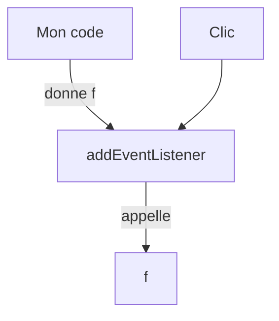

# Fonction fléchée et callback

> [!info] En une phrase
> En JavaScript une fonction est une valeur : on l'écrit souvent en flèche (x => x * 2) et on la passe à une autre fonction qui l'appellera plus tard (callback).

```dataviewjs
await dv.view("10 — Templates/Scripts/learning", { view: "concept" })
```

## 1 · Comprendre
### Définition
```js
function doubler(x) { return x * 2; }   // déclaration classique
const doubler2 = (x) => x * 2;           // fonction fléchée, retour implicite
const saluer = (nom = "toi") => {        // paramètre par défaut, corps en bloc
  return `Bonjour ${nom}`;
};
```
Un **callback** est une fonction passée en argument, que l'autre fonction appelle au bon moment :
```js
setTimeout(() => console.log("2 secondes plus tard"), 2000);
bouton.addEventListener("click", () => console.log("clic"));
```

### Pourquoi ça existe
Le navigateur est piloté par des événements (clic, réponse réseau, minuterie) : il faut pouvoir dire « quand ça arrive, appelle ceci ».

### Le problème résolu
Réutiliser un comportement et brancher son propre code sur celui d'une bibliothèque.

## 2 · Explorer
### Comment ça fonctionne


### Exemple concret
```js
const nombres = [1, 2, 3];
const doubles = nombres.map((n) => n * 2);   // map appelle le callback pour chaque élément
console.log(doubles); // [2, 4, 6]
```

### Cas d'utilisation
- Gestion d'événements
- Méthodes de tableau
- Composants React (fonctions qui renvoient de l'affichage)

> [!warning] À ne pas confondre
> Passer `f()` au lieu de `f` : `addEventListener("click", envoyer())` **appelle** `envoyer` tout de suite et passe son résultat. Il faut passer la fonction elle-même : `envoyer` ou `() => envoyer()`.

## 3 · Pratiquer
- Réécris trois fonctions classiques en fonctions fléchées
- Écris une fonction `repeter(n, action)` qui appelle `action` n fois

## 4 · Expliquer
> [!quote] Mon résumé, avec mes mots
> _À écrire sans regarder la fiche. Si je bloque, je ne l'ai pas encore compris._

## 5 · Relier
- **Prérequis** : [[Fonction]] · [[Variables et types en JavaScript]]
- **Complémentaires** : [[Portée et closure]] · [[Méthodes de tableau (map, filter, reduce)]]
- **Utilisé par** : [[Événement JavaScript]]

## 6 · Réviser
> [!question] Me faire interroger
> Je demande à Claude de m'interroger sur cette notion pour vérifier que je l'ai comprise.

### Validation de la maîtrise
La notion est maîtrisée quand j'ai réussi **tous les exercices** qui l'utilisent (statut `reussi` dans l'exercice).

```dataviewjs
await dv.view("10 — Templates/Scripts/learning", { view: "maitrise" })
```
