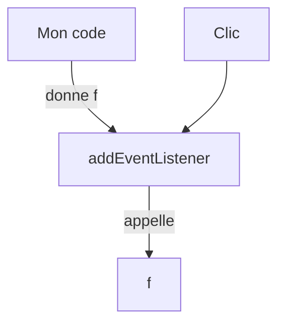

# Fonction fléchée et callback

> [!info] En une phrase
> En JavaScript une fonction est une valeur : on l'écrit souvent en flèche (x => x * 2) et on la passe à une autre fonction qui l'appellera plus tard (callback).

```dataviewjs
await dv.view("10 — Templates/Scripts/learning", { view: "concept" })
```

## 1 · Comprendre
### Définition
```js
function doubler(x) { return x * 2; }   // déclaration classique
const doubler2 = (x) => x * 2;           // fonction fléchée, retour implicite
const saluer = (nom = "toi") => {        // paramètre par défaut, corps en bloc
  return `Bonjour ${nom}`;
};
```
Un **callback** est une fonction passée en argument, que l'autre fonction appelle au bon moment :
```js
setTimeout(() => console.log("2 secondes plus tard"), 2000);
bouton.addEventListener("click", () => console.log("clic"));
```

### Pourquoi ça existe
Le navigateur est piloté par des événements (clic, réponse réseau, minuterie) : il faut pouvoir dire « quand ça arrive, appelle ceci ».

### Le problème résolu
Réutiliser un comportement et brancher son propre code sur celui d'une bibliothèque.

## 2 · Explorer
### Comment ça fonctionne


### Exemple concret
```js
const nombres = [1, 2, 3];
const doubles = nombres.map((n) => n * 2);   // map appelle le callback pour chaque élément
console.log(doubles); // [2, 4, 6]
```

### Cas d'utilisation
- Gestion d'événements
- Méthodes de tableau
- Composants React (fonctions qui renvoient de l'affichage)

> [!warning] À ne pas confondre
> Passer `f()` au lieu de `f` : `addEventListener("click", envoyer())` **appelle** `envoyer` tout de suite et passe son résultat. Il faut passer la fonction elle-même : `envoyer` ou `() => envoyer()`.

## 3 · Pratiquer

### Exercice visuel

Sur Excalidraw, **sans regarder la fiche**. Puis je compare avec la fiche, je corrige en rouge ce qui était faux, et j'explique mon dessin à voix haute ou à Claude dans le chat.

> [!example] 🛣️ Suis le trajet
> Dessine `depenses.forEach(d => console.log(d.montant))` : qui appelle la fonction fléchée, combien de fois, avec quoi.

> [!example] 🔄 Change de contexte
> Redessine la même idée pour un écouteur de clic `bouton.addEventListener("click", () => …)`. Quand le callback est-il appelé ?

### Mon schéma

> [!tip] Mon dessin Excalidraw
> _Je crée le dessin « Schéma - Fonction fléchée et callback » et je l'intègre ici avec `![[Schéma - Fonction fléchée et callback.excalidraw]]`, puis je coche `schema`._

### Appliquer dans le fil rouge
- Pas encore d'étape du fil rouge pour cette notion : elle sera pratiquée dans le fil rouge de son niveau (voir [[Niveaux]]).

## 4 · Relier
- **Prérequis** : [[Fonction]] · [[Variables et types]]
- **Complémentaires** : [[Portée et closure]] · [[Méthodes de tableau (map, filter, reduce)]]
- **Utilisé par** : [[Événement JavaScript]]

## 5 · Réviser
> [!question] Me faire interroger
> Je demande à Claude de m'interroger sur cette notion pour vérifier que je l'ai comprise.

### Validation (compris, puis maîtrisé)
Trois cases à cocher dans les propriétés de la fiche :
- `schema` : mon dessin du concept est dans « Mon schéma » ;
- `exercice_visuel` : j'ai fait et corrigé les exercices visuels de la section 3 ;
- `fil_rouge` : je l'ai appliqué dans le fil rouge (coché tout seul quand une étape qui l'utilise est réussie).

Les trois cochées : la notion compte comme **comprise**. **Maîtrisé** : c'est moi qui le mets dans `status`, quand je le sens.

```dataviewjs
await dv.view("10 — Templates/Scripts/learning", { view: "maitrise" })
```
