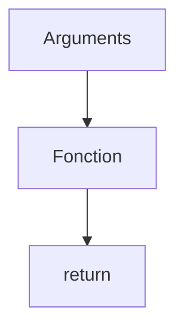

# Fonction

> [!info] En une phrase
> Un bloc de code nommé, qui prend des paramètres et renvoie un résultat, pour ne pas répéter le même code.

## 1 · Comprendre
### Définition
On **définit** une fonction avec `def nom(paramètres):`, puis on l'**appelle** avec `nom(arguments)`. `return` renvoie le résultat et arrête la fonction. Sans `return`, elle renvoie `None`.

### Pourquoi ça existe
Découper un script en petites étapes qu'on peut nommer, tester et réutiliser : `lister_fichiers()`, `creer_archive()`.

### Le problème résolu
Un script de 200 lignes sans fonction est dur à lire, à corriger et à tester ; le même code copié à trois endroits doit être corrigé trois fois.

## 2 · Explorer
### Comment ça fonctionne

- **Paramètre** : le nom dans la définition (`dossier`) ; **argument** : la valeur passée à l'appel (`"photos"`).
- Valeur par défaut : `def zipper(dossier, nom="archive.zip"):`.
- Argument nommé à l'appel : `zipper("photos", nom="vacances.zip")`.
- Les variables créées dans une fonction n'existent **que dedans** (portée locale).

### Exemple concret
```python
def est_image(nom_fichier: str) -> bool:
    """Renvoie True si le fichier est une image."""
    return nom_fichier.lower().endswith((".png", ".jpg"))

def compter_images(noms: list[str]) -> int:
    total = 0
    for nom in noms:
        if est_image(nom):
            total += 1
    return total

print(compter_images(["a.PNG", "b.txt", "c.jpg"]))   # 2
```
Les `: str` et `-> bool` sont des **annotations de type** : facultatives, elles documentent ce que la fonction attend.

> [!abstract]- Comment ça s'écrit (référence à chercher, pas à apprendre par cœur)
> L'idée est la même partout ; seule l'écriture change.
>
> **Python**
> ```python
> def total(depenses, categorie="courses"):
>     return sum(d["montant"] for d in depenses if d["categorie"] == categorie)
> ```
>
> **JavaScript / TypeScript**
> ```js
> function total(depenses, categorie = "courses") {
>   return depenses.filter((d) => d.categorie === categorie)
>                  .reduce((s, d) => s + d.montant, 0);
> }
> const double = (x) => x * 2;   // fonction fléchée
> // TypeScript : function total(depenses: Depense[], categorie = "courses"): number
> ```
> Voir aussi [[Fonction fléchée et callback]] : une fonction est une valeur qu'on peut passer à une autre.
>
> **Bash**
> ```bash
> total() {
>   echo "Catégorie : $1"   # $1, $2 : les arguments
>   return 0                # code de sortie, pas une valeur
> }
> resultat="$(total courses)"   # on récupère ce qui est affiché
> ```
> En Bash, une fonction **affiche** son résultat ; `return` ne renvoie qu'un code de sortie (0 à 255).
>
> **C# (.NET)**
> ```csharp
> static decimal Total(List<decimal> montants)
> {
>     return montants.Sum();
> }
>
> static int Double(int x) => x * 2;   // version courte
> ```
> Les types des paramètres et du retour sont obligatoires (`void` si rien n'est renvoyé). En C#, une fonction vit toujours dans une classe : on parle de **méthode** ; `static` veut dire qu'on l'appelle sans créer d'objet.

### Cas d'utilisation
- Découper ton script : lire les arguments, lister, zipper, nettoyer
- Une fonction serverless est une fonction `handler(event)` que la plateforme appelle à ta place

> [!warning] À ne pas confondre
> `print` (affiche à l'écran, ne renvoie rien d'utilisable) et `return` (renvoie une valeur au code qui appelle). Et `est_image` (la fonction elle-même) vs `est_image("a.png")` (l'appel).

## 3 · Relier
- **Prérequis** : [[Variables et types]] · [[Condition (if)]]
- **Complémentaires** : [[Module et import]]
- **Utilisé par** : [[Test automatisé]] · [[Arguments de ligne de commande]]
