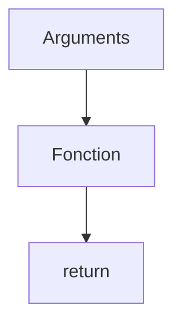

# Fonction

> [!info] En une phrase
> Un bloc de code nommé, qui prend des paramètres et renvoie un résultat, pour ne pas répéter le même code.

```dataviewjs
await dv.view("10 — Templates/Scripts/learning", { view: "concept" })
```

## 1 · Comprendre
### Définition
On **définit** une fonction avec `def nom(paramètres):`, puis on l'**appelle** avec `nom(arguments)`. `return` renvoie le résultat et arrête la fonction. Sans `return`, elle renvoie `None`.

### Pourquoi ça existe
Découper un script en petites étapes qu'on peut nommer, tester et réutiliser : `lister_fichiers()`, `creer_archive()`.

### Le problème résolu
Un script de 200 lignes sans fonction est dur à lire, à corriger et à tester ; le même code copié à trois endroits doit être corrigé trois fois.

## 2 · Explorer
### Comment ça fonctionne

- **Paramètre** : le nom dans la définition (`dossier`) ; **argument** : la valeur passée à l'appel (`"photos"`).
- Valeur par défaut : `def zipper(dossier, nom="archive.zip"):`.
- Argument nommé à l'appel : `zipper("photos", nom="vacances.zip")`.
- Les variables créées dans une fonction n'existent **que dedans** (portée locale).

### Exemple concret
```python
def est_image(nom_fichier: str) -> bool:
    """Renvoie True si le fichier est une image."""
    return nom_fichier.lower().endswith((".png", ".jpg"))

def compter_images(noms: list[str]) -> int:
    total = 0
    for nom in noms:
        if est_image(nom):
            total += 1
    return total

print(compter_images(["a.PNG", "b.txt", "c.jpg"]))   # 2
```
Les `: str` et `-> bool` sont des **annotations de type** : facultatives, elles documentent ce que la fonction attend.

### Cas d'utilisation
- Découper ton script : lire les arguments, lister, zipper, nettoyer
- Une fonction Nuclio est une fonction `handler(context, event)` que la plateforme appelle

> [!warning] À ne pas confondre
> `print` (affiche à l'écran, ne renvoie rien d'utilisable) et `return` (renvoie une valeur au code qui appelle). Et `est_image` (la fonction elle-même) vs `est_image("a.png")` (l'appel).

## 3 · Pratiquer

### Exercice visuel

Sur Excalidraw, **sans regarder la fiche**. Puis je compare avec la fiche, je corrige en rouge ce qui était faux, et j'explique mon dessin avec mes mots (section 4).

> [!example] 🧠 Dessine de mémoire
> Dessine une fonction comme une machine : paramètres en entrée, corps, valeur renvoyée. Prends `total_categorie(depenses, "courses")`.

> [!example] 🔍 Trouve l'erreur
> Ce schéma est faux. Corrige-le en rouge et explique l'erreur.
>
> ```mermaid
> flowchart TD
>   F[Fonction print] --> R[Résultat]
>   R --> V[Variable remplie]
> ```

### Mon schéma

> [!tip] Mon dessin Excalidraw
> _Je crée le dessin « Schéma - Fonction » et je l'intègre ici avec `![[Schéma - Fonction.excalidraw]]`._

### Appliquer dans le fil rouge
- [[Dépenses 04 - Ranger en fonctions]]

## 4 · Expliquer
> [!quote] Mon résumé, avec mes mots
> _J'explique mon schéma avec mes mots, sans regarder la fiche. Si je bloque, je ne l'ai pas encore compris._

## 5 · Relier
- **Prérequis** : [[Variables et types en Python]] · [[Condition (if)]]
- **Complémentaires** : [[Module et import Python]]
- **Utilisé par** : [[pytest]] · [[Arguments de ligne de commande]]

## 6 · Réviser
> [!question] Me faire interroger
> Je demande à Claude de m'interroger sur cette notion pour vérifier que je l'ai comprise.

### Validation de la maîtrise
La notion est maîtrisée quand je sais :
1. **l'expliquer** de façon fluide, à partir de mon schéma (section 4) ;
2. **l'adapter** à un autre contexte (consigne « Change de contexte », ou Claude m'interroge sur un autre cas) ;
3. **l'appliquer** pour de vrai dans le fil rouge (section 3).

Réussir un exercice ne suffit pas. C'est moi qui passe le statut en `maitrise`.

```dataviewjs
await dv.view("10 — Templates/Scripts/learning", { view: "maitrise" })
```
