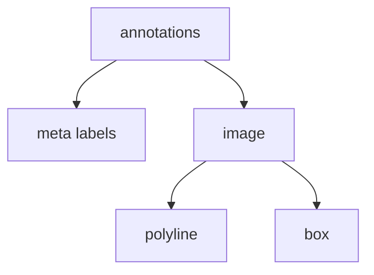

# Format CVAT for images 1.1

> [!info] En une phrase
> Le format XML dans lequel CVAT exporte et importe les annotations d'une tâche : la liste des labels, puis, image par image, les formes dessinées.

```dataviewjs
await dv.view("10 — Templates/Scripts/learning", { view: "concept" })
```

## 1 · Comprendre
### Définition
Un fichier `annotations.xml` avec :
- `<version>1.1</version>` ;
- `<meta>` : la tâche et ses **labels** (nom, type de forme, attributs autorisés) ;
- un `<image>` par image, qui contient les **formes**.

### Pourquoi ça existe
- Sauvegarder les annotations hors de CVAT, les traiter avec un script, puis les **réimporter** (Actions → Upload annotations → « CVAT 1.1 »).

### Le problème résolu
- Faire passer des annotations d'un outil à un autre (ici : du graphe calculé par `replication` vers CVAT).

## 2 · Explorer
### Comment ça fonctionne


### Exemple concret
Chaque forme porte `label`, `source` (`manual`, `auto`…), `occluded` (`0`/`1`), `z_order`, et ses attributs CVAT en enfants :
```xml
<box label="etiquette de cote" source="manual" occluded="0"
     xtl="210.00" ytl="378.00" xbr="240.00" ybr="392.00" z_order="0">
  <attribute name="nom">2000</attribute>
</box>
```
Les coordonnées sont en **pixels**, origine en **haut à gauche**, `y` vers le **bas**, toujours écrites avec 2 décimales (sauf le masque, en entiers).

### Les 9 formes, une par une
Vérifié dans le code de l'export CVAT (`cvat/apps/dataset_manager/formats/cvat.py`). Pour être sûr à 100 % sur **ta** version, exporte un exemple de chaque forme depuis ton CVAT.

| Balise | Type dans meta | Géométrie |
| --- | --- | --- |
| `box` | `rectangle` | `xtl ytl xbr ybr`, `rotation` seulement si ≠ 0 |
| `polygon` | `polygon` | `points="x,y;x,y;..."` |
| `polyline` | `polyline` | `points="x,y;x,y;..."` |
| `points` | `points` | `points="x,y;x,y;..."` |
| `ellipse` | `ellipse` | `cx cy rx ry`, `rotation` seulement si ≠ 0 |
| `cuboid` | `cuboid` | 16 nombres : 4 coins de la face avant (`…1`), 4 de la face arrière (`…2`) |
| `mask` | `mask` | `rle left top width height`, en **entiers** |
| `skeleton` | `skeleton` | pas de géométrie : des `<points>` enfants, un par articulation |
| `tag` | `tag` | aucune géométrie : une étiquette pour toute l'image |

**Rectangle** (déjà vu)
```xml
<box label="voiture" source="manual" occluded="0" xtl="10.00" ytl="20.00" xbr="110.00" ybr="80.00" z_order="0">
</box>
```
Avec une rotation, CVAT ajoute `rotation="30.00"` (en degrés, autour du centre).

**Polygone, polyligne, points** : même format, seule la balise change. Un polygone se referme tout seul, on ne répète **pas** le premier point.
```xml
<polygon label="toit" source="manual" occluded="0" points="10.00,10.00;50.00,10.00;30.00,40.00" z_order="0">
</polygon>
<points label="vanne" source="manual" occluded="0" points="25.00,30.00;60.00,70.00" z_order="0">
</points>
```

**Ellipse** : un centre (`cx`, `cy`) et deux rayons (`rx` horizontal, `ry` vertical).
```xml
<ellipse label="manometre" source="manual" occluded="0" cx="100.00" cy="80.00" rx="30.00" ry="20.00" z_order="0">
</ellipse>
```

**Cuboïde** (boîte 3D dessinée en perspective) : `t` = top (haut), `b` = bottom (bas), `l` = left, `r` = right ; `1` = face avant, `2` = face arrière.
```xml
<cuboid label="armoire" source="manual" occluded="0"
        xtl1="10.00" ytl1="10.00" xbl1="10.00" ybl1="60.00" xtr1="60.00" ytr1="10.00" xbr1="60.00" ybr1="60.00"
        xtl2="25.00" ytl2="0.00" xbl2="25.00" ybl2="50.00" xtr2="75.00" ytr2="0.00" xbr2="75.00" ybr2="50.00" z_order="0">
</cuboid>
```

**Masque** : une zone coloriée pixel par pixel, dans un rectangle qui commence à (`left`, `top`) et mesure `width` × `height` pixels.
```xml
<mask label="fuite" source="manual" occluded="0" rle="2, 2, 4, 2, 2" left="40" top="30" width="4" height="3" z_order="0">
</mask>
```
`rle` (*run-length encoding*) se lit ligne par ligne, de gauche à droite, en comptant **alternativement** les pixels vides puis pleins, en commençant par les vides : ici « 2 vides, 2 pleins, 4 vides, 2 pleins, 2 vides » sur 4 × 3 = 12 pixels :
```text
. . X X
. . . .
X X . .
```
Le total des nombres doit faire `width × height`. Si le masque commence par un pixel plein, le premier nombre vaut `0`.

**Squelette** : une forme faite de points nommés (tête, épaule…). La balise `skeleton` n'a pas de géométrie ni de `occluded` ; chaque point enfant a son propre label, un attribut `outside` (`1` = point absent de l'image) et pas de `z_order`.
```xml
<skeleton label="robinet" source="manual" z_order="0">
  <points label="entree" source="manual" outside="0" occluded="0" points="20.00,40.00">
  </points>
  <points label="sortie" source="manual" outside="0" occluded="0" points="80.00,40.00">
  </points>
</skeleton>
```
Dans `<meta>`, un label `skeleton` a des **sous-labels** (un par point, avec `<parent>`) et un dessin `<svg>` des liaisons : le plus simple est de recopier ce bloc depuis un export CVAT.

**Tag** : pas de forme, juste « cette image contient… ». Ni `occluded` ni `z_order`.
```xml
<tag label="plan valide" source="manual">
</tag>
```

**Ordre dans `<image>`** : CVAT écrit d'abord toutes les formes, puis tous les tags.

### Cas d'utilisation
- Le POC CVAT : la fonction Nuclio reçoit ce format à l'export.
- Lire un export CVAT pour en extraire les formes.

> [!warning] À ne pas confondre
> - Dans `<meta>`, un rectangle a le type `rectangle` ; dans `<image>`, la forme s'appelle `<box>`.
> - À l'import, CVAT associe les formes par **nom de label** : un label absent de la tâche (faute de frappe, accent) fait échouer l'import.
> - L'export « CVAT for **video** 1.1 » est un autre format (des `<track>`), à ne pas confondre.
> - `polygon`, `polyline` et `points` ont la même géométrie : une seule fonction suffit pour les trois.
> - Le masque est en **entiers** et son `rle` est une liste de nombres séparés par `, ` (virgule **et** espace), pas par `;`.

## 3 · Pratiquer
- Pas d'exercice pour l'instant : le projet du graphe passe par l'API, voir [[Annotations dans l'API CVAT]].

## 4 · Expliquer
> [!quote] Mon résumé, avec mes mots
> _À écrire sans regarder la fiche. Si je bloque, je ne l'ai pas encore compris._

## 5 · Relier
- **Prérequis** : [[XML]]
- **Notion parente** :
- **Complémentaires** : [[XML en Python (ElementTree)]], [[Annotations dans l'API CVAT]]
- **Utilisé par** :
- **Commandes** :

## 6 · Réviser
> [!question] Me faire interroger
> Je demande à Claude de m'interroger sur cette notion pour vérifier que je l'ai comprise.

### Validation de la maîtrise
La notion est maîtrisée quand j'ai réussi **tous les exercices** qui l'utilisent (statut `reussi` dans l'exercice).

```dataviewjs
await dv.view("10 — Templates/Scripts/learning", { view: "maitrise" })
```
