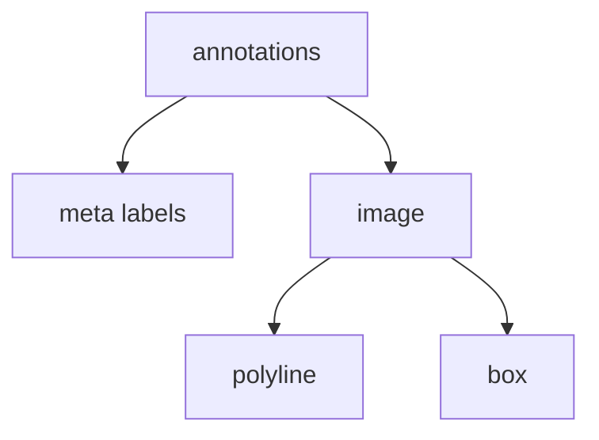

# Format CVAT for images 1.1

> [!info] En une phrase
> Le format XML dans lequel CVAT exporte et importe les annotations d'une tâche : la liste des labels, puis, image par image, les formes dessinées.

```dataviewjs
await dv.view("10 — Templates/Scripts/learning", { view: "concept" })
```

## 1 · Comprendre
### Définition
Un fichier `annotations.xml` avec :
- `<version>1.1</version>` ;
- `<meta>` : la tâche et ses **labels** (nom, type de forme, attributs autorisés) ;
- un `<image>` par image, qui contient les **formes**.

### Pourquoi ça existe
- Sauvegarder les annotations hors de CVAT, les traiter avec un script, puis les **réimporter** (Actions → Upload annotations → « CVAT 1.1 »).

### Le problème résolu
- Faire passer des annotations d'un outil à un autre (ici : du graphe calculé par `replication` vers CVAT).

## 2 · Explorer
### Comment ça fonctionne


### Exemple concret
| Forme | Balise | Géométrie |
| --- | --- | --- |
| Polyligne | `<polyline>` | `points="x1,y1;x2,y2;..."` |
| Polygone | `<polygon>` | `points=` pareil, fermé |
| Rectangle | `<box>` | `xtl ytl` (haut gauche), `xbr ybr` (bas droite) |
| Point | `<points>` | `points="x,y"` |

Chaque forme porte aussi `label`, `source` (`manual`, `auto`…), `occluded` (`0`/`1`), `z_order`, et ses attributs CVAT en enfants :
```xml
<box label="etiquette de cote" source="manual" occluded="0"
     xtl="210.00" ytl="378.00" xbr="240.00" ybr="392.00" z_order="0">
  <attribute name="nom">2000</attribute>
</box>
```
Les coordonnées sont en **pixels**, origine en **haut à gauche**, `y` vers le **bas**.

### Cas d'utilisation
- Le POC CVAT : la fonction Nuclio reçoit ce format à l'export.
- La conversion du graphe géométrique en annotations : [[Projet - Convertir le graphe en XML CVAT]].

> [!warning] À ne pas confondre
> - Dans `<meta>`, un rectangle a le type `rectangle` ; dans `<image>`, la forme s'appelle `<box>`.
> - À l'import, CVAT associe les formes par **nom de label** : un label absent de la tâche (faute de frappe, accent) fait échouer l'import.
> - L'export « CVAT for **video** 1.1 » est un autre format (des `<track>`), à ne pas confondre.

## 3 · Pratiquer
- [[Projet - Convertir le graphe en XML CVAT]]

## 4 · Expliquer
> [!quote] Mon résumé, avec mes mots
> _À écrire sans regarder la fiche. Si je bloque, je ne l'ai pas encore compris._

## 5 · Relier
- **Prérequis** : [[XML]]
- **Notion parente** :
- **Complémentaires** : [[XML en Python (ElementTree)]]
- **Utilisé par** :
- **Commandes** :

## 6 · Réviser
> [!question] Me faire interroger
> Je demande à Claude de m'interroger sur cette notion pour vérifier que je l'ai comprise.

### Validation de la maîtrise
La notion est maîtrisée quand j'ai réussi **tous les exercices** qui l'utilisent (statut `reussi` dans l'exercice).

```dataviewjs
await dv.view("10 — Templates/Scripts/learning", { view: "maitrise" })
```
