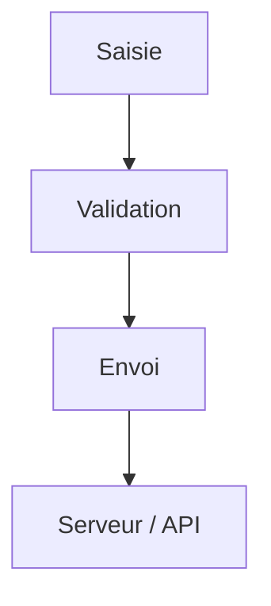

# Formulaire HTML

> [!info] En une phrase
> L'élément form et ses champs (input, select, textarea, button) permettent à l'utilisateur de saisir des données et de les envoyer.

```dataviewjs
await dv.view("10 — Templates/Scripts/learning", { view: "concept" })
```

## 1 · Comprendre
### Définition
Un `<form>` regroupe des champs. À l'envoi, le navigateur envoie les valeurs (identifiées par l'attribut `name`) à l'adresse `action`, avec la méthode `method` (GET ou POST). Aujourd'hui, on intercepte souvent l'envoi en JavaScript pour appeler une API avec `fetch`.

### Pourquoi ça existe
Toute interaction de saisie : connexion, recherche, création, téléversement de fichier.

### Le problème résolu
Récupérer des données de l'utilisateur de façon standard, avec validation et accessibilité intégrées.

## 2 · Explorer
### Comment ça fonctionne


### Exemple concret
```html
<form action="/api/exports" method="post">
  <label for="nom">Nom de l'export</label>
  <input id="nom" name="nom" type="text" required minlength="3">

  <label for="format">Format</label>
  <select id="format" name="format">
    <option value="png">PNG</option>
    <option value="zip">ZIP</option>
  </select>

  <label><input type="checkbox" name="annotations" checked> Avec annotations</label>

  <button type="submit">Lancer</button>
</form>
```
Types utiles : `text`, `email`, `password`, `number`, `date`, `file`, `checkbox`, `radio`. Validation native : `required`, `min`, `max`, `pattern`.

### Cas d'utilisation
- Formulaires de connexion et de création
- Un champ de fichier pour envoyer une image

> [!warning] À ne pas confondre
> La validation **dans le navigateur** (confort) et la validation **sur le serveur** (obligatoire) : n'importe qui peut contourner la première. Et chaque champ doit avoir un `<label>` relié par `for`/`id`.

## 3 · Pratiquer
- Écris un formulaire de contact avec 4 types de champs, labels et validation ; observe les messages du navigateur.

## 4 · Expliquer
> [!quote] Mon résumé, avec mes mots
> _À écrire sans regarder la fiche. Si je bloque, je ne l'ai pas encore compris._

## 5 · Relier
- **Prérequis** : [[Élément et attribut HTML]]
- **Complémentaires** : [[Accessibilité web]] · [[Événement JavaScript]] · [[Validation des données]]

## 6 · Réviser
> [!question] Me faire interroger
> Je demande à Claude de m'interroger sur cette notion pour vérifier que je l'ai comprise.

### Validation de la maîtrise
La notion est maîtrisée quand j'ai réussi **tous les exercices** qui l'utilisent (statut `reussi` dans l'exercice).

```dataviewjs
await dv.view("10 — Templates/Scripts/learning", { view: "maitrise" })
```
