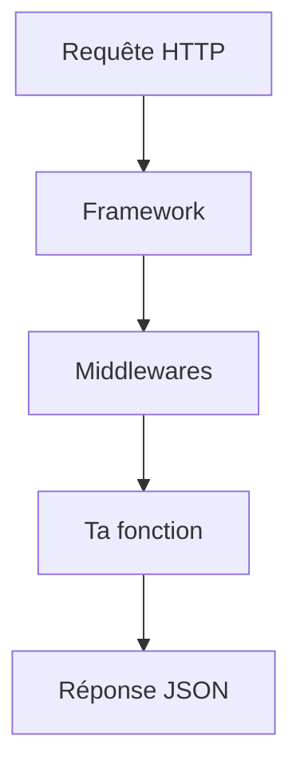

# Framework web

> [!info] En une phrase
> Un **framework web** est une base de code qui reçoit les requêtes HTTP à ta place et appelle **ta** fonction selon l'adresse et la méthode : tu écris seulement ce que fait chaque route.

```dataviewjs
await dv.view("10 — Templates/Scripts/learning", { view: "concept" })
```

## 1 · Comprendre
### Définition
Sans framework, il faudrait ouvrir un port, lire les octets de la requête, découper l'en-tête, transformer le JSON, gérer les erreurs… Un framework web s'en charge et te laisse écrire :
- les **routes** (une méthode + une adresse → une fonction, voir [[Endpoint]]) ;
- ce que fait chaque fonction.

Il apporte aussi, prêts à l'emploi : la lecture et l'écriture du JSON, la validation des données, les [[Middleware|middlewares]] (journal, authentification, CORS), la configuration, et souvent l'[[Service et injection de dépendances|injection de dépendances]] et une documentation [[OpenAPI]].

Exemples : **FastAPI** ou Flask (Python), **Express** (Node.js), **ASP.NET Core** (.NET), Spring (Java).

### Pourquoi ça existe
Toutes les API ont besoin des mêmes briques. Les réécrire à chaque projet serait long et plein de failles.

### Le problème résolu
Se concentrer sur ce qui est propre à l'application (les règles, les données) et laisser le framework gérer HTTP de façon correcte et sûre.

## 2 · Explorer
### Comment ça fonctionne

« Ne m'appelle pas, c'est moi qui t'appelle » : c'est le framework qui a la main et qui appelle ton code au bon moment. C'est la différence avec une **bibliothèque**, que c'est toi qui appelles.

### Exemple concret
La même route dans deux frameworks : `GET /depenses` renvoie la liste en JSON.

> [!abstract]- Comment ça s'écrit (référence à chercher, pas à apprendre par cœur)
> **Python (FastAPI)**
> ```python
> app = FastAPI()
>
> @app.get("/depenses")
> def lister():
>     return depenses
> ```
> **C# (ASP.NET Core, API minimale)**
> ```csharp
> var builder = WebApplication.CreateBuilder(args);
> var app = builder.Build();
>
> app.MapGet("/depenses", () => depenses);
>
> app.Run();
> ```
> **JavaScript (Express)**
> ```js
> const app = express();
> app.get("/depenses", (req, res) => res.json(depenses));
> app.listen(3000);
> ```
> Dans les trois cas : on crée l'application, on déclare une route, on lance le serveur. Le framework transforme la liste en JSON tout seul.

### Cas d'utilisation
- Toute API REST
- Un back-end qui sert aussi des pages web

> [!warning] À ne pas confondre
> **Framework** (il appelle ton code, il impose une structure) et **bibliothèque** (tu l'appelles quand tu veux, comme `requests`). Et **framework web** (côté serveur) et **framework front** (Vue, React, Angular : côté navigateur).

## 3 · Pratiquer

### Exercice visuel

Sur Excalidraw, **sans regarder la fiche**. Puis je compare avec la fiche, je corrige en rouge ce qui était faux, et j'explique mon dessin à voix haute ou à Claude dans le chat.

> [!example] 🧠 Dessine de mémoire
> Dessine le trajet d'une requête `POST /depenses` : ce que fait le framework avant ta fonction, ta fonction, ce que fait le framework après. Colorie en vert la seule partie que tu écris.

> [!example] 🔄 Change de contexte
> Refais le même dessin pour l'API Python de MesDépenses puis pour une API en C# : quelles cases changent de nom, lesquelles restent identiques ?

### Mon schéma

> [!tip] Mon dessin Excalidraw
> _Je crée le dessin « Schéma - Framework web » et je l'intègre ici avec `![[Schéma - Framework web.excalidraw]]`, puis je coche `schema`._

### Appliquer dans le fil rouge
- [[Découvrir .NET 03 - Une API minimale]]

## 4 · Relier
- **Prérequis** : [[HTTP]] · [[API REST]]
- **Complémentaires** : [[Endpoint]] · [[Middleware]] · [[Service et injection de dépendances]] · [[OpenAPI]]
- **Utilisé par** : [[Cours - Une API web avec ASP.NET Core]]

## 5 · Réviser
> [!question] Me faire interroger
> Je demande à Claude de m'interroger sur cette notion pour vérifier que je l'ai comprise.

### Validation (compris, puis maîtrisé)
Trois cases à cocher dans les propriétés de la fiche :
- `schema` : mon dessin du concept est dans « Mon schéma » ;
- `exercice_visuel` : j'ai fait et corrigé les exercices visuels de la section 3 ;
- `fil_rouge` : je l'ai appliqué dans le fil rouge (coché tout seul quand une étape qui l'utilise est réussie).

Les trois cochées : la notion compte comme **comprise**. **Maîtrisé** : c'est moi qui le mets dans `status`, quand je le sens.

```dataviewjs
await dv.view("10 — Templates/Scripts/learning", { view: "maitrise" })
```
