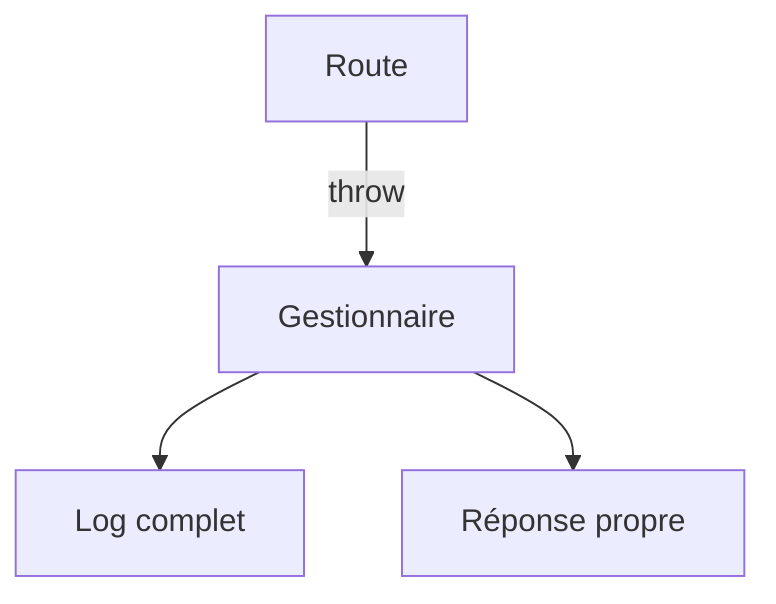

# Gestion des erreurs d'une API

> [!info] En une phrase
> Une API bien faite renvoie, pour chaque problème, le bon code de statut et un corps d'erreur clair et toujours de la même forme, sans révéler de détails internes.

```dataviewjs
await dv.view("10 — Templates/Scripts/learning", { view: "concept" })
```

## 1 · Comprendre
### Définition
Principes :
- **Le bon code** : 400/422 si les données sont fausses, 401/403 pour l'accès, 404 si absent, 409 en cas de conflit, 500 pour un bug.
- **Une forme unique** pour toutes les erreurs :
```json
{ "erreur": { "code": "TACHE_INTROUVABLE", "message": "La tâche 12 n'existe pas" } }
```
- **Pas de détail interne** dans la réponse (trace, requête SQL, chemin) : on les met dans les **logs**.
- **Un gestionnaire central** plutôt qu'un `try/catch` différent dans chaque route.

### Pourquoi ça existe
Sans règle, chaque route invente sa façon d'échouer et le client ne sait pas quoi afficher ; et une trace d'erreur exposée aide un attaquant.

### Le problème résolu
Des clients qui réagissent correctement, et des erreurs faciles à retrouver dans les logs.

## 2 · Explorer
### Comment ça fonctionne


### Exemple concret
```js
class ErreurApi extends Error {
  constructor(status, code, message) { super(message); this.status = status; this.code = code; }
}
app.get("/taches/:id", async (req, res, next) => {
  try {
    const t = await trouverTache(req.params.id);
    if (!t) throw new ErreurApi(404, "TACHE_INTROUVABLE", `La tâche ${req.params.id} n'existe pas`);
    res.json(t);
  } catch (e) { next(e); }
});
// middleware d'erreur : 4 paramètres, déclaré en dernier
app.use((err, req, res, next) => {
  const status = err.status ?? 500;
  if (status === 500) console.error(err);       // le détail reste dans les logs
  res.status(status).json({ erreur: { code: err.code ?? "ERREUR_INTERNE",
    message: status === 500 ? "Erreur interne" : err.message } });
});
```

### Cas d'utilisation
- Le frontend qui affiche des messages d'erreur
- Le débogage en production

> [!warning] À ne pas confondre
> Renvoyer **200 avec `{"ok": false}`** : le client, les proxys et la supervision croient que tout va bien. Utilise les codes de statut.

## 3 · Pratiquer

### Exercice visuel

Sur Excalidraw, **sans regarder la fiche**. Puis je compare avec la fiche, je corrige en rouge ce qui était faux, et j'explique mon dessin à voix haute ou à Claude dans le chat.

> [!example] 🛣️ Suis le trajet
> Dessine ce qui arrive quand on demande `GET /depenses/999` : la route, l'erreur levée, le code renvoyé, le corps JSON, ce qu'affiche le front.

> [!example] ⚖️ Avant / après
> Avant / après : une API qui renvoie 500 avec une page HTML, puis une qui renvoie 404 avec `{"detail": …}`. Dessine ce que le front peut en faire.

### Mon schéma

> [!tip] Mon dessin Excalidraw
> _Je crée le dessin « Schéma - Gestion des erreurs d'une API » et je l'intègre ici avec `![[Schéma - Gestion des erreurs d'une API.excalidraw]]`, puis je coche `schema`._

### Appliquer dans le fil rouge
- [[MesDépenses 01 - Prendre l'API en main]]

## 4 · Relier
- **Au travail** : [Gestion des erreurs d'une API au travail](obsidian://open?vault=Travail&file=Gestion%20des%20erreurs%20d%27une%20API%20au%20travail)
- **Prérequis** : [[Code de statut HTTP]] · [[Middleware]] · [[Exception]]
- **Complémentaires** : [[Journaliser avec logging]]

## 5 · Réviser
> [!question] Me faire interroger
> Je demande à Claude de m'interroger sur cette notion pour vérifier que je l'ai comprise.

### Validation (compris, puis maîtrisé)
Trois cases à cocher dans les propriétés de la fiche :
- `schema` : mon dessin du concept est dans « Mon schéma » ;
- `exercice_visuel` : j'ai fait et corrigé les exercices visuels de la section 3 ;
- `fil_rouge` : je l'ai appliqué dans le fil rouge (coché tout seul quand une étape qui l'utilise est réussie).

Les trois cochées : la notion compte comme **comprise**. **Maîtrisé** : c'est moi qui le mets dans `status`, quand je le sens.

```dataviewjs
await dv.view("10 — Templates/Scripts/learning", { view: "maitrise" })
```
