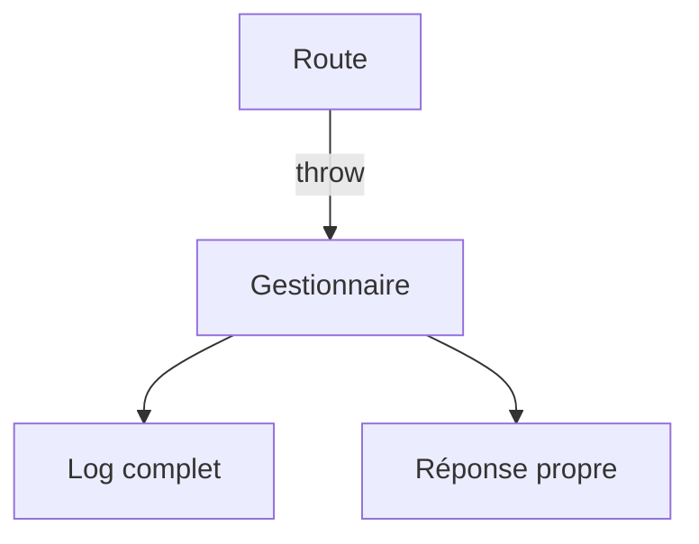

# Gestion des erreurs d'une API

> [!info] En une phrase
> Une API bien faite renvoie, pour chaque problème, le bon code de statut et un corps d'erreur clair et toujours de la même forme, sans révéler de détails internes.

```dataviewjs
await dv.view("10 — Templates/Scripts/learning", { view: "concept" })
```

## 1 · Comprendre
### Définition
Principes :
- **Le bon code** : 400/422 si les données sont fausses, 401/403 pour l'accès, 404 si absent, 409 en cas de conflit, 500 pour un bug.
- **Une forme unique** pour toutes les erreurs :
```json
{ "erreur": { "code": "TACHE_INTROUVABLE", "message": "La tâche 12 n'existe pas" } }
```
- **Pas de détail interne** dans la réponse (trace, requête SQL, chemin) : on les met dans les **logs**.
- **Un gestionnaire central** plutôt qu'un `try/catch` différent dans chaque route.

### Pourquoi ça existe
Sans règle, chaque route invente sa façon d'échouer et le client ne sait pas quoi afficher ; et une trace d'erreur exposée aide un attaquant.

### Le problème résolu
Des clients qui réagissent correctement, et des erreurs faciles à retrouver dans les logs.

## 2 · Explorer
### Comment ça fonctionne


### Exemple concret
```js
class ErreurApi extends Error {
  constructor(status, code, message) { super(message); this.status = status; this.code = code; }
}
app.get("/taches/:id", async (req, res, next) => {
  try {
    const t = await trouverTache(req.params.id);
    if (!t) throw new ErreurApi(404, "TACHE_INTROUVABLE", `La tâche ${req.params.id} n'existe pas`);
    res.json(t);
  } catch (e) { next(e); }
});
// middleware d'erreur : 4 paramètres, déclaré en dernier
app.use((err, req, res, next) => {
  const status = err.status ?? 500;
  if (status === 500) console.error(err);       // le détail reste dans les logs
  res.status(status).json({ erreur: { code: err.code ?? "ERREUR_INTERNE",
    message: status === 500 ? "Erreur interne" : err.message } });
});
```

### Cas d'utilisation
- Toute API, dont ta fonction Nuclio
- Le frontend qui affiche des messages d'erreur
- Le débogage en production

> [!warning] À ne pas confondre
> Renvoyer **200 avec `{"ok": false}`** : le client, les proxys et la supervision croient que tout va bien. Utilise les codes de statut.

## 3 · Pratiquer
- Ajoute un middleware d'erreur à une API Express et fais-le répondre correctement pour un 404, un 400 et une exception imprévue

## 4 · Expliquer
> [!quote] Mon résumé, avec mes mots
> _À écrire sans regarder la fiche. Si je bloque, je ne l'ai pas encore compris._

## 5 · Relier
- **Prérequis** : [[Code de statut HTTP]] · [[Middleware]] · [[Exception]]
- **Complémentaires** : [[Journaliser avec logging]]

## 6 · Réviser
> [!question] Me faire interroger
> Je demande à Claude de m'interroger sur cette notion pour vérifier que je l'ai comprise.

### Validation de la maîtrise
La notion est maîtrisée quand j'ai réussi **tous les exercices** qui l'utilisent (statut `reussi` dans l'exercice).

```dataviewjs
await dv.view("10 — Templates/Scripts/learning", { view: "maitrise" })
```
