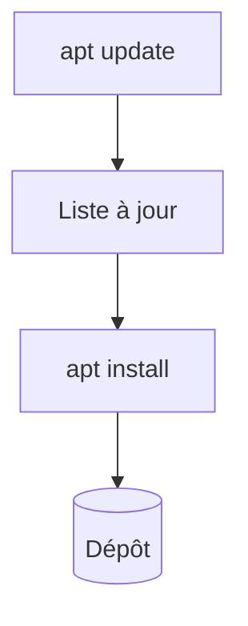

# Gestionnaire de paquets

> [!info] En une phrase
> L'outil qui installe, met à jour et désinstalle les logiciels d'un système depuis des dépôts de confiance (apt sous Ubuntu, winget sous Windows).

```dataviewjs
await dv.view("10 — Templates/Scripts/learning", { view: "concept" })
```

## 1 · Comprendre
### Définition
Un **gestionnaire de paquets** télécharge des logiciels depuis des **dépôts** et gère leurs dépendances. Il y en a pour les systèmes et pour les langages :

| Niveau | Outil |
| --- | --- |
| Ubuntu / Debian (WSL, beaucoup d'images Docker) | `apt` |
| Alpine (petites images Docker) | `apk` |
| Windows | `winget` |
| Python | [[pip]] |
| Node.js | [[npm]] |

### Pourquoi ça existe
Installer un logiciel en une commande, toujours depuis la même source, et tout mettre à jour d'un coup.

### Le problème résolu
Chercher des installateurs sur des sites web, gérer les dépendances à la main.

## 2 · Explorer
### Comment ça fonctionne


### Exemple concret
```bash
sudo apt update              # met à jour la LISTE des paquets disponibles
sudo apt upgrade             # met à jour les paquets installés
sudo apt install tree zip    # installer
apt search unzip             # chercher
sudo apt remove tree         # désinstaller
```
Dans un Dockerfile basé sur Debian :
```dockerfile
RUN apt-get update && apt-get install -y --no-install-recommends zip \
 && rm -rf /var/lib/apt/lists/*
```
```powershell
winget install Python.Python.3.12    # sous Windows
```

### Cas d'utilisation
- Installer des outils dans WSL (`zip`, `tree`, `jq`)
- Les lignes `RUN apt-get install` des Dockerfile de CVAT (en entreprise, elles passent par le [[Nexus]] ou un [[Proxy]])

> [!warning] À ne pas confondre
> `apt update` (rafraîchit la liste, n'installe rien) et `apt upgrade` (installe les mises à jour). Et `apt` (paquets du **système**) avec `pip` (paquets **Python**).

## 3 · Pratiquer
- Dans WSL, installe `tree`, puis lance `tree -L 2` dans ton dossier de projets.

## 4 · Expliquer
> [!quote] Mon résumé, avec mes mots
> _À écrire sans regarder la fiche. Si je bloque, je ne l'ai pas encore compris._

## 5 · Relier
- **Prérequis** : [[Permissions Linux]]
- **Complémentaires** : [[pip]] · [[npm]]
- **Commandes** : [[apt]]

## 6 · Réviser
> [!question] Me faire interroger
> Je demande à Claude de m'interroger sur cette notion pour vérifier que je l'ai comprise.

### Validation de la maîtrise
La notion est maîtrisée quand j'ai réussi **tous les exercices** qui l'utilisent (statut `reussi` dans l'exercice).

```dataviewjs
await dv.view("10 — Templates/Scripts/learning", { view: "maitrise" })
```
