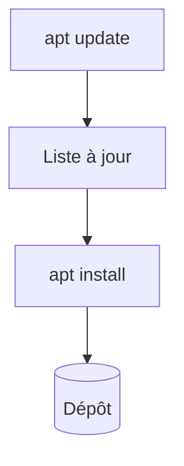

# Gestionnaire de paquets

> [!info] En une phrase
> Un gestionnaire de paquets installe, met à jour et retire des logiciels ou des bibliothèques depuis un dépôt de confiance : apt pour le système, pip pour Python, npm pour JavaScript.

```dataviewjs
await dv.view("10 — Templates/Scripts/learning", { view: "concept" })
```

## 1 · Comprendre
### Définition
Un **gestionnaire de paquets** télécharge des logiciels depuis des **dépôts** et gère leurs dépendances. Il y en a pour les systèmes et pour les langages :

| Niveau | Outil |
| --- | --- |
| Ubuntu / Debian (WSL, beaucoup d'images Docker) | `apt` |
| Alpine (petites images Docker) | `apk` |
| Windows | `winget` |
| Python | [[Gestionnaire de paquets]] |
| Node.js | [[Gestionnaire de paquets]] |

### Pourquoi ça existe
Installer un logiciel en une commande, toujours depuis la même source, et tout mettre à jour d'un coup.

### Le problème résolu
Chercher des installateurs sur des sites web, gérer les dépendances à la main.

## 2 · Explorer
### Comment ça fonctionne


### Exemple concret
```bash
sudo apt update              # met à jour la LISTE des paquets disponibles
sudo apt upgrade             # met à jour les paquets installés
sudo apt install tree zip    # installer
apt search unzip             # chercher
sudo apt remove tree         # désinstaller
```
Dans un Dockerfile basé sur Debian :
```dockerfile
RUN apt-get update && apt-get install -y --no-install-recommends zip \
 && rm -rf /var/lib/apt/lists/*
```
Dans un script ou un Dockerfile, on écrit **`apt-get`** plutôt que `apt` : même travail, mais une sortie stable faite pour les scripts (`apt` est fait pour un humain devant le terminal). Détail dans [[apt]].
```powershell
winget install Python.Python.3.12    # sous Windows
```

> [!abstract]- Comment ça s'écrit (référence à chercher, pas à apprendre par cœur)
> L'idée est la même partout ; seule l'écriture change.
>
> **Système (apt, Ubuntu et Debian)**
> ```bash
> sudo apt update && sudo apt install curl
> ```
> Installe pour toute la machine.
>
> **Python (pip)**
> ```bash
> python -m pip install requests
> pip install -r requirements.txt   # tout le projet
> pip freeze > requirements.txt     # figer les versions
> ```
> Dans un [[Environnement virtuel Python|environnement virtuel]], pour ne pas toucher au Python du système. Les détails sont dans [[pip install]].
>
> **JavaScript (npm)**
> ```bash
> npm install axios        # ajoute à package.json
> npm ci                   # installe exactement package-lock.json
> npm run dev              # lance un script de package.json
> ```
> Les paquets vont dans `node_modules/` du projet ; la liste est dans [[package.json]].

### Cas d'utilisation
- Installer des outils dans WSL (`zip`, `tree`, `jq`)
- Les lignes `RUN apt-get install` des Dockerfile (derrière un [[Proxy]], elles passent par un miroir interne)

> [!warning] À ne pas confondre
> `apt update` (rafraîchit la liste, n'installe rien) et `apt upgrade` (installe les mises à jour). Et `apt` (paquets du **système**) avec `pip` (paquets **Python**).

## 3 · Pratiquer

### Exercice visuel

Sur Excalidraw, **sans regarder la fiche**. Puis je compare avec la fiche, je corrige en rouge ce qui était faux, et j'explique mon dessin à voix haute ou à Claude dans le chat.

> [!example] 🛣️ Suis le trajet
> Dessine `apt install curl` : ta commande, le dépôt de paquets, les dépendances téléchargées, l'installation.

> [!example] 🔄 Change de contexte
> Refais le dessin pour `apk add` dans une image Alpine construite dans la CI GitLab, derrière le proxy. Où ça bloque ?

### Mon schéma

> [!tip] Mon dessin Excalidraw
> _Je crée le dessin « Schéma - Gestionnaire de paquets » et je l'intègre ici avec `![[Schéma - Gestionnaire de paquets.excalidraw]]`, puis je coche `schema`._

### Appliquer dans le fil rouge
- [[Dépenses 10 - Un environnement propre]]

## 4 · Relier
- **Prérequis** : [[Permissions Linux]]
- **Complémentaires** : [[Gestionnaire de paquets]] · [[Gestionnaire de paquets]]
- **Commandes** : [[apt]]

## 5 · Réviser
> [!question] Me faire interroger
> Je demande à Claude de m'interroger sur cette notion pour vérifier que je l'ai comprise.

### Validation (compris, puis maîtrisé)
Trois cases à cocher dans les propriétés de la fiche :
- `schema` : mon dessin du concept est dans « Mon schéma » ;
- `exercice_visuel` : j'ai fait et corrigé les exercices visuels de la section 3 ;
- `fil_rouge` : je l'ai appliqué dans le fil rouge (coché tout seul quand une étape qui l'utilise est réussie).

Les trois cochées : la notion compte comme **comprise**. **Maîtrisé** : c'est moi qui le mets dans `status`, quand je le sens.

```dataviewjs
await dv.view("10 — Templates/Scripts/learning", { view: "maitrise" })
```
