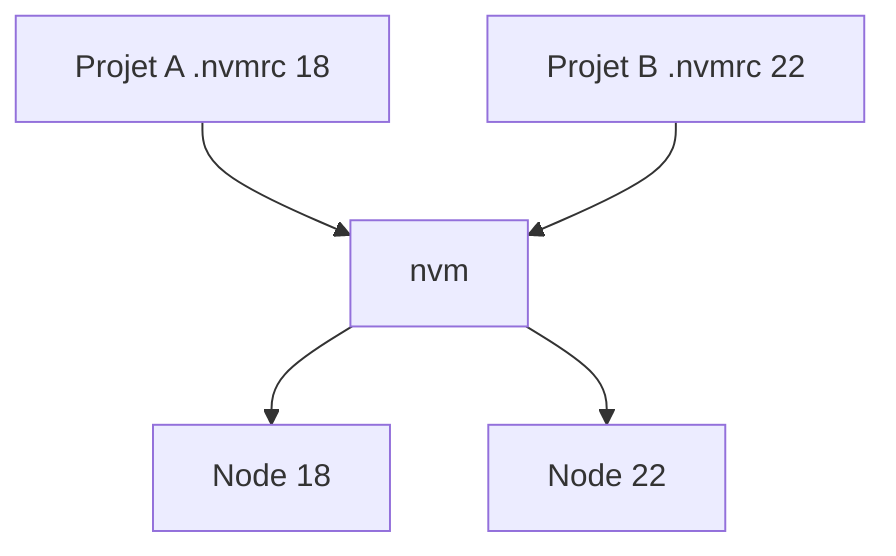

# Gestionnaire de versions de Node (nvm)

> [!info] En une phrase
> nvm installe plusieurs versions de Node.js côte à côte et bascule de l'une à l'autre selon le projet.

```dataviewjs
await dv.view("10 — Templates/Scripts/learning", { view: "concept" })
```

## 1 · Comprendre
### Définition
Chaque projet attend une version de Node (`engines` dans `package.json`, ou un fichier **`.nvmrc`** qui contient par exemple `20`). Avec **nvm** :
```bash
nvm install 20        # installe Node 20 (la dernière 20.x)
nvm use 20            # l'active dans ce terminal
nvm alias default 20  # version par défaut des nouveaux terminaux
nvm ls                # versions installées
nvm use               # lit .nvmrc
```
Les versions **paires** (18, 20, 22) deviennent **LTS** (support long) : ce sont celles à utiliser. nvm fonctionne dans WSL et Linux ; sous Windows natif, l'équivalent est *nvm-windows* ou *fnm*.

### Pourquoi ça existe
Un vieux projet tourne en Node 16, un nouveau en Node 22 : une seule installation système ne suffit pas.

### Le problème résolu
Avoir exactement la même version que la CI et l'image Docker du projet, sans `sudo` ni conflit.

## 2 · Explorer
### Comment ça fonctionne


### Exemple concret
```bash
curl -o- https://raw.githubusercontent.com/nvm-sh/nvm/v0.40.1/install.sh | bash
# rouvre le terminal
nvm install --lts
node -v
echo "22" > .nvmrc
```
Le même problème existe en Python, résolu par `pyenv` et les [[Environnement virtuel Python|environnements virtuels]].

### Cas d'utilisation
- Préparer ta machine WSL pour un projet
- Reproduire un bug qui n'arrive qu'avec une version
- Aligner local, CI et Docker

> [!warning] À ne pas confondre
> **nvm** (versions de Node) et **npm** (paquets d'un projet). Et installer Node avec `apt` puis avec nvm : deux `node` cohabitent ; `which node` dit lequel est utilisé.

## 3 · Pratiquer

### Exercice visuel

Sur Excalidraw, **sans regarder la fiche**. Puis je compare avec la fiche, je corrige en rouge ce qui était faux, et j'explique mon dessin à voix haute ou à Claude dans le chat.

> [!example] 🧠 Dessine de mémoire
> Dessine ton WSL avec trois versions de Node installées par nvm, et deux projets qui en utilisent une différente.

> [!example] 🛣️ Suis le trajet
> Suis ce qui se passe quand tu tapes `node` après `nvm use 22` : quel dossier le PATH pointe-t-il ?

### Mon schéma

> [!tip] Mon dessin Excalidraw
> _Je crée le dessin « Schéma - Gestionnaire de versions de Node (nvm) » et je l'intègre ici avec `![[Schéma - Gestionnaire de versions de Node (nvm).excalidraw]]`, puis je coche `schema`._

### Appliquer dans le fil rouge
- Pas encore d'étape du fil rouge pour cette notion : elle sera pratiquée dans le fil rouge de son niveau (voir [[Niveaux]]).

## 4 · Relier
- **Prérequis** : [[Node.js]] · [[Variable d'environnement]]
- **Complémentaires** : [[Environnement virtuel Python]]

## 5 · Réviser
> [!question] Me faire interroger
> Je demande à Claude de m'interroger sur cette notion pour vérifier que je l'ai comprise.

### Validation de la maîtrise
Trois cases à cocher dans les propriétés de la fiche :
- `schema` : mon dessin du concept est dans « Mon schéma » ;
- `exercice_visuel` : j'ai fait et corrigé les exercices visuels de la section 3 ;
- `fil_rouge` : je l'ai appliqué dans le fil rouge (coché tout seul quand une étape qui l'utilise est réussie).

Les trois cochées : la notion compte comme **comprise**. **Maîtrisé** : c'est moi qui le mets dans `status`, quand je le sens.

```dataviewjs
await dv.view("10 — Templates/Scripts/learning", { view: "maitrise" })
```
