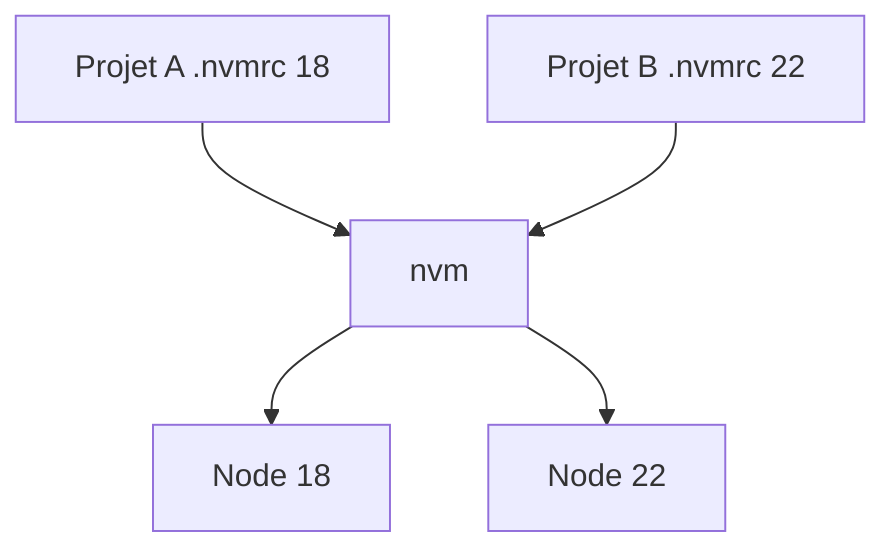

# Gestionnaire de versions de Node (nvm)

> [!info] En une phrase
> nvm installe plusieurs versions de Node.js côte à côte et bascule de l'une à l'autre selon le projet.

```dataviewjs
await dv.view("10 — Templates/Scripts/learning", { view: "concept" })
```

## 1 · Comprendre
### Définition
Chaque projet attend une version de Node (`engines` dans `package.json`, ou un fichier **`.nvmrc`** qui contient par exemple `20`). Avec **nvm** :
```bash
nvm install 20        # installe Node 20 (la dernière 20.x)
nvm use 20            # l'active dans ce terminal
nvm alias default 20  # version par défaut des nouveaux terminaux
nvm ls                # versions installées
nvm use               # lit .nvmrc
```
Les versions **paires** (18, 20, 22) deviennent **LTS** (support long) : ce sont celles à utiliser. nvm fonctionne dans WSL et Linux ; sous Windows natif, l'équivalent est *nvm-windows* ou *fnm*.

### Pourquoi ça existe
Un vieux projet tourne en Node 16, un nouveau en Node 22 : une seule installation système ne suffit pas.

### Le problème résolu
Avoir exactement la même version que la CI et l'image Docker du projet, sans `sudo` ni conflit.

## 2 · Explorer
### Comment ça fonctionne


### Exemple concret
```bash
curl -o- https://raw.githubusercontent.com/nvm-sh/nvm/v0.40.1/install.sh | bash
# rouvre le terminal
nvm install --lts
node -v
echo "22" > .nvmrc
```
Le même problème existe en Python, résolu par `pyenv` et les [[Environnement virtuel Python|environnements virtuels]].

### Cas d'utilisation
- Préparer ta machine WSL pour un projet
- Reproduire un bug qui n'arrive qu'avec une version
- Aligner local, CI et Docker

> [!warning] À ne pas confondre
> **nvm** (versions de Node) et **npm** (paquets d'un projet). Et installer Node avec `apt` puis avec nvm : deux `node` cohabitent ; `which node` dit lequel est utilisé.

## 3 · Pratiquer
- Installe nvm dans WSL, installe deux versions et bascule ; vérifie avec `node -v` et `which node`

## 4 · Expliquer
> [!quote] Mon résumé, avec mes mots
> _À écrire sans regarder la fiche. Si je bloque, je ne l'ai pas encore compris._

## 5 · Relier
- **Prérequis** : [[Node.js]] · [[Variable d'environnement]]
- **Complémentaires** : [[Environnement virtuel Python]]

## 6 · Réviser
> [!question] Me faire interroger
> Je demande à Claude de m'interroger sur cette notion pour vérifier que je l'ai comprise.

### Validation de la maîtrise
La notion est maîtrisée quand j'ai réussi **tous les exercices** qui l'utilisent (statut `reussi` dans l'exercice).

```dataviewjs
await dv.view("10 — Templates/Scripts/learning", { view: "maitrise" })
```
