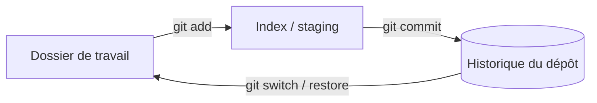

# Git

> [!info] En une phrase
> Un outil qui enregistre l'historique de ton code, version par version, pour revenir en arrière et travailler à plusieurs.

```dataviewjs
await dv.view("10 — Templates/Scripts/learning", { view: "concept" })
```

## 1 · Comprendre
### Définition
**Git** est un système de gestion de versions **distribué** : chaque copie du projet contient tout l'historique. On enregistre des « photos » du projet (les [[Commit|commits]]) et on peut développer en parallèle sur des [[Branche Git|branches]].

### Pourquoi ça existe
Créé en 2005 par Linus Torvalds pour développer le noyau Linux : des milliers de personnes modifiaient le même code, il fallait un outil rapide, fiable et sans serveur central obligatoire.

### Le problème résolu
Sans Git : `projet_final_v2_VRAI.zip`, impossible de savoir qui a changé quoi, de revenir à hier, ou de fusionner le travail de deux personnes.

## 2 · Explorer
### Comment ça fonctionne
Les trois zones à comprendre :

- **Dossier de travail** : les fichiers tels que tu les vois.
- **Index (staging)** : ce que tu as choisi d'inclure dans la prochaine photo.
- **Dépôt** : l'historique des commits, dans le dossier caché `.git`.

### Exemple concret
```bash
git init
git add index.js
git commit -m "Premier serveur"
git log --oneline
```

### Cas d'utilisation
- Historiser son travail, même seul
- Collaborer (avec GitHub ou GitLab)
- Tester une idée sur une branche sans casser le reste

> [!warning] À ne pas confondre
> **Git** (l'outil, en local) et **GitHub/GitLab** (des sites qui hébergent des dépôts Git et ajoutent des pull requests, de l'intégration continue…). Git fonctionne très bien sans eux.

## 3 · Pratiquer

### Exercice visuel

Sur Excalidraw, **sans regarder la fiche**. Puis je compare avec la fiche, je corrige en rouge ce qui était faux, et j'explique mon dessin à voix haute ou à Claude dans le chat.

> [!example] ⚖️ Avant / après
> Avant / après : ton projet sans Git (fichiers `main_v2_final.py`, copies datées), puis avec Git. Dessine où se trouvent les anciennes versions dans chaque cas.

> [!example] 🧠 Dessine de mémoire
> Dessine le cycle de travail Git : modifier, `add`, `commit`, `push`, `pull`, avec les zones (fichiers, index, dépôt local, dépôt distant).

### Mon schéma

> [!tip] Mon dessin Excalidraw
> _Je crée le dessin « Schéma - Git » et je l'intègre ici avec `![[Schéma - Git.excalidraw]]`, puis je coche `schema`._

### Appliquer dans le fil rouge
- [[Dépenses 07 - Le projet dans Git]]

Pour m'aider :
- [[Fiche - Publier un dépôt sur GitHub]]

## 4 · Relier
- **Prérequis** : [[Terminal]], [[Système de fichiers]]
- **Notions clés** : [[Dépôt Git]] → [[Commit]] → [[Branche Git]] → [[Merge]] → [[Conflit de merge]]
- **Commandes** : [[git init]] · [[git status]] · [[git add]] · [[git commit]] · [[git branch]] · [[git switch]] · [[git merge]]
- **Cours** : [[Cours - Git, les bases]] · [[Cours - Branches et fusion]]

## 5 · Réviser
> [!question] Me faire interroger
> Je demande à Claude de m'interroger sur cette notion pour vérifier que je l'ai comprise.

### Validation (compris, puis maîtrisé)
Trois cases à cocher dans les propriétés de la fiche :
- `schema` : mon dessin du concept est dans « Mon schéma » ;
- `exercice_visuel` : j'ai fait et corrigé les exercices visuels de la section 3 ;
- `fil_rouge` : je l'ai appliqué dans le fil rouge (coché tout seul quand une étape qui l'utilise est réussie).

Les trois cochées : la notion compte comme **comprise**. **Maîtrisé** : c'est moi qui le mets dans `status`, quand je le sens.

```dataviewjs
await dv.view("10 — Templates/Scripts/learning", { view: "maitrise" })
```
