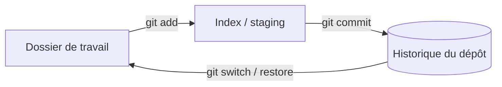

# Git

> [!info] En une phrase
> Un outil qui enregistre l'historique de ton code, version par version, pour revenir en arrière et travailler à plusieurs.

```dataviewjs
await dv.view("10 — Templates/Scripts/learning", { view: "concept" })
```

## 1 · Comprendre
### Définition
**Git** est un système de gestion de versions **distribué** : chaque copie du projet contient tout l'historique. On enregistre des « photos » du projet (les [[Commit|commits]]) et on peut développer en parallèle sur des [[Branche Git|branches]].

### Pourquoi ça existe
Créé en 2005 par Linus Torvalds pour développer le noyau Linux : des milliers de personnes modifiaient le même code, il fallait un outil rapide, fiable et sans serveur central obligatoire.

### Le problème résolu
Sans Git : `projet_final_v2_VRAI.zip`, impossible de savoir qui a changé quoi, de revenir à hier, ou de fusionner le travail de deux personnes.

## 2 · Explorer
### Comment ça fonctionne
Les trois zones à comprendre :

- **Dossier de travail** : les fichiers tels que tu les vois.
- **Index (staging)** : ce que tu as choisi d'inclure dans la prochaine photo.
- **Dépôt** : l'historique des commits, dans le dossier caché `.git`.

### Exemple concret
```bash
git init
git add index.js
git commit -m "Premier serveur"
git log --oneline
```

### Cas d'utilisation
- Historiser son travail, même seul
- Collaborer (avec GitHub ou GitLab)
- Tester une idée sur une branche sans casser le reste

> [!warning] À ne pas confondre
> **Git** (l'outil, en local) et **GitHub/GitLab** (des sites qui hébergent des dépôts Git et ajoutent des pull requests, de l'intégration continue…). Git fonctionne très bien sans eux.

## 3 · Pratiquer
- [[Exercice - Branches et merge avec Git]]
- [[Fiche - Publier un dépôt sur GitHub]]

## 4 · Expliquer
> [!quote] Mon résumé, avec mes mots
> _À écrire sans regarder la fiche. Si je bloque, je ne l'ai pas encore compris._

## 5 · Relier
- **Prérequis** : [[Terminal]], [[Système de fichiers]]
- **Notions clés** : [[Dépôt Git]] → [[Commit]] → [[Branche Git]] → [[Merge]] → [[Conflit de merge]]
- **Commandes** : [[git init]] · [[git status]] · [[git add]] · [[git commit]] · [[git branch]] · [[git switch]] · [[git merge]]
- **Cours** : [[Cours - Git, les bases]] · [[Cours - Branches et fusion]]

## 6 · Réviser
> [!question]- À quoi sert l'index (staging) ?
> À choisir précisément quelles modifications iront dans le prochain commit.

> [!question]- Git ou GitHub : lequel est indispensable ?
> Git. GitHub n'est qu'un hébergeur de dépôts Git.

> [!question]- Que contient le dossier `.git` ?
> Tout l'historique et la configuration du dépôt. Le supprimer efface l'historique.

### Validation de la maîtrise
- [x] Je l'explique sans notes, en 3 phrases, à quelqu'un qui ne connaît pas
- [x] J'ai réussi un exercice qui l'utilise
- [ ] Je l'ai utilisé dans un projet
- [ ] Je sais dire quand ne pas l'utiliser (ou ce qu'il ne faut pas confondre)
