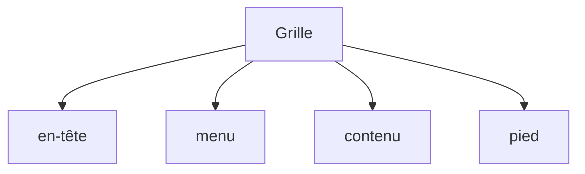

# Grid CSS

> [!info] En une phrase
> Le mode de mise en page CSS en grille, en lignes et colonnes, pour construire la structure d'une page ou d'une galerie.

```dataviewjs
await dv.view("10 — Templates/Scripts/learning", { view: "concept" })
```

## 1 · Comprendre
### Définition
`display: grid` sur un conteneur, puis on définit les colonnes (`grid-template-columns`) et éventuellement les lignes. L'unité `fr` partage l'espace restant. Les enfants se placent automatiquement, ou sur des zones nommées (`grid-template-areas`).

### Pourquoi ça existe
Construire des mises en page en deux dimensions (en-tête, menu latéral, contenu, pied) sans astuces.

### Le problème résolu
Les grilles faites avec des flottants ou des Flexbox imbriquées, fragiles et compliquées.

## 2 · Explorer
### Comment ça fonctionne


### Exemple concret
```css
.page {
  display: grid;
  grid-template-columns: 220px 1fr;
  grid-template-areas:
    "entete entete"
    "menu   contenu"
    "pied   pied";
  gap: 1rem;
  min-height: 100vh;
}
header { grid-area: entete; }
nav    { grid-area: menu; }
main   { grid-area: contenu; }
footer { grid-area: pied; }

.galerie {               /* autant de colonnes de 200px minimum que possible */
  display: grid;
  grid-template-columns: repeat(auto-fill, minmax(200px, 1fr));
  gap: 12px;
}
```

### Cas d'utilisation
- La structure générale d'une application (menu + contenu)
- Une galerie d'images qui s'adapte à la largeur

> [!warning] À ne pas confondre
> `fr` (une part de l'espace **restant**) et `%` (une part de la largeur **totale**). Grid pour la structure, [[Flexbox]] pour aligner à l'intérieur d'une zone : les deux se combinent.

## 3 · Pratiquer

### Exercice visuel

Sur Excalidraw, **sans regarder la fiche**. Puis je compare avec la fiche, je corrige en rouge ce qui était faux, et j'explique mon dessin à voix haute ou à Claude dans le chat.

> [!example] 🧠 Dessine de mémoire
> Dessine la page de ton application en grille : en-tête, liste, totaux, pied de page. Écris les lignes et les colonnes.

> [!example] 🔄 Change de contexte
> Redessine la même grille sur un téléphone. Qu'est-ce qui passe en une seule colonne ?

### Mon schéma

> [!tip] Mon dessin Excalidraw
> _Je crée le dessin « Schéma - Grid CSS » et je l'intègre ici avec `![[Schéma - Grid CSS.excalidraw]]`, puis je coche `schema`._

### Appliquer dans le fil rouge
- Pas encore d'étape du fil rouge pour cette notion : elle sera pratiquée dans le fil rouge de son niveau (voir [[Niveaux]]).

## 4 · Relier
- **Prérequis** : [[Modèle de boîte]]
- **Complémentaires** : [[Flexbox]] · [[Responsive design]]

## 5 · Réviser
> [!question] Me faire interroger
> Je demande à Claude de m'interroger sur cette notion pour vérifier que je l'ai comprise.

### Validation de la maîtrise
Trois cases à cocher dans les propriétés de la fiche :
- `schema` : mon dessin du concept est dans « Mon schéma » ;
- `exercice_visuel` : j'ai fait et corrigé les exercices visuels de la section 3 ;
- `fil_rouge` : je l'ai appliqué dans le fil rouge (coché tout seul quand une étape qui l'utilise est réussie).

Les trois cochées : la notion compte comme **comprise**. **Maîtrisé** : c'est moi qui le mets dans `status`, quand je le sens.

```dataviewjs
await dv.view("10 — Templates/Scripts/learning", { view: "maitrise" })
```
