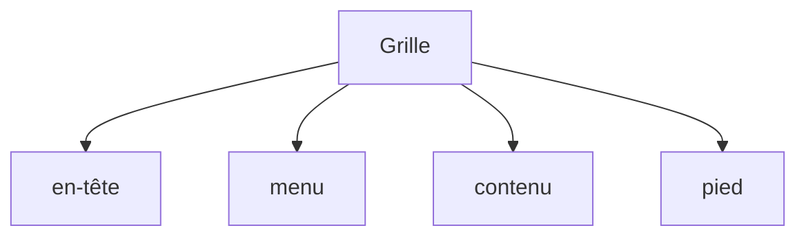

# Grid CSS

> [!info] En une phrase
> Le mode de mise en page CSS en grille, en lignes et colonnes, pour construire la structure d'une page ou d'une galerie.

```dataviewjs
await dv.view("10 — Templates/Scripts/learning", { view: "concept" })
```

## 1 · Comprendre
### Définition
`display: grid` sur un conteneur, puis on définit les colonnes (`grid-template-columns`) et éventuellement les lignes. L'unité `fr` partage l'espace restant. Les enfants se placent automatiquement, ou sur des zones nommées (`grid-template-areas`).

### Pourquoi ça existe
Construire des mises en page en deux dimensions (en-tête, menu latéral, contenu, pied) sans astuces.

### Le problème résolu
Les grilles faites avec des flottants ou des Flexbox imbriquées, fragiles et compliquées.

## 2 · Explorer
### Comment ça fonctionne


### Exemple concret
```css
.page {
  display: grid;
  grid-template-columns: 220px 1fr;
  grid-template-areas:
    "entete entete"
    "menu   contenu"
    "pied   pied";
  gap: 1rem;
  min-height: 100vh;
}
header { grid-area: entete; }
nav    { grid-area: menu; }
main   { grid-area: contenu; }
footer { grid-area: pied; }

.galerie {               /* autant de colonnes de 200px minimum que possible */
  display: grid;
  grid-template-columns: repeat(auto-fill, minmax(200px, 1fr));
  gap: 12px;
}
```

### Cas d'utilisation
- La structure générale d'une application (menu + contenu)
- Une galerie d'images qui s'adapte à la largeur

> [!warning] À ne pas confondre
> `fr` (une part de l'espace **restant**) et `%` (une part de la largeur **totale**). Grid pour la structure, [[Flexbox]] pour aligner à l'intérieur d'une zone : les deux se combinent.

## 3 · Pratiquer
- Construis la mise en page « en-tête / menu / contenu / pied » puis une galerie de 12 cartes avec `auto-fill`.

## 4 · Expliquer
> [!quote] Mon résumé, avec mes mots
> _À écrire sans regarder la fiche. Si je bloque, je ne l'ai pas encore compris._

## 5 · Relier
- **Prérequis** : [[Modèle de boîte]]
- **Complémentaires** : [[Flexbox]] · [[Responsive design]]

## 6 · Réviser
> [!question] Me faire interroger
> Je demande à Claude de m'interroger sur cette notion pour vérifier que je l'ai comprise.

### Validation de la maîtrise
- [ ] Je l'explique sans notes, en 3 phrases, à quelqu'un qui ne connaît pas
- [ ] J'ai réussi un exercice qui l'utilise
- [ ] Je l'ai utilisé dans un projet
- [ ] Je sais dire quand ne pas l'utiliser (ou ce qu'il ne faut pas confondre)
