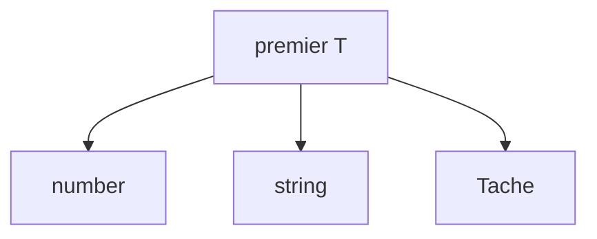

# Générique TypeScript

> [!info] En une phrase
> Un générique est un type paramétré (Array<T>, Promise<T>) : on écrit une fonction ou un type une fois, et il fonctionne avec n'importe quel type en gardant la vérification.

```dataviewjs
await dv.view("10 — Templates/Scripts/learning", { view: "concept" })
```

## 1 · Comprendre
### Définition
```ts
function premier<T>(liste: T[]): T | undefined {
  return liste[0];
}
const n = premier([1, 2, 3]);        // T = number, n: number | undefined
const s = premier(["a", "b"]);       // T = string

interface ReponsePage<T> {
  page: number;
  total: number;
  resultats: T[];
}
const r: ReponsePage<Tache> = await charger();
```
Tu en utilises déjà : `string[]` est `Array<string>`, une fonction async renvoie `Promise<T>`, `useState<number>(0)` en React.
**Contrainte** : `<T extends { id: number }>` exige que T ait un `id`.

### Pourquoi ça existe
Sans générique, il faudrait écrire une version par type, ou utiliser `any` et perdre la vérification.

### Le problème résolu
Écrire du code réutilisable (listes, réponses paginées, caches) qui reste typé.

## 2 · Explorer
### Comment ça fonctionne


### Exemple concret
```ts
function parId<T extends { id: number }>(liste: T[], id: number): T | undefined {
  return liste.find((x) => x.id === id);
}
async function getJson<T>(url: string): Promise<T> {
  const rep = await fetch(url);
  if (!rep.ok) throw new Error(String(rep.status));
  return rep.json() as Promise<T>;
}
const taches = await getJson<Tache[]>("/api/taches");
```

### Cas d'utilisation
- Fonctions d'appel d'API
- Hooks et services typés en React / Angular
- Structures de données réutilisables

> [!warning] À ne pas confondre
> `getJson<Tache[]>` ne **vérifie pas** que le serveur renvoie bien des tâches : c'est une promesse que tu fais au compilateur.

## 3 · Pratiquer

### Exercice visuel

Sur Excalidraw, **sans regarder la fiche**. Puis je compare avec la fiche, je corrige en rouge ce qui était faux, et j'explique mon dessin à voix haute ou à Claude dans le chat.

> [!example] 🧠 Dessine de mémoire
> Dessine `Array<T>` comme une boîte avec un trou `T`. Remplis-la avec `Depense`, puis avec `string`.

> [!example] 🔄 Change de contexte
> Redessine l'idée pour `http.get<Depense[]>()` dans Angular. Que garantit le `<Depense[]>` et que ne garantit-il pas ?

### Mon schéma

> [!tip] Mon dessin Excalidraw
> _Je crée le dessin « Schéma - Générique TypeScript » et je l'intègre ici avec `![[Schéma - Générique TypeScript.excalidraw]]`, puis je coche `schema`._

### Appliquer dans le fil rouge
- Pas encore d'étape du fil rouge pour cette notion : elle sera pratiquée dans le fil rouge de son niveau (voir [[Niveaux]]).

## 4 · Relier
- **Prérequis** : [[Type et interface TypeScript]] · [[Fonction fléchée et callback]]

## 5 · Réviser
> [!question] Me faire interroger
> Je demande à Claude de m'interroger sur cette notion pour vérifier que je l'ai comprise.

### Validation (compris, puis maîtrisé)
Trois cases à cocher dans les propriétés de la fiche :
- `schema` : mon dessin du concept est dans « Mon schéma » ;
- `exercice_visuel` : j'ai fait et corrigé les exercices visuels de la section 3 ;
- `fil_rouge` : je l'ai appliqué dans le fil rouge (coché tout seul quand une étape qui l'utilise est réussie).

Les trois cochées : la notion compte comme **comprise**. **Maîtrisé** : c'est moi qui le mets dans `status`, quand je le sens.

```dataviewjs
await dv.view("10 — Templates/Scripts/learning", { view: "maitrise" })
```
