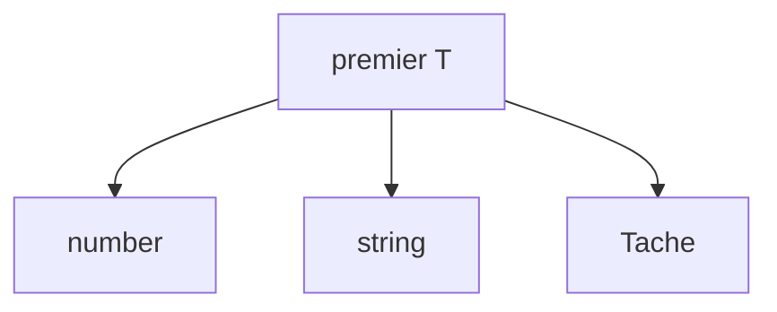

# Générique TypeScript

> [!info] En une phrase
> Un générique est un type paramétré (Array<T>, Promise<T>) : on écrit une fonction ou un type une fois, et il fonctionne avec n'importe quel type en gardant la vérification.

```dataviewjs
await dv.view("10 — Templates/Scripts/learning", { view: "concept" })
```

## 1 · Comprendre
### Définition
```ts
function premier<T>(liste: T[]): T | undefined {
  return liste[0];
}
const n = premier([1, 2, 3]);        // T = number, n: number | undefined
const s = premier(["a", "b"]);       // T = string

interface ReponsePage<T> {
  page: number;
  total: number;
  resultats: T[];
}
const r: ReponsePage<Tache> = await charger();
```
Tu en utilises déjà : `string[]` est `Array<string>`, une fonction async renvoie `Promise<T>`, `useState<number>(0)` en React.
**Contrainte** : `<T extends { id: number }>` exige que T ait un `id`.

### Pourquoi ça existe
Sans générique, il faudrait écrire une version par type, ou utiliser `any` et perdre la vérification.

### Le problème résolu
Écrire du code réutilisable (listes, réponses paginées, caches) qui reste typé.

## 2 · Explorer
### Comment ça fonctionne


### Exemple concret
```ts
function parId<T extends { id: number }>(liste: T[], id: number): T | undefined {
  return liste.find((x) => x.id === id);
}
async function getJson<T>(url: string): Promise<T> {
  const rep = await fetch(url);
  if (!rep.ok) throw new Error(String(rep.status));
  return rep.json() as Promise<T>;
}
const taches = await getJson<Tache[]>("/api/taches");
```

### Cas d'utilisation
- Fonctions d'appel d'API
- Hooks et services typés en React / Angular
- Structures de données réutilisables

> [!warning] À ne pas confondre
> `getJson<Tache[]>` ne **vérifie pas** que le serveur renvoie bien des tâches : c'est une promesse que tu fais au compilateur.

## 3 · Pratiquer
- Écris `grouperPar<T>(liste: T[], cle: (x: T) => string)` qui renvoie un objet de listes

## 4 · Expliquer
> [!quote] Mon résumé, avec mes mots
> _À écrire sans regarder la fiche. Si je bloque, je ne l'ai pas encore compris._

## 5 · Relier
- **Prérequis** : [[Type et interface TypeScript]] · [[Fonction fléchée et callback]]

## 6 · Réviser
> [!question] Me faire interroger
> Je demande à Claude de m'interroger sur cette notion pour vérifier que je l'ai comprise.

### Validation de la maîtrise
La notion est maîtrisée quand j'ai réussi **tous les exercices** qui l'utilisent (statut `reussi` dans l'exercice).

```dataviewjs
await dv.view("10 — Templates/Scripts/learning", { view: "maitrise" })
```
