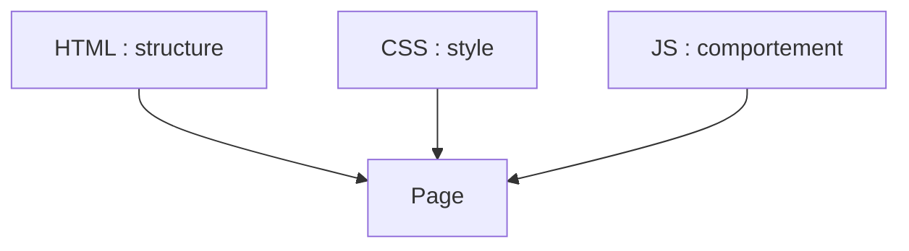

# HTML

> [!info] En une phrase
> Le langage qui décrit la structure et le sens du contenu d'une page web : titres, paragraphes, liens, images, formulaires.

```dataviewjs
await dv.view("10 — Templates/Scripts/learning", { view: "concept" })
```

## 1 · Comprendre
### Définition
**HTML** (*HyperText Markup Language*) n'est pas un langage de programmation : il **balise** le contenu pour dire ce que chaque morceau **est** (un titre, une liste, un bouton). Le navigateur lit ce fichier et construit la page. Le style vient du [[CSS]], le comportement du [[JavaScript]].

### Pourquoi ça existe
Un format commun que tous les navigateurs comprennent, et qui donne du **sens** au contenu (pour les humains, les lecteurs d'écran, les moteurs de recherche).

### Le problème résolu
Partager des documents reliés entre eux (liens) lisibles sur n'importe quelle machine.

## 2 · Explorer
### Comment ça fonctionne


### Exemple concret
```html
<!doctype html>
<html lang="fr">
<head>
  <meta charset="utf-8">
  <meta name="viewport" content="width=device-width, initial-scale=1">
  <title>Mon outil</title>
  <link rel="stylesheet" href="style.css">
</head>
<body>
  <header><h1>Archives</h1></header>
  <main>
    <p>Liste des <strong>exports</strong> :</p>
    <ul>
      <li><a href="/exports/1">Export du 6 novembre</a></li>
    </ul>
    
  </main>
  <script src="app.js"></script>
</body>
</html>
```
- `<head>` : informations sur la page (titre, encodage, styles) ; `<body>` : ce qui s'affiche.
- Balises **sémantiques** : `header`, `nav`, `main`, `section`, `article`, `footer`, plutôt que des `div` partout.

### Cas d'utilisation
- Toute page web ; les composants React, Vue et Angular produisent du HTML

> [!warning] À ne pas confondre
> **HTML** (structure, le *quoi*) et **CSS** (apparence, le *comment ça s'affiche*). Utiliser `<h1>` pour grossir un texte est une erreur : c'est le CSS qui gère la taille.

## 3 · Pratiquer

### Exercice visuel

Sur Excalidraw, **sans regarder la fiche**. Puis je compare avec la fiche, je corrige en rouge ce qui était faux, et j'explique mon dessin à voix haute ou à Claude dans le chat.

> [!example] 🧠 Dessine de mémoire
> Dessine la structure d'une page de ton application sous forme de boîtes imbriquées : header, main, la liste, le formulaire, footer.

> [!example] 🔍 Trouve l'erreur
> Ce schéma est faux. Corrige-le en rouge et explique l'erreur.
>
> ```mermaid
> flowchart TD
>   B[body] --> D1[div titre]
>   B --> D2[div liste]
>   D2 --> D3[div bouton]
> ```

### Mon schéma

> [!tip] Mon dessin Excalidraw
> _Je crée le dessin « Schéma - HTML » et je l'intègre ici avec `![[Schéma - HTML.excalidraw]]`, puis je coche `schema`._

### Appliquer dans le fil rouge
- Pas encore d'étape du fil rouge pour cette notion : elle sera pratiquée dans le fil rouge de son niveau (voir [[Niveaux]]).

## 4 · Relier
- **Au travail** : [HTML au travail](obsidian://open?vault=Travail&file=HTML%20au%20travail)
- **Prérequis** : [[Client-serveur]] · [[HTTP]]
- **Complémentaires** : [[CSS]] · [[JavaScript]] · [[Élément et attribut HTML]]
- **Utilisé par** : [[DOM]] · [[React]]

## 5 · Réviser
> [!question] Me faire interroger
> Je demande à Claude de m'interroger sur cette notion pour vérifier que je l'ai comprise.

### Validation (compris, puis maîtrisé)
Trois cases à cocher dans les propriétés de la fiche :
- `schema` : mon dessin du concept est dans « Mon schéma » ;
- `exercice_visuel` : j'ai fait et corrigé les exercices visuels de la section 3 ;
- `fil_rouge` : je l'ai appliqué dans le fil rouge (coché tout seul quand une étape qui l'utilise est réussie).

Les trois cochées : la notion compte comme **comprise**. **Maîtrisé** : c'est moi qui le mets dans `status`, quand je le sens.

```dataviewjs
await dv.view("10 — Templates/Scripts/learning", { view: "maitrise" })
```
