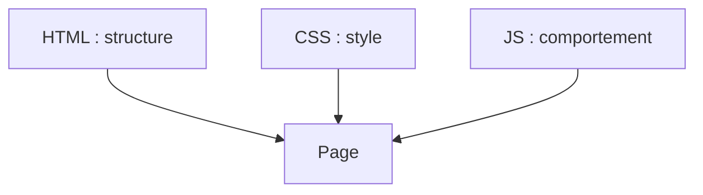

# HTML

> [!info] En une phrase
> Le langage qui décrit la structure et le sens du contenu d'une page web : titres, paragraphes, liens, images, formulaires.

```dataviewjs
await dv.view("10 — Templates/Scripts/learning", { view: "concept" })
```

## 1 · Comprendre
### Définition
**HTML** (*HyperText Markup Language*) n'est pas un langage de programmation : il **balise** le contenu pour dire ce que chaque morceau **est** (un titre, une liste, un bouton). Le navigateur lit ce fichier et construit la page. Le style vient du [[CSS]], le comportement du [[JavaScript]].

### Pourquoi ça existe
Un format commun que tous les navigateurs comprennent, et qui donne du **sens** au contenu (pour les humains, les lecteurs d'écran, les moteurs de recherche).

### Le problème résolu
Partager des documents reliés entre eux (liens) lisibles sur n'importe quelle machine.

## 2 · Explorer
### Comment ça fonctionne


### Exemple concret
```html
<!doctype html>
<html lang="fr">
<head>
  <meta charset="utf-8">
  <meta name="viewport" content="width=device-width, initial-scale=1">
  <title>Mon outil</title>
  <link rel="stylesheet" href="style.css">
</head>
<body>
  <header><h1>Archives</h1></header>
  <main>
    <p>Liste des <strong>exports</strong> :</p>
    <ul>
      <li><a href="/exports/1">Export du 6 novembre</a></li>
    </ul>
    
  </main>
  <script src="app.js"></script>
</body>
</html>
```
- `<head>` : informations sur la page (titre, encodage, styles) ; `<body>` : ce qui s'affiche.
- Balises **sémantiques** : `header`, `nav`, `main`, `section`, `article`, `footer`, plutôt que des `div` partout.

### Cas d'utilisation
- Toute page web ; les composants React, Vue et Angular produisent du HTML
- Le bouton à ajouter dans l'interface de CVAT est, au final, un élément HTML

> [!warning] À ne pas confondre
> **HTML** (structure, le *quoi*) et **CSS** (apparence, le *comment ça s'affiche*). Utiliser `<h1>` pour grossir un texte est une erreur : c'est le CSS qui gère la taille.

## 3 · Pratiquer
- Écris une page avec un en-tête, un menu de 3 liens, un article avec titre, paragraphe, liste et image, et un pied de page.

## 4 · Expliquer
> [!quote] Mon résumé, avec mes mots
> _À écrire sans regarder la fiche. Si je bloque, je ne l'ai pas encore compris._

## 5 · Relier
- **Prérequis** : [[Client-serveur]] · [[HTTP]]
- **Complémentaires** : [[CSS]] · [[JavaScript]] · [[Élément et attribut HTML]]
- **Utilisé par** : [[DOM]] · [[React]]

## 6 · Réviser
> [!question] Me faire interroger
> Je demande à Claude de m'interroger sur cette notion pour vérifier que je l'ai comprise.

### Validation de la maîtrise
- [ ] Je l'explique sans notes, en 3 phrases, à quelqu'un qui ne connaît pas
- [ ] J'ai réussi un exercice qui l'utilise
- [ ] Je l'ai utilisé dans un projet
- [ ] Je sais dire quand ne pas l'utiliser (ou ce qu'il ne faut pas confondre)
