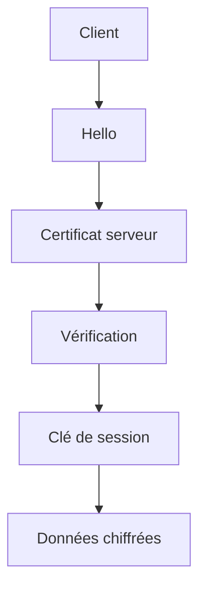

# HTTPS et TLS

> [!info] En une phrase
> HTTPS, c'est HTTP transporté dans un tunnel TLS : les échanges sont chiffrés et le serveur prouve son identité avec un certificat.

```dataviewjs
await dv.view("10 — Templates/Scripts/learning", { view: "concept" })
```

## 1 · Comprendre
### Définition
**TLS** (successeur de SSL) chiffre une connexion TCP et **authentifie** le serveur. **HTTPS** = HTTP au-dessus de TLS, sur le port 443. Trois garanties :
1. **Confidentialité** : personne sur le chemin ne lit les données ;
2. **Intégrité** : personne ne les modifie sans que ce soit détecté ;
3. **Authenticité** : tu parles bien au vrai serveur, grâce à son [[Certificat]].

### Pourquoi ça existe
Les données passent par des dizaines de machines (Wi-Fi, box, opérateurs) : sans chiffrement, mots de passe et jetons circulent en clair.

### Le problème résolu
L'espionnage et la modification des échanges, et les faux sites qui se font passer pour le vrai.

## 2 · Explorer
### Comment ça fonctionne

Le client vérifie le certificat (signé par une autorité de confiance ? nom correct ? pas expiré ?), puis les deux côtés fabriquent une clé de session et chiffrent la suite.

### Exemple concret
```bash
curl -v https://gitlab.com 2>&1 | grep -iE "SSL|TLS|subject|issuer|expire"
openssl s_client -connect gitlab.com:443 -servername gitlab.com </dev/null | head -20
```

### Cas d'utilisation
- Tout site et toute API en production

> [!warning] À ne pas confondre
> **Chiffré** ne veut pas dire **sûr** : un site malveillant peut avoir un HTTPS valide. Le cadenas garantit seulement que tu parles au propriétaire du nom affiché.

## 3 · Pratiquer

### Exercice visuel

Sur Excalidraw, **sans regarder la fiche**. Puis je compare avec la fiche, je corrige en rouge ce qui était faux, et j'explique mon dessin à voix haute ou à Claude dans le chat.

> [!example] 🛣️ Suis le trajet
> Dessine une connexion HTTPS : la poignée de main TLS, le certificat vérifié, puis la requête HTTP chiffrée dans le tunnel.

> [!example] ⚖️ Avant / après
> Avant / après : la même requête de connexion en HTTP puis en HTTPS. Dessine ce que voit quelqu'un sur le réseau dans chaque cas.

### Mon schéma

> [!tip] Mon dessin Excalidraw
> _Je crée le dessin « Schéma - HTTPS et TLS » et je l'intègre ici avec `![[Schéma - HTTPS et TLS.excalidraw]]`, puis je coche `schema`._

### Appliquer dans le fil rouge
- Pas encore d'étape du fil rouge pour cette notion : elle sera pratiquée dans le fil rouge de son niveau (voir [[Niveaux]]).

## 4 · Relier
- **Au travail** : [[HTTPS et TLS au travail]]
- **Prérequis** : [[HTTP]] · [[TCP et UDP]]
- **Complémentaires** : [[Certificat]]
- **Commandes** : [[curl]] · [[openssl]]

## 5 · Réviser
> [!question] Me faire interroger
> Je demande à Claude de m'interroger sur cette notion pour vérifier que je l'ai comprise.

### Validation (compris, puis maîtrisé)
Trois cases à cocher dans les propriétés de la fiche :
- `schema` : mon dessin du concept est dans « Mon schéma » ;
- `exercice_visuel` : j'ai fait et corrigé les exercices visuels de la section 3 ;
- `fil_rouge` : je l'ai appliqué dans le fil rouge (coché tout seul quand une étape qui l'utilise est réussie).

Les trois cochées : la notion compte comme **comprise**. **Maîtrisé** : c'est moi qui le mets dans `status`, quand je le sens.

```dataviewjs
await dv.view("10 — Templates/Scripts/learning", { view: "maitrise" })
```
