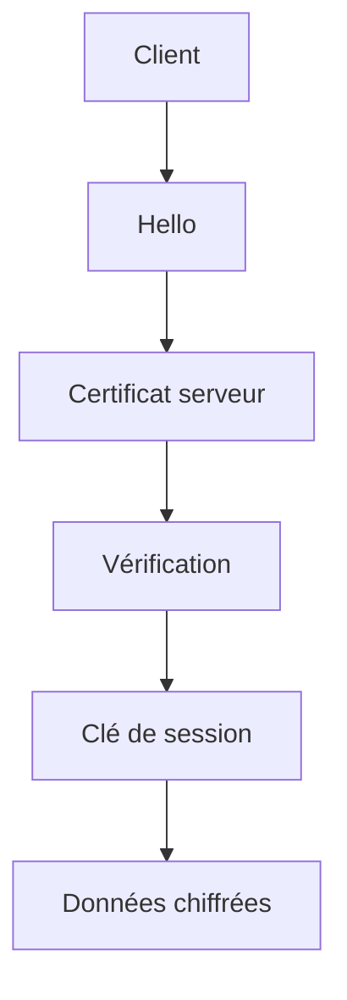

# HTTPS et TLS

> [!info] En une phrase
> HTTPS, c'est HTTP transporté dans un tunnel TLS : les échanges sont chiffrés et le serveur prouve son identité avec un certificat.

```dataviewjs
await dv.view("10 — Templates/Scripts/learning", { view: "concept" })
```

## 1 · Comprendre
### Définition
**TLS** (successeur de SSL) chiffre une connexion TCP et **authentifie** le serveur. **HTTPS** = HTTP au-dessus de TLS, sur le port 443. Trois garanties :
1. **Confidentialité** : personne sur le chemin ne lit les données ;
2. **Intégrité** : personne ne les modifie sans que ce soit détecté ;
3. **Authenticité** : tu parles bien au vrai serveur, grâce à son [[Certificat]].

### Pourquoi ça existe
Les données passent par des dizaines de machines (Wi-Fi, box, opérateurs) : sans chiffrement, mots de passe et jetons circulent en clair.

### Le problème résolu
L'espionnage et la modification des échanges, et les faux sites qui se font passer pour le vrai.

## 2 · Explorer
### Comment ça fonctionne

Le client vérifie le certificat (signé par une autorité de confiance ? nom correct ? pas expiré ?), puis les deux côtés fabriquent une clé de session et chiffrent la suite.

### Exemple concret
```bash
curl -v https://gitlab.com 2>&1 | grep -iE "SSL|TLS|subject|issuer|expire"
openssl s_client -connect gitlab.com:443 -servername gitlab.com </dev/null | head -20
```

### Cas d'utilisation
- Tout site et toute API en production
- Le registre Docker et le Nexus de l'entreprise (Docker refuse un registre non HTTPS par défaut)
- Traefik peut gérer le HTTPS devant CVAT

> [!warning] À ne pas confondre
> **Chiffré** ne veut pas dire **sûr** : un site malveillant peut avoir un HTTPS valide. Le cadenas garantit seulement que tu parles au propriétaire du nom affiché.

## 3 · Pratiquer
- Affiche avec `curl -v` la version de TLS, l'émetteur et la date d'expiration du certificat de trois sites.

## 4 · Expliquer
> [!quote] Mon résumé, avec mes mots
> _À écrire sans regarder la fiche. Si je bloque, je ne l'ai pas encore compris._

## 5 · Relier
- **Prérequis** : [[HTTP]] · [[TCP et UDP]]
- **Complémentaires** : [[Certificat]]
- **Commandes** : [[curl]] · [[openssl]]

## 6 · Réviser
> [!question] Me faire interroger
> Je demande à Claude de m'interroger sur cette notion pour vérifier que je l'ai comprise.

### Validation de la maîtrise
La notion est maîtrisée quand j'ai réussi **tous les exercices** qui l'utilisent (statut `reussi` dans l'exercice).

```dataviewjs
await dv.view("10 — Templates/Scripts/learning", { view: "maitrise" })
```
