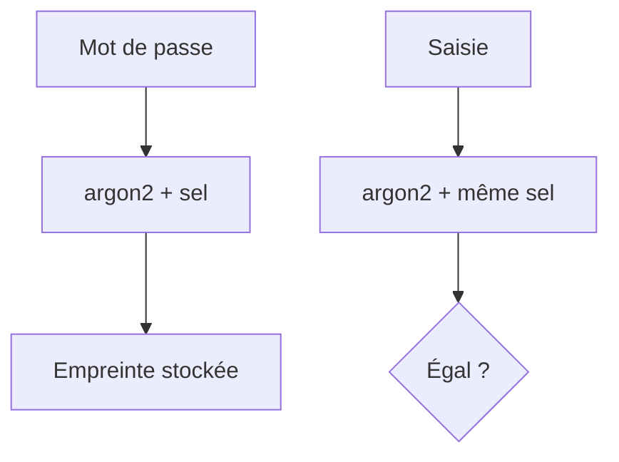

# Hachage de mot de passe

> [!info] En une phrase
> On ne stocke jamais un mot de passe : on stocke son empreinte calculée par une fonction lente et salée (bcrypt, argon2), et on compare les empreintes à la connexion.

```dataviewjs
await dv.view("10 — Templates/Scripts/learning", { view: "concept" })
```

## 1 · Comprendre
### Définition
Une **fonction de hachage** transforme un texte en empreinte de taille fixe, **sans retour possible**. À la connexion, on hache ce que l'utilisateur tape et on compare.
- **Sel** (*salt*) : une valeur aléatoire ajoutée à chaque mot de passe ; deux utilisateurs avec le même mot de passe ont des empreintes différentes.
- **Lente exprès** : **argon2**, **bcrypt**, **scrypt** prennent ~100 ms, ce qui rend les essais en masse très coûteux.
- **Jamais** MD5 ou SHA-256 seuls pour des mots de passe : trop rapides (des milliards d'essais par seconde).
- **Chiffrer** (réversible avec une clé) n'est pas **hacher** (irréversible).

### Pourquoi ça existe
Les bases de données fuient. Si les mots de passe y sont en clair, tous les comptes (et ceux des autres sites où les gens réutilisent le même mot de passe) tombent.

### Le problème résolu
Même en cas de fuite, retrouver les mots de passe doit être extrêmement long.

## 2 · Explorer
### Comment ça fonctionne


### Exemple concret
```js
import bcrypt from "bcrypt";
const empreinte = await bcrypt.hash("MonMotDePasse!", 12);
// $2b$12$Q9h0…  (algorithme, coût, sel et empreinte dans une seule chaîne)
const ok = await bcrypt.compare("MonMotDePasse!", empreinte);   // true
```
```python
from argon2 import PasswordHasher
ph = PasswordHasher()
h = ph.hash("MonMotDePasse!")
ph.verify(h, "MonMotDePasse!")
```

### Cas d'utilisation
- Inscription et connexion
- Réinitialisation de mot de passe
- Comprendre pourquoi un site ne peut pas te « renvoyer » ton mot de passe

> [!warning] À ne pas confondre
> Un message « mot de passe incorrect » et « utilisateur inconnu » différents permettent de deviner qui a un compte : réponds pareil dans les deux cas.

## 3 · Pratiquer
- Hache le même mot de passe deux fois avec bcrypt et explique pourquoi les résultats diffèrent mais que `compare` réussit

## 4 · Expliquer
> [!quote] Mon résumé, avec mes mots
> _À écrire sans regarder la fiche. Si je bloque, je ne l'ai pas encore compris._

## 5 · Relier
- **Prérequis** : [[Authentification]]
- **Complémentaires** : [[Session et cookie]]

## 6 · Réviser
> [!question] Me faire interroger
> Je demande à Claude de m'interroger sur cette notion pour vérifier que je l'ai comprise.

### Validation de la maîtrise
La notion est maîtrisée quand j'ai réussi **tous les exercices** qui l'utilisent (statut `reussi` dans l'exercice).

```dataviewjs
await dv.view("10 — Templates/Scripts/learning", { view: "maitrise" })
```
