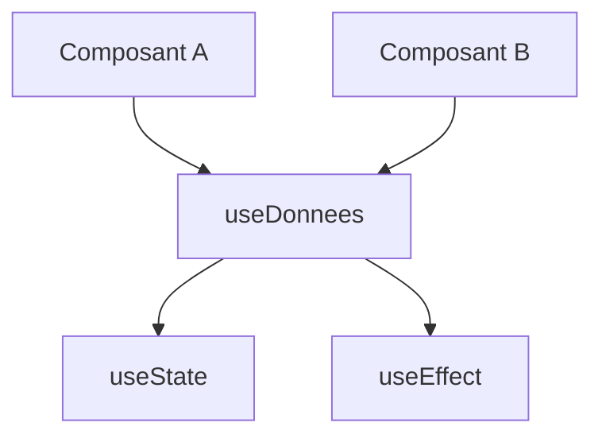

# Hook React

> [!info] En une phrase
> Les hooks sont les fonctions use… (useState, useEffect, useContext, useMemo, useRef) qui donnent des capacités aux composants ; on peut écrire ses propres hooks pour réutiliser une logique.

```dataviewjs
await dv.view("10 — Templates/Scripts/learning", { view: "concept" })
```

## 1 · Comprendre
### Définition
Hooks fournis :
| Hook | Rôle |
| --- | --- |
| `useState` | état local |
| `useEffect` | synchroniser avec l'extérieur |
| `useContext` | lire une valeur partagée (utilisateur connecté, thème) sans passer de props |
| `useRef` | garder une valeur sans réafficher, ou accéder à un élément du DOM |
| `useMemo` / `useCallback` | mémoriser un calcul / une fonction coûteux |
| `useReducer` | état complexe avec des actions |
**Règles des hooks** :
1. Les appeler **au premier niveau** du composant, jamais dans un `if`, une boucle ou une fonction imbriquée.
2. Les appeler seulement dans un composant ou un autre hook.
**Hook personnalisé** : une fonction qui commence par `use` et appelle d'autres hooks.

### Pourquoi ça existe
Plusieurs composants ont besoin de la même logique (charger des données, lire le stockage local) : il faut la factoriser.

### Le problème résolu
Réutiliser de la logique avec état sans copier-coller ni composants artificiels.

## 2 · Explorer
### Comment ça fonctionne


### Exemple concret
```tsx
function useDonnees<T>(url: string) {
  const [donnees, setDonnees] = useState<T | null>(null);
  const [erreur, setErreur] = useState<string | null>(null);
  useEffect(() => {
    let actif = true;
    fetch(url).then((r) => r.ok ? r.json() : Promise.reject(new Error(String(r.status))))
      .then((d) => actif && setDonnees(d)).catch((e) => actif && setErreur(e.message));
    return () => { actif = false; };
  }, [url]);
  return { donnees, erreur, chargement: !donnees && !erreur };
}
const { donnees: taches, chargement } = useDonnees<Tache[]>("/api/taches");
```

### Cas d'utilisation
- Factoriser les appels d'API
- Contexte d'authentification (`useAuth`)

> [!warning] À ne pas confondre
> Appeler un hook dans un `if` : React les repère par leur **ordre d'appel**, qui doit être identique à chaque rendu. Et un hook personnalisé partage la **logique**, pas l'**état** : chaque composant qui l'appelle a sa propre copie.

## 3 · Pratiquer

### Exercice visuel

Sur Excalidraw, **sans regarder la fiche**. Puis je compare avec la fiche, je corrige en rouge ce qui était faux, et j'explique mon dessin à voix haute ou à Claude dans le chat.

> [!example] 🧠 Dessine de mémoire
> Dessine un composant et les hooks qui lui donnent des capacités (useState, useEffect, useRef). Écris la capacité de chacun.

> [!example] 🔄 Change de contexte
> Redessine-le pour un composant Vue : quelles fonctions de Vue jouent le même rôle ?

### Mon schéma

> [!tip] Mon dessin Excalidraw
> _Je crée le dessin « Schéma - Hook React » et je l'intègre ici avec `![[Schéma - Hook React.excalidraw]]`, puis je coche `schema`._

### Appliquer dans le fil rouge
- Pas encore d'étape du fil rouge pour cette notion : elle sera pratiquée dans le fil rouge de son niveau (voir [[Niveaux]]).

## 4 · Relier
- **Au travail** : [[Hook React au travail]]
- **Prérequis** : [[État et réactivité]] · [[Effet React (useEffect)]] · [[Portée et closure]]
- **Complémentaires** : [[Générique TypeScript]]

## 5 · Réviser
> [!question] Me faire interroger
> Je demande à Claude de m'interroger sur cette notion pour vérifier que je l'ai comprise.

### Validation (compris, puis maîtrisé)
Trois cases à cocher dans les propriétés de la fiche :
- `schema` : mon dessin du concept est dans « Mon schéma » ;
- `exercice_visuel` : j'ai fait et corrigé les exercices visuels de la section 3 ;
- `fil_rouge` : je l'ai appliqué dans le fil rouge (coché tout seul quand une étape qui l'utilise est réussie).

Les trois cochées : la notion compte comme **comprise**. **Maîtrisé** : c'est moi qui le mets dans `status`, quand je le sens.

```dataviewjs
await dv.view("10 — Templates/Scripts/learning", { view: "maitrise" })
```
