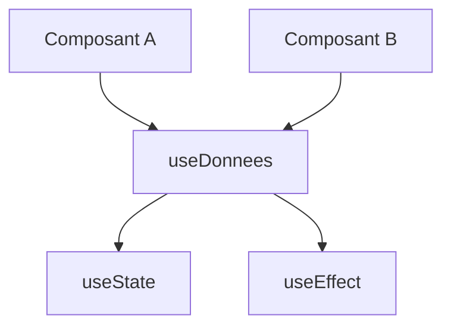

# Hook React

> [!info] En une phrase
> Les hooks sont les fonctions use… (useState, useEffect, useContext, useMemo, useRef) qui donnent des capacités aux composants ; on peut écrire ses propres hooks pour réutiliser une logique.

```dataviewjs
await dv.view("10 — Templates/Scripts/learning", { view: "concept" })
```

## 1 · Comprendre
### Définition
Hooks fournis :
| Hook | Rôle |
| --- | --- |
| `useState` | état local |
| `useEffect` | synchroniser avec l'extérieur |
| `useContext` | lire une valeur partagée (utilisateur connecté, thème) sans passer de props |
| `useRef` | garder une valeur sans réafficher, ou accéder à un élément du DOM |
| `useMemo` / `useCallback` | mémoriser un calcul / une fonction coûteux |
| `useReducer` | état complexe avec des actions |
**Règles des hooks** :
1. Les appeler **au premier niveau** du composant, jamais dans un `if`, une boucle ou une fonction imbriquée.
2. Les appeler seulement dans un composant ou un autre hook.
**Hook personnalisé** : une fonction qui commence par `use` et appelle d'autres hooks.

### Pourquoi ça existe
Plusieurs composants ont besoin de la même logique (charger des données, lire le stockage local) : il faut la factoriser.

### Le problème résolu
Réutiliser de la logique avec état sans copier-coller ni composants artificiels.

## 2 · Explorer
### Comment ça fonctionne


### Exemple concret
```tsx
function useDonnees<T>(url: string) {
  const [donnees, setDonnees] = useState<T | null>(null);
  const [erreur, setErreur] = useState<string | null>(null);
  useEffect(() => {
    let actif = true;
    fetch(url).then((r) => r.ok ? r.json() : Promise.reject(new Error(String(r.status))))
      .then((d) => actif && setDonnees(d)).catch((e) => actif && setErreur(e.message));
    return () => { actif = false; };
  }, [url]);
  return { donnees, erreur, chargement: !donnees && !erreur };
}
const { donnees: taches, chargement } = useDonnees<Tache[]>("/api/taches");
```

### Cas d'utilisation
- Factoriser les appels d'API
- Contexte d'authentification (`useAuth`)
- Le code de CVAT utilise beaucoup de hooks

> [!warning] À ne pas confondre
> Appeler un hook dans un `if` : React les repère par leur **ordre d'appel**, qui doit être identique à chaque rendu. Et un hook personnalisé partage la **logique**, pas l'**état** : chaque composant qui l'appelle a sa propre copie.

## 3 · Pratiquer
- Écris `useStockageLocal(cle, valeurInitiale)` qui fonctionne comme useState mais garde la valeur dans localStorage

## 4 · Expliquer
> [!quote] Mon résumé, avec mes mots
> _À écrire sans regarder la fiche. Si je bloque, je ne l'ai pas encore compris._

## 5 · Relier
- **Prérequis** : [[État React (useState)]] · [[Effet React (useEffect)]] · [[Portée et closure]]
- **Complémentaires** : [[Générique TypeScript]]

## 6 · Réviser
> [!question] Me faire interroger
> Je demande à Claude de m'interroger sur cette notion pour vérifier que je l'ai comprise.

### Validation de la maîtrise
La notion est maîtrisée quand j'ai réussi **tous les exercices** qui l'utilisent (statut `reussi` dans l'exercice).

```dataviewjs
await dv.view("10 — Templates/Scripts/learning", { view: "maitrise" })
```
