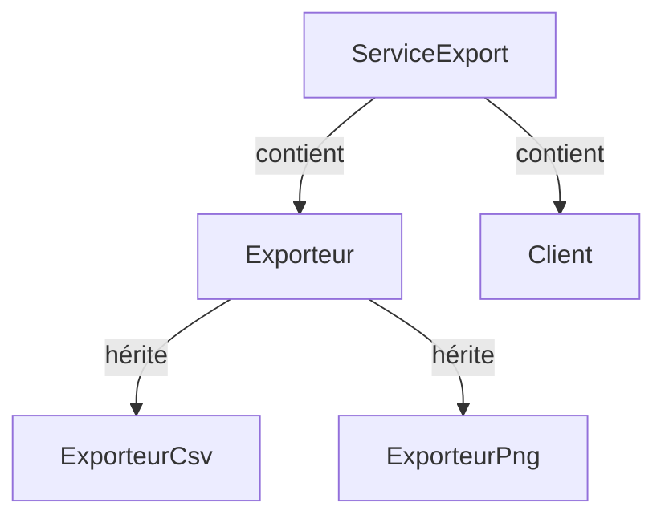

# Héritage et composition

> [!info] En une phrase
> L'héritage crée une classe à partir d'une autre (« est un ») ; la composition construit un objet en y plaçant d'autres objets (« a un ») ; la règle des patrons est de préférer la composition.

```dataviewjs
await dv.view("10 — Templates/Scripts/learning", { view: "concept" })
```

## 1 · Comprendre
### Définition
**Héritage** : la classe enfant reprend tout de la classe parent et peut ajouter ou remplacer des méthodes.
```python
class Exporteur:
    def exporter(self, annotations): raise NotImplementedError
    def nom_fichier(self, tache_id): return f"tache-{tache_id}.{self.extension}"

class ExporteurCsv(Exporteur):          # « un ExporteurCsv EST un Exporteur »
    extension = "csv"
    def exporter(self, annotations): ...
```
**Composition** : l'objet **contient** d'autres objets et leur délègue le travail.
```python
class ServiceExport:                    # « un ServiceExport A UN client et UN exporteur »
    def __init__(self, client, exporteur):
        self.client = client
        self.exporteur = exporteur
    def lancer(self, tache_id):
        return self.exporteur.exporter(self.client.annotations(tache_id))
```
**« Préférer la composition à l'héritage »** : l'héritage crée un lien fort et figé (changer le parent peut casser tous les enfants, et on ne peut pas changer de parent en cours de route) ; la composition permet de remplacer une pièce, y compris dans les tests.

### Pourquoi ça existe
Réutiliser du code et assembler des comportements sans tout réécrire.

### Le problème résolu
Choisir le bon lien entre les classes pour que le code reste souple.

## 2 · Explorer
### Comment ça fonctionne


### Exemple concret
Le piège de l'héritage profond : `ExporteurPngAvecLegendeEtFiligraneCompresse` hérite de quatre niveaux, et chaque combinaison demande une nouvelle classe. Avec la composition, on assemble les options :
```python
exporteur = ExporteurPng(legende=True, filigrane=Filigrane("CONFIDENTIEL"), compression=6)
```
`super()` appelle la méthode du parent quand on veut l'étendre plutôt que la remplacer :
```python
class ExporteurCsvAvecEntete(ExporteurCsv):
    def exporter(self, annotations):
        return "label,x,y\n" + super().exporter(annotations)
```

### Cas d'utilisation
- Les classes de base d'un framework (`models.Model` en Django, `Component` en Angular)
- Assembler des services
- Les patrons Décorateur, Stratégie, Adaptateur reposent sur la composition

> [!warning] À ne pas confondre
> Utiliser l'héritage seulement pour partager du code (« une Tache hérite de Liste parce qu'elle contient des éléments ») : si la phrase « X **est un** Y » est fausse, c'est de la composition qu'il faut.

## 3 · Pratiquer
- Pour cinq paires (Chien / Animal, Voiture / Moteur, Admin / Utilisateur, Panier / Liste, Fichier PNG / Fichier), dis si c'est « est un » ou « a un »

## 4 · Expliquer
> [!quote] Mon résumé, avec mes mots
> _À écrire sans regarder la fiche. Si je bloque, je ne l'ai pas encore compris._

## 5 · Relier
- **Prérequis** : [[Classe et objet]]
- **Complémentaires** : [[Interface et polymorphisme]] · [[Principes SOLID]]

## 6 · Réviser
> [!question] Me faire interroger
> Je demande à Claude de m'interroger sur cette notion pour vérifier que je l'ai comprise.

### Validation de la maîtrise
La notion est maîtrisée quand j'ai réussi **tous les exercices** qui l'utilisent (statut `reussi` dans l'exercice).

```dataviewjs
await dv.view("10 — Templates/Scripts/learning", { view: "maitrise" })
```
