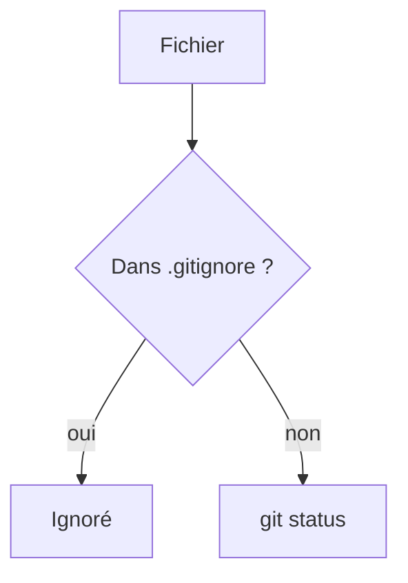

# Ignorer des fichiers (gitignore)

> [!info] En une phrase
> Le fichier .gitignore liste ce que Git doit ignorer : environnements, dépendances, fichiers générés, secrets.

```dataviewjs
await dv.view("10 — Templates/Scripts/learning", { view: "concept" })
```

## 1 · Comprendre
### Définition
`.gitignore`, à la racine du dépôt, contient des motifs : chaque fichier qui correspond n'apparaît plus dans `git status` et ne peut pas être ajouté par erreur.

```text
# Python
.venv/
__pycache__/
*.pyc
# Node
node_modules/
dist/
# Secrets et données locales
.env
*.log
sortie/
```

### Pourquoi ça existe
Un dépôt ne doit contenir que ce qui est nécessaire pour reconstruire le projet.

### Le problème résolu
Des dépôts énormes (`node_modules`, `.venv`), des conflits sur des fichiers générés, des mots de passe publiés (`.env`).

## 2 · Explorer
### Comment ça fonctionne


### Exemple concret
```bash
git check-ignore -v .venv/bin/python   # quelle règle ignore ce fichier
git status --ignored                   # voir aussi les ignorés
git rm -r --cached node_modules        # arrêter de suivre un dossier déjà commité
```
Modèles prêts à l'emploi : github.com/github/gitignore.

### Cas d'utilisation
- Tout nouveau projet : créer le `.gitignore` **avant** le premier commit
- Le `.dockerignore` suit la même idée pour le contexte de build Docker

> [!warning] À ne pas confondre
> Ajouter un fichier au `.gitignore` ne le **retire pas** s'il est déjà suivi : il faut `git rm --cached`. Et un secret déjà poussé reste dans l'historique : il faut le **changer**, pas seulement l'ignorer.

## 3 · Pratiquer

### Exercice visuel

Sur Excalidraw, **sans regarder la fiche**. Puis je compare avec la fiche, je corrige en rouge ce qui était faux, et j'explique mon dessin avec mes mots (section 4).

> [!example] ⚖️ Avant / après
> Avant / après : `git status` dans MesDépenses sans `.gitignore` (avec `.venv`, `node_modules`, `.env`), puis avec. Dessine ce qui disparaît.

> [!example] 🔍 Trouve l'erreur
> Ce schéma est faux. Corrige-le en rouge et explique l'erreur.
>
> ```mermaid
> flowchart TD
>   E[.env déjà commité] --> G[Ajout au gitignore]
>   G --> S[Secret retiré]
> ```

### Mon schéma

> [!tip] Mon dessin Excalidraw
> _Je crée le dessin « Schéma - Ignorer des fichiers (gitignore) » et je l'intègre ici avec `![[Schéma - Ignorer des fichiers (gitignore).excalidraw]]`._

### Appliquer dans le fil rouge
- Pas encore d'étape du fil rouge pour cette notion : je l'applique dans mon travail (CVAT, Nuclio) ou je demande une étape à Claude.

## 4 · Expliquer
> [!quote] Mon résumé, avec mes mots
> _J'explique mon schéma avec mes mots, sans regarder la fiche. Si je bloque, je ne l'ai pas encore compris._

## 5 · Relier
- **Prérequis** : [[Dépôt Git]]
- **Complémentaires** : [[Index Git (staging)]] · [[Secret et fichier .env]]

## 6 · Réviser
> [!question] Me faire interroger
> Je demande à Claude de m'interroger sur cette notion pour vérifier que je l'ai comprise.

### Validation de la maîtrise
La notion est maîtrisée quand je sais :
1. **l'expliquer** de façon fluide, à partir de mon schéma (section 4) ;
2. **l'adapter** à un autre contexte (consigne « Change de contexte », ou Claude m'interroge sur un autre cas) ;
3. **l'appliquer** pour de vrai dans le fil rouge (section 3).

Réussir un exercice ne suffit pas. C'est moi qui passe le statut en `maitrise`.

```dataviewjs
await dv.view("10 — Templates/Scripts/learning", { view: "maitrise" })
```
