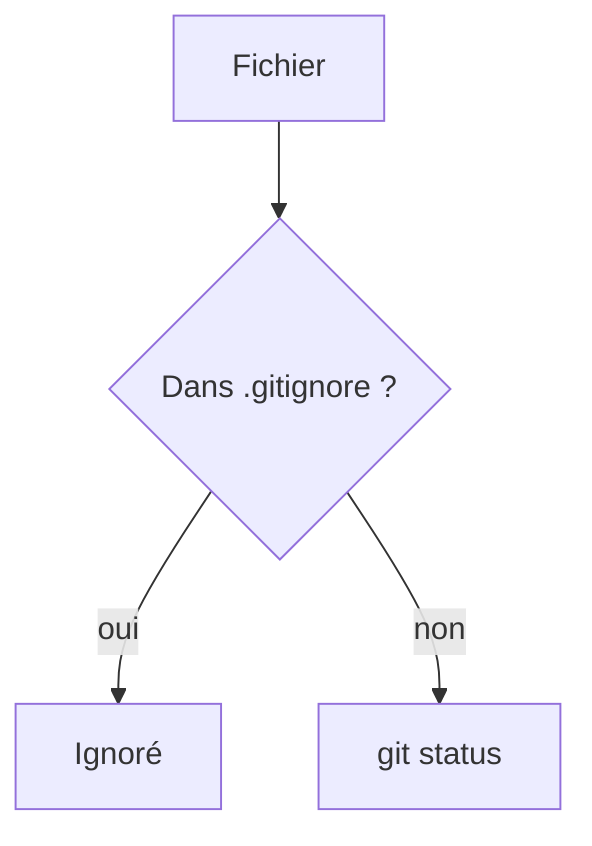

# Ignorer des fichiers (gitignore)

> [!info] En une phrase
> Le fichier .gitignore liste ce que Git doit ignorer : environnements, dépendances, fichiers générés, secrets.

## 1 · Comprendre
### Définition
`.gitignore`, à la racine du dépôt, contient des motifs : chaque fichier qui correspond n'apparaît plus dans `git status` et ne peut pas être ajouté par erreur.

```text
# Python
.venv/
__pycache__/
*.pyc
# Node
node_modules/
dist/
# Secrets et données locales
.env
*.log
sortie/
```

### Pourquoi ça existe
Un dépôt ne doit contenir que ce qui est nécessaire pour reconstruire le projet.

### Le problème résolu
Des dépôts énormes (`node_modules`, `.venv`), des conflits sur des fichiers générés, des mots de passe publiés (`.env`).

## 2 · Explorer
### Comment ça fonctionne


### Exemple concret
```bash
git check-ignore -v .venv/bin/python   # quelle règle ignore ce fichier
git status --ignored                   # voir aussi les ignorés
git rm -r --cached node_modules        # arrêter de suivre un dossier déjà commité
```
Modèles prêts à l'emploi : github.com/github/gitignore.

### Cas d'utilisation
- Tout nouveau projet : créer le `.gitignore` **avant** le premier commit
- Le `.dockerignore` suit la même idée pour le contexte de build Docker

> [!warning] À ne pas confondre
> Ajouter un fichier au `.gitignore` ne le **retire pas** s'il est déjà suivi : il faut `git rm --cached`. Et un secret déjà poussé reste dans l'historique : il faut le **changer**, pas seulement l'ignorer.

## 3 · Relier
- **Prérequis** : [[Dépôt Git]]
- **Complémentaires** : [[Index Git (staging)]] · [[Secret et fichier .env]]
