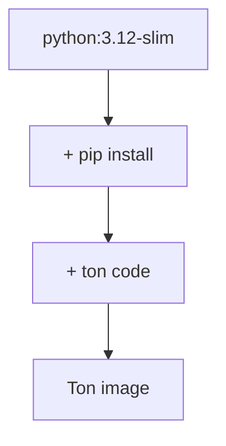

# Image Docker

> [!info] En une phrase
> Le modèle figé d'une application : système minimal, dépendances et code, prêt à être lancé.

```dataviewjs
await dv.view("10 — Templates/Scripts/learning", { view: "concept" })
```

## 1 · Comprendre
### Définition
Une **image** est construite à partir d'un `Dockerfile`, couche par couche. Elle est en **lecture seule** et peut être partagée via un registre (Docker Hub, Nexus, GitLab Registry).

Une image est un **empilement de couches** : chaque instruction du [[Dockerfile]] (`RUN`, `COPY`…) ajoute une couche par-dessus les précédentes. Une **image dérivée** est une image construite `FROM` une autre : elle réutilise toutes ses couches et n'ajoute que les siennes.

### Pourquoi ça existe
Figer une application et tout son environnement dans un paquet qu'on peut copier, versionner et lancer à l'identique n'importe où.

### Le problème résolu
« Ça marche sur ma machine » : sans image, chaque machine installe ses propres versions des outils et des bibliothèques.

## 2 · Explorer
### Comment ça fonctionne

- **Couches partagées** : dix images dérivées de `python:3.12-slim` ne stockent cette base qu'une fois.
- **Cache** : au rebuild, Docker réutilise les couches dont l'instruction et les fichiers n'ont pas changé. Une couche modifiée invalide toutes celles **au-dessus**. D'où l'ordre : dépendances d'abord, code ensuite.
- **Nom et tag** : `nom:tag` (`python:3.12-slim`). Le même contenu peut avoir plusieurs tags (`1.2.0` et `latest`).
- **Variantes officielles** : `python:3.12` (complète, lourde), `-slim` (Debian réduite, bon choix par défaut), `-alpine` (minuscule, mais certaines bibliothèques s'y installent mal).

### Exemple concret
```dockerfile
# Image dérivée : on part de l'image officielle CVAT et on ajoute un fichier
FROM cvat/server:v2.20.0
COPY mon_reglage.py /home/django/cvat/settings/
```
```bash
docker image ls                    # images présentes sur la machine
docker history mon-image           # ses couches et leur taille
docker image inspect mon-image     # tout le détail (env, CMD, couches)
```

### Cas d'utilisation
- Partir d'une image officielle (`python`, `node`, `postgres`) au lieu d'installer un système complet
- Ajouter une petite modification à l'image d'un projet (image dérivée)
- Projet CVAT : construire les images du projet dans la CI

> [!warning] À ne pas confondre
> **Image** (le modèle figé) et [[Conteneur]] (une instance qui tourne). Modifier un fichier dans un conteneur **ne change pas** l'image : il faut changer le Dockerfile et reconstruire.

## 3 · Pratiquer
- Construis deux fois de suite la même image et observe les lignes `CACHED`.
- Change une ligne de ton code puis reconstruis : quelles couches sont refaites ?
- Écris une image dérivée de `python:3.12-slim` qui ajoute seulement un script, et regarde `docker history`.

## 4 · Expliquer
> [!quote] Mon résumé, avec mes mots
> _À écrire sans regarder la fiche. Si je bloque, je ne l'ai pas encore compris._

## 5 · Relier
- **Notion parente** : [[Docker]]
- **Prérequis** : [[Dockerfile]]
- **Donne naissance à** : [[Conteneur]]
- **Complémentaires** : [[Registre Docker]] · [[Démon Docker]]
- **Commandes** : [[docker build]] · [[docker tag]] · [[docker push]]

## 6 · Réviser
> [!question] Me faire interroger
> Je demande à Claude de m'interroger sur cette notion pour vérifier que je l'ai comprise.

### Validation de la maîtrise
La notion est maîtrisée quand j'ai réussi **tous les exercices** qui l'utilisent (statut `reussi` dans l'exercice).

```dataviewjs
await dv.view("10 — Templates/Scripts/learning", { view: "maitrise" })
```
