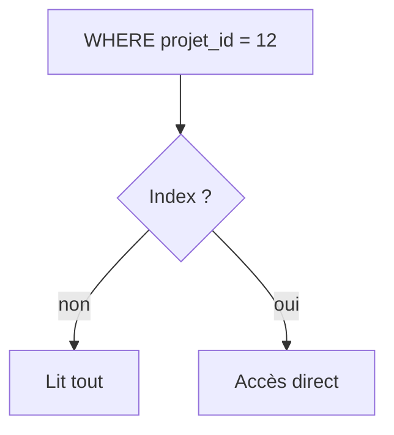

# Index de base de données

> [!info] En une phrase
> Un index est une structure annexe, comme l'index d'un livre, qui permet à la base de trouver des lignes sans lire toute la table ; il accélère les lectures mais ralentit un peu les écritures.

```dataviewjs
await dv.view("10 — Templates/Scripts/learning", { view: "concept" })
```

## 1 · Comprendre
### Définition
Sans index, `WHERE projet_id = 12` oblige la base à lire **toutes** les lignes (*seq scan*). Avec un index (un arbre trié, *B-tree*), elle va directement aux bonnes lignes.
```sql
CREATE INDEX idx_tache_projet ON tache (projet_id);
CREATE UNIQUE INDEX idx_user_email ON utilisateur (lower(email));   -- unicité, sans casse
```
- La clé primaire et les colonnes `UNIQUE` ont déjà un index.
- Utile sur les colonnes des `WHERE`, `JOIN` et `ORDER BY` fréquents.
- Chaque index prend de la place et doit être mis à jour à chaque `INSERT`/`UPDATE` : on n'en met pas partout.
- **`EXPLAIN ANALYZE`** montre comment la base exécute une requête et si elle utilise un index.

### Pourquoi ça existe
Une table de millions de lignes rend chaque recherche lente si la base doit tout parcourir.

### Le problème résolu
Passer d'une requête de plusieurs secondes à quelques millisecondes.

## 2 · Explorer
### Comment ça fonctionne


### Exemple concret
```sql
EXPLAIN ANALYZE SELECT * FROM tache WHERE projet_id = 12;
-- Seq Scan on tache  (actual time=0.01..85.3 rows=40 ...)
CREATE INDEX idx_tache_projet ON tache (projet_id);
EXPLAIN ANALYZE SELECT * FROM tache WHERE projet_id = 12;
-- Index Scan using idx_tache_projet on tache  (actual time=0.02..0.09 rows=40 ...)
```

### Cas d'utilisation
- Une page qui devient lente quand les données grossissent
- Garantir l'unicité (e-mail)
- Optimiser les jointures

> [!warning] À ne pas confondre
> Cet **index de base de données** n'a rien à voir avec l'[[Index Git (staging)]]. Et un index sur `email` ne sert pas pour `WHERE lower(email) = …` : l'expression doit correspondre.

## 3 · Pratiquer

### Exercice visuel

Sur Excalidraw, **sans regarder la fiche**. Puis je compare avec la fiche, je corrige en rouge ce qui était faux, et j'explique mon dessin avec mes mots (section 4).

> [!example] ⚖️ Avant / après
> Avant / après : chercher les dépenses d'une catégorie dans 1 million de lignes sans index, puis avec. Dessine le chemin de la base dans chaque cas.

> [!example] 🧠 Dessine de mémoire
> Dessine un index comme l'index d'un livre, posé sur la colonne `categorie`. Montre ce qu'il coûte quand on ajoute une ligne.

### Mon schéma

> [!tip] Mon dessin Excalidraw
> _Je crée le dessin « Schéma - Index de base de données » et je l'intègre ici avec `![[Schéma - Index de base de données.excalidraw]]`._

### Appliquer dans le fil rouge
- Pas encore d'étape du fil rouge pour cette notion : je l'applique dans mon travail (CVAT, Nuclio) ou je demande une étape à Claude.

## 4 · Expliquer
> [!quote] Mon résumé, avec mes mots
> _J'explique mon schéma avec mes mots, sans regarder la fiche. Si je bloque, je ne l'ai pas encore compris._

## 5 · Relier
- **Prérequis** : [[SQL]] · [[Jointure SQL]]
- **Complémentaires** : [[Clé primaire et clé étrangère]]

## 6 · Réviser
> [!question] Me faire interroger
> Je demande à Claude de m'interroger sur cette notion pour vérifier que je l'ai comprise.

### Validation de la maîtrise
La notion est maîtrisée quand je sais :
1. **l'expliquer** de façon fluide, à partir de mon schéma (section 4) ;
2. **l'adapter** à un autre contexte (consigne « Change de contexte », ou Claude m'interroge sur un autre cas) ;
3. **l'appliquer** pour de vrai dans le fil rouge (section 3).

Réussir un exercice ne suffit pas. C'est moi qui passe le statut en `maitrise`.

```dataviewjs
await dv.view("10 — Templates/Scripts/learning", { view: "maitrise" })
```
