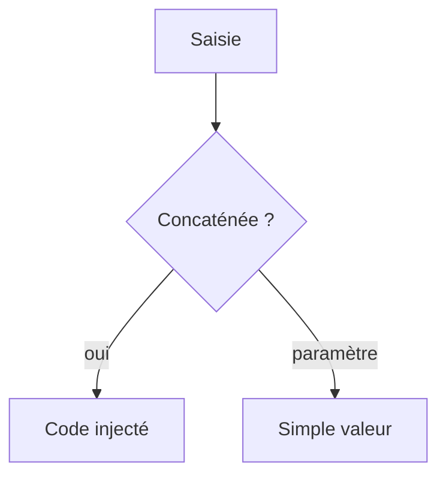

# Injection SQL

> [!info] En une phrase
> Une injection SQL arrive quand une donnée de l'utilisateur est collée dans une requête SQL : elle peut alors en changer le sens, lire ou effacer la base. On s'en protège avec des requêtes paramétrées.

```dataviewjs
await dv.view("10 — Templates/Scripts/learning", { view: "concept" })
```

## 1 · Comprendre
### Définition
Code **vulnérable** :
```js
const sql = `SELECT * FROM utilisateur WHERE email = '${req.body.email}'`;
```
Si l'attaquant envoie `' OR '1'='1`, la requête devient `… WHERE email = '' OR '1'='1'` : **tous** les utilisateurs. Avec `'; DROP TABLE utilisateur; --`, pire.
**Protection** : la **requête paramétrée** ; la valeur est envoyée **séparément** du SQL et ne peut jamais être interprétée comme du code.
```js
await db.query("SELECT * FROM utilisateur WHERE email = $1", [req.body.email]);
```
Les [[ORM]] paramètrent pour toi (sauf si tu utilises leurs fonctions « SQL brut » avec concaténation).
Le même principe vaut pour l'**injection de commande** (`subprocess` avec `shell=True` et une chaîne construite).

### Pourquoi ça existe
Le SQL mélange code et données dans une seule chaîne ; si on la construit à la main, la frontière disparaît.

### Le problème résolu
Empêcher qu'un champ de formulaire devienne une commande exécutée par ta base.

## 2 · Explorer
### Comment ça fonctionne


### Exemple concret
```python
# vulnérable
cur.execute(f"SELECT * FROM tache WHERE nom = '{nom}'")
# correct
cur.execute("SELECT * FROM tache WHERE nom = %s", (nom,))
```
Un nom de colonne ou un sens de tri ne peut pas être paramétré : on le choisit dans une **liste autorisée** (`if tri not in ("nom", "cree_le"): …`).

### Cas d'utilisation
- Toute requête qui contient une valeur venant de l'extérieur
- Revue de code
- Scripts qui lancent des commandes système

> [!warning] À ne pas confondre
> Échapper les apostrophes à la main n'est **pas** une protection fiable. Et la [[Validation des données]] aide, mais ne remplace pas la requête paramétrée.

## 3 · Pratiquer
- Écris une route vulnérable sur une base de test, exploite-la avec curl, puis corrige-la

## 4 · Expliquer
> [!quote] Mon résumé, avec mes mots
> _À écrire sans regarder la fiche. Si je bloque, je ne l'ai pas encore compris._

## 5 · Relier
- **Prérequis** : [[SQL]] · [[Validation des données]]
- **Complémentaires** : [[XSS]] · [[Lancer une commande (subprocess)]]

## 6 · Réviser
> [!question] Me faire interroger
> Je demande à Claude de m'interroger sur cette notion pour vérifier que je l'ai comprise.

### Validation de la maîtrise
La notion est maîtrisée quand j'ai réussi **tous les exercices** qui l'utilisent (statut `reussi` dans l'exercice).

```dataviewjs
await dv.view("10 — Templates/Scripts/learning", { view: "maitrise" })
```
