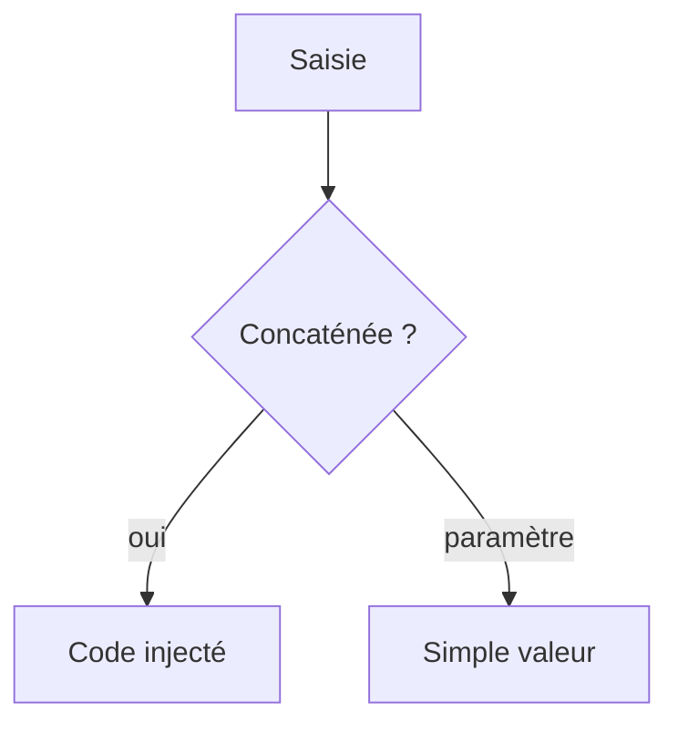

# Injection SQL

> [!info] En une phrase
> Une injection SQL arrive quand une donnée de l'utilisateur est collée dans une requête SQL : elle peut alors en changer le sens, lire ou effacer la base. On s'en protège avec des requêtes paramétrées.

```dataviewjs
await dv.view("10 — Templates/Scripts/learning", { view: "concept" })
```

## 1 · Comprendre
### Définition
Code **vulnérable** :
```js
const sql = `SELECT * FROM utilisateur WHERE email = '${req.body.email}'`;
```
Si l'attaquant envoie `' OR '1'='1`, la requête devient `… WHERE email = '' OR '1'='1'` : **tous** les utilisateurs. Avec `'; DROP TABLE utilisateur; --`, pire.
**Protection** : la **requête paramétrée** ; la valeur est envoyée **séparément** du SQL et ne peut jamais être interprétée comme du code.
```js
await db.query("SELECT * FROM utilisateur WHERE email = $1", [req.body.email]);
```
Les [[ORM]] paramètrent pour toi (sauf si tu utilises leurs fonctions « SQL brut » avec concaténation).
Le même principe vaut pour l'**injection de commande** (`subprocess` avec `shell=True` et une chaîne construite).

### Pourquoi ça existe
Le SQL mélange code et données dans une seule chaîne ; si on la construit à la main, la frontière disparaît.

### Le problème résolu
Empêcher qu'un champ de formulaire devienne une commande exécutée par ta base.

## 2 · Explorer
### Comment ça fonctionne


### Exemple concret
```python
# vulnérable
cur.execute(f"SELECT * FROM tache WHERE nom = '{nom}'")
# correct
cur.execute("SELECT * FROM tache WHERE nom = %s", (nom,))
```
Un nom de colonne ou un sens de tri ne peut pas être paramétré : on le choisit dans une **liste autorisée** (`if tri not in ("nom", "cree_le"): …`).

### Cas d'utilisation
- Toute requête qui contient une valeur venant de l'extérieur
- Revue de code
- Scripts qui lancent des commandes système

> [!warning] À ne pas confondre
> Échapper les apostrophes à la main n'est **pas** une protection fiable. Et la [[Validation des données]] aide, mais ne remplace pas la requête paramétrée.

## 3 · Pratiquer

### Exercice visuel

Sur Excalidraw, **sans regarder la fiche**. Puis je compare avec la fiche, je corrige en rouge ce qui était faux, et j'explique mon dessin à voix haute ou à Claude dans le chat.

> [!example] 🛣️ Suis le trajet
> Dessine la requête SQL construite avec le texte saisi `' OR '1'='1`. Montre où le texte devient du code.

> [!example] ⚖️ Avant / après
> Avant / après : la même recherche avec une chaîne collée, puis avec un paramètre. Dessine où va la donnée dans chaque cas.

### Mon schéma

> [!tip] Mon dessin Excalidraw
> _Je crée le dessin « Schéma - Injection SQL » et je l'intègre ici avec `![[Schéma - Injection SQL.excalidraw]]`, puis je coche `schema`._

### Appliquer dans le fil rouge
- Pas encore d'étape du fil rouge pour cette notion : elle sera pratiquée dans le fil rouge de son niveau (voir [[Niveaux]]).

## 4 · Relier
- **Prérequis** : [[SQL]] · [[Validation des données]]
- **Complémentaires** : [[XSS]] · [[Lancer une commande (subprocess)]]

## 5 · Réviser
> [!question] Me faire interroger
> Je demande à Claude de m'interroger sur cette notion pour vérifier que je l'ai comprise.

### Validation de la maîtrise
Trois cases à cocher dans les propriétés de la fiche :
- `schema` : mon dessin du concept est dans « Mon schéma » ;
- `exercice_visuel` : j'ai fait et corrigé les exercices visuels de la section 3 ;
- `fil_rouge` : je l'ai appliqué dans le fil rouge (coché tout seul quand une étape qui l'utilise est réussie).

Les trois cochées : la notion compte comme **comprise**. **Maîtrisé** : c'est moi qui le mets dans `status`, quand je le sens.

```dataviewjs
await dv.view("10 — Templates/Scripts/learning", { view: "maitrise" })
```
