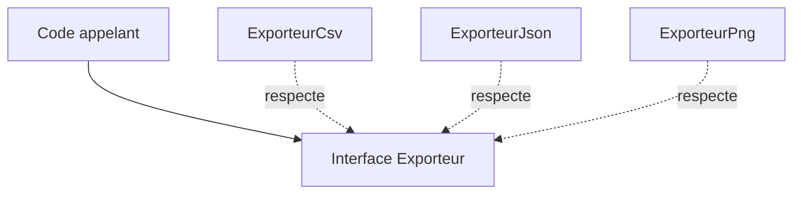

# Interface et polymorphisme

> [!info] En une phrase
> Une interface décrit ce qu'un objet sait faire sans dire comment ; le polymorphisme permet d'utiliser de la même façon des objets différents qui respectent cette interface.

```dataviewjs
await dv.view("10 — Templates/Scripts/learning", { view: "concept" })
```

## 1 · Comprendre
### Définition
**Interface** : un contrat, une liste de méthodes. « Tout exporteur a une méthode `exporter(annotations)` qui renvoie des octets. »
**Polymorphisme** (« plusieurs formes ») : le code qui utilise l'interface ne sait pas, et n'a pas besoin de savoir, quelle classe concrète il manipule.
```python
from typing import Protocol

class Exporteur(Protocol):               # l'interface (Python)
    def exporter(self, annotations: list[dict]) -> bytes: ...

class ExporteurCsv:
    def exporter(self, annotations): return "\n".join(a["label"] for a in annotations).encode()

class ExporteurJson:
    def exporter(self, annotations): return json.dumps(annotations).encode()

def sauvegarder(exp: Exporteur, annotations, chemin):   # marche avec N'IMPORTE QUEL exporteur
    Path(chemin).write_bytes(exp.exporter(annotations))
```
En TypeScript : `interface Exporteur { exporter(a: Annotation[]): Uint8Array }` et `class ExporteurCsv implements Exporteur`.
En Python, on parle aussi de **duck typing** : « si ça marche comme un canard et cancane comme un canard, c'est un canard » ; `Protocol` permet à l'éditeur de le vérifier.

### Pourquoi ça existe
Sans contrat commun, le code se remplit de `if format == "csv" … elif format == "json" …` qu'il faut modifier à chaque nouveau cas.

### Le problème résolu
Ajouter un nouveau cas (un format, une source de données, un fournisseur) en écrivant une nouvelle classe, sans toucher au code qui l'utilise. C'est le cœur de presque tous les design patterns.

## 2 · Explorer
### Comment ça fonctionne


### Exemple concret
Le même principe permet de **tester** sans la vraie API :
```python
class SourceAnnotations(Protocol):
    def annotations(self, tache_id: int) -> list[dict]: ...

class SourceCvat:                       # la vraie, en production
    def __init__(self, client): self.client = client
    def annotations(self, tache_id): return self.client.tasks.retrieve(tache_id).get_annotations()["shapes"]

class SourceFactice:                    # pour les tests
    def annotations(self, tache_id): return [{"label": "voiture", "points": [0, 0, 10, 10]}]
```
Ta fonction Nuclio peut recevoir l'une ou l'autre : elle ne voit que l'interface.

### Cas d'utilisation
- Injection de dépendances (Angular, NestJS)
- Tests avec des doublures
- Brancher plusieurs fournisseurs (stockage local ou S3, CVAT ou fichier)

> [!warning] À ne pas confondre
> Une **interface** (le contrat, sans code) n'est pas une **classe parent** (qui contient du code partagé). Et créer une interface pour une seule implémentation qui n'en aura jamais d'autre : c'est du travail pour rien (YAGNI).

## 3 · Pratiquer
- Écris une interface `Notifieur` (`envoyer(message)`) avec deux implémentations (console et fichier) et une fonction qui fonctionne avec les deux

## 4 · Expliquer
> [!quote] Mon résumé, avec mes mots
> _À écrire sans regarder la fiche. Si je bloque, je ne l'ai pas encore compris._

## 5 · Relier
- **Prérequis** : [[Héritage et composition]] · [[Type et interface TypeScript]]
- **Complémentaires** : [[Principes SOLID]] · [[Doublure de test (mock)]]

## 6 · Réviser
> [!question] Me faire interroger
> Je demande à Claude de m'interroger sur cette notion pour vérifier que je l'ai comprise.

### Validation de la maîtrise
La notion est maîtrisée quand j'ai réussi **tous les exercices** qui l'utilisent (statut `reussi` dans l'exercice).

```dataviewjs
await dv.view("10 — Templates/Scripts/learning", { view: "maitrise" })
```
