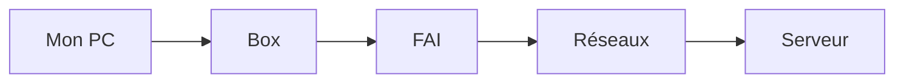

# Internet

> [!info] En une phrase
> Un immense réseau de réseaux qui permet à des machines du monde entier d'échanger des données.

```dataviewjs
await dv.view("10 — Templates/Scripts/learning", { view: "concept" })
```

## 1 · Comprendre
### Définition
Internet est l'interconnexion de millions de réseaux informatiques. Chaque machine connectée a une **adresse IP** ; les données voyagent découpées en **paquets** qui passent de routeur en routeur jusqu'à leur destination.

### Pourquoi ça existe
Permettre à des ordinateurs éloignés, de constructeurs différents, de communiquer avec des règles communes (les protocoles, comme TCP/IP).

## 2 · Explorer
### Comment ça fonctionne

- **IP** : adresse d'une machine.
- **DNS** : traduit un nom (`github.com`) en adresse IP.
- **TCP** : garantit que les paquets arrivent complets et dans l'ordre.

> [!warning] À ne pas confondre
> **Internet** (le réseau) et **le Web** (un service qui fonctionne *sur* Internet, avec HTTP et des pages). L'e-mail ou les jeux en ligne utilisent Internet sans être « le Web ».

## 3 · Pratiquer

### Exercice visuel

Sur Excalidraw, **sans regarder la fiche**. Puis je compare avec la fiche, je corrige en rouge ce qui était faux, et j'explique mon dessin à voix haute ou à Claude dans le chat.

> [!example] 🛣️ Suis le trajet
> Dessine le chemin d'une requête de ton PC jusqu'à un site sur Internet : ton PC, ta box ou le réseau local, Internet, le serveur.

> [!example] ⚖️ Avant / après
> Avant / après : un réseau local seul (3 PC chez toi), puis ce même réseau relié à Internet. Dessine ce qui a été ajouté entre les deux.

### Mon schéma

> [!tip] Mon dessin Excalidraw
> _Je crée le dessin « Schéma - Internet » et je l'intègre ici avec `![[Schéma - Internet.excalidraw]]`, puis je coche `schema`._

### Appliquer dans le fil rouge
- Pas encore d'étape du fil rouge pour cette notion : elle sera pratiquée dans le fil rouge de son niveau (voir [[Niveaux]]).

## 4 · Relier
- **Mène à** : [[Client-serveur]], puis [[HTTP]]
- **Cours** : [[Cours - Comment fonctionne le web]]

## 5 · Réviser
> [!question] Me faire interroger
> Je demande à Claude de m'interroger sur cette notion pour vérifier que je l'ai comprise.

### Validation de la maîtrise
Trois cases à cocher dans les propriétés de la fiche :
- `schema` : mon dessin du concept est dans « Mon schéma » ;
- `exercice_visuel` : j'ai fait et corrigé les exercices visuels de la section 3 ;
- `fil_rouge` : je l'ai appliqué dans le fil rouge (coché tout seul quand une étape qui l'utilise est réussie).

Les trois cochées : la notion compte comme **comprise**. **Maîtrisé** : c'est moi qui le mets dans `status`, quand je le sens.

```dataviewjs
await dv.view("10 — Templates/Scripts/learning", { view: "maitrise" })
```
