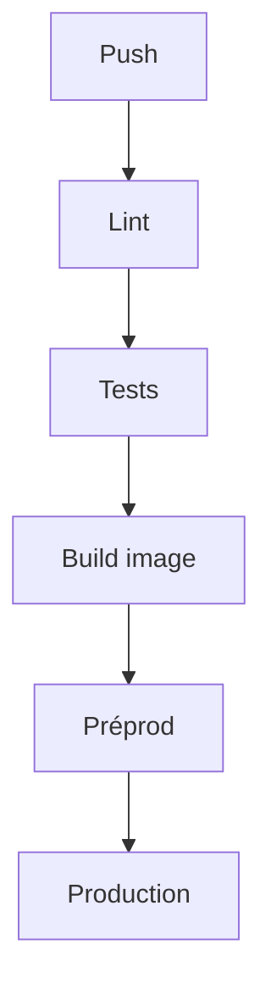

# Intégration et déploiement continus (CI-CD)

> [!info] En une phrase
> L'intégration continue vérifie automatiquement chaque modification (build, lint, tests) ; le déploiement continu la met ensuite en ligne automatiquement si tout est vert.

```dataviewjs
await dv.view("10 — Templates/Scripts/learning", { view: "concept" })
```

## 1 · Comprendre
### Définition
- **CI** (*Continuous Integration*) : à chaque push ou merge request, une [[Pipeline GitLab CI|pipeline]] construit le projet et lance les vérifications. On fusionne souvent, par petits morceaux.
- **CD** : *Continuous Delivery* (l'application est **prête** à être livrée, la mise en production se fait d'un clic) ou *Continuous Deployment* (elle part **automatiquement** en production).
Étapes typiques :
1. **lint** et formatage ([[Linter et formateur]]) ;
2. **tests** unitaires et d'intégration ;
3. **build** de l'image Docker, poussée dans un registre ([[Nexus]]) ;
4. **déploiement** en préproduction, tests de bout en bout ;
5. **déploiement** en production (souvent manuel : `when: manual`).

### Pourquoi ça existe
Intégrer à la main, rarement, de grosses modifications donne des fusions douloureuses et des mises en production risquées.

### Le problème résolu
Des livraisons petites, fréquentes, vérifiées et reproductibles ; un problème est détecté minutes après le commit.

## 2 · Explorer
### Comment ça fonctionne


### Exemple concret
```yaml
stages: [verifier, construire, deployer]
lint:   { stage: verifier, image: node:22, script: [npm ci, npm run lint] }
tests:  { stage: verifier, image: node:22, script: [npm ci, npm test] }
image:  { stage: construire, extends: .kaniko, rules: [{ if: $CI_COMMIT_BRANCH == $CI_DEFAULT_BRANCH }] }
preprod:
  stage: deployer
  environment: { name: preprod, url: https://preprod.exemple.com }
  script: [./deployer.sh preprod $CI_COMMIT_SHORT_SHA]
prod:
  stage: deployer
  environment: { name: production }
  when: manual
  script: [./deployer.sh prod $CI_COMMIT_SHORT_SHA]
```

### Cas d'utilisation
- Ta pipeline CVAT + Nexus
- Tout projet d'équipe
- Livrer une correction en quelques minutes

> [!warning] À ne pas confondre
> La **CI** (vérifier) et la **CD** (livrer) : beaucoup d'équipes ont une CI sans déploiement automatique, et c'est très bien. Et une pipeline lente (30 minutes) n'est plus utilisée : garde-la rapide (cache, jobs en parallèle).

## 3 · Pratiquer
- Dessine la pipeline idéale de ton projet CVAT, étape par étape, et ce qui doit bloquer la suite

## 4 · Expliquer
> [!quote] Mon résumé, avec mes mots
> _À écrire sans regarder la fiche. Si je bloque, je ne l'ai pas encore compris._

## 5 · Relier
- **Prérequis** : [[Pipeline GitLab CI]] · [[Test automatisé]]
- **Complémentaires** : [[Environnement de déploiement]] · [[Construire une image dans la CI]]
- **Utilisé par** : [[Supervision et observabilité]]

## 6 · Réviser
> [!question] Me faire interroger
> Je demande à Claude de m'interroger sur cette notion pour vérifier que je l'ai comprise.

### Validation de la maîtrise
La notion est maîtrisée quand j'ai réussi **tous les exercices** qui l'utilisent (statut `reussi` dans l'exercice).

```dataviewjs
await dv.view("10 — Templates/Scripts/learning", { view: "maitrise" })
```
