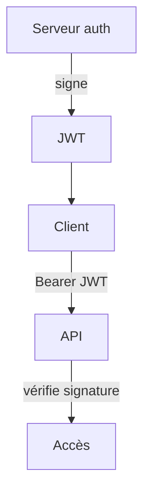

# JWT

> [!info] En une phrase
> Un JWT est un jeton signé qui contient des informations (qui tu es, jusqu'à quand) ; le serveur vérifie la signature au lieu de chercher une session en base.

```dataviewjs
await dv.view("10 — Templates/Scripts/learning", { view: "concept" })
```

## 1 · Comprendre
### Définition
**JWT** (*JSON Web Token*) : trois parties en Base64URL séparées par des points : `en-tête.contenu.signature`.
```json
// en-tête              // contenu (claims)
{ "alg": "HS256" }      { "sub": "42", "role": "admin", "exp": 1767225600 }
```
- La **signature** est calculée avec une clé secrète (HS256) ou une clé privée (RS256). Modifier le contenu casse la signature.
- Le contenu est **lisible par tous** (encodé, pas chiffré) : jamais de secret dedans.
- `exp` (expiration), `sub` (sujet, l'utilisateur), `iat` (émis le), `iss` (émetteur), `aud` (destinataire).
- Envoyé dans `Authorization: Bearer <jwt>`.
- Durée courte (5 à 15 min) + **jeton de rafraîchissement** (*refresh token*) pour en obtenir un nouveau.

### Pourquoi ça existe
Avec plusieurs serveurs ou services, partager une base de sessions est lourd ; un jeton vérifiable partout est plus simple.

### Le problème résolu
Authentifier des appels d'API sans état côté serveur, y compris entre services.

## 2 · Explorer
### Comment ça fonctionne


### Exemple concret
```js
import jwt from "jsonwebtoken";
const jeton = jwt.sign({ sub: "42", role: "annotateur" }, process.env.JWT_SECRET, { expiresIn: "15m" });
function exigerAuth(req, res, next) {
  const [, j] = (req.headers.authorization ?? "").split(" ");
  try { req.user = jwt.verify(j, process.env.JWT_SECRET); next(); }
  catch { res.status(401).json({ erreur: "Jeton invalide ou expiré" }); }
}
```
Pour lire un jeton : jwt.io (seulement avec des jetons de test, jamais un vrai).

### Cas d'utilisation
- API appelées par une application mobile ou un frontend séparé
- Communication entre microservices
- Le `id_token` d'OpenID Connect

> [!warning] À ne pas confondre
> **Décoder** (n'importe qui peut lire) et **vérifier** (contrôler la signature et `exp`) : n'utilise jamais `jwt.decode` pour authentifier. Et un JWT volé reste valable jusqu'à son expiration.

## 3 · Pratiquer
- Crée un JWT, décode-le sur jwt.io, modifie un caractère du contenu et vérifie que `jwt.verify` le refuse

## 4 · Expliquer
> [!quote] Mon résumé, avec mes mots
> _À écrire sans regarder la fiche. Si je bloque, je ne l'ai pas encore compris._

## 5 · Relier
- **Prérequis** : [[Authentification]] · [[JSON]]
- **Complémentaires** : [[Session et cookie]] · [[OAuth 2 et OpenID Connect]]

## 6 · Réviser
> [!question] Me faire interroger
> Je demande à Claude de m'interroger sur cette notion pour vérifier que je l'ai comprise.

### Validation de la maîtrise
La notion est maîtrisée quand j'ai réussi **tous les exercices** qui l'utilisent (statut `reussi` dans l'exercice).

```dataviewjs
await dv.view("10 — Templates/Scripts/learning", { view: "maitrise" })
```
