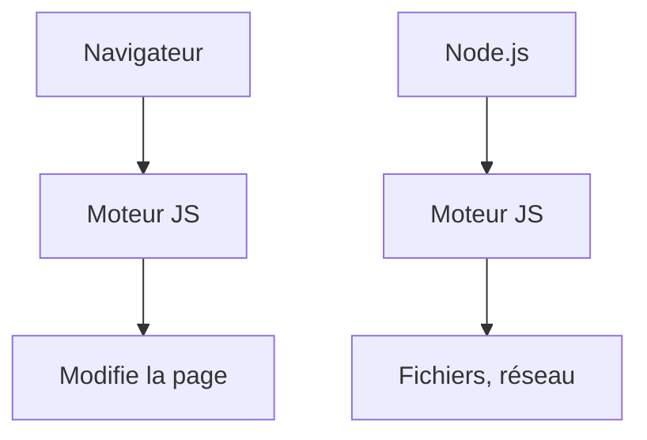

# JavaScript

> [!info] En une phrase
> Le langage de programmation du navigateur, qui tourne aussi côté serveur avec Node.js : il rend les pages interactives.

```dataviewjs
await dv.view("10 — Templates/Scripts/learning", { view: "concept" })
```

## 1 · Comprendre
### Définition
**JavaScript** (JS) est un langage de programmation **interprété**, à typage **dynamique**. Le navigateur l'exécute dans la page ; [[Node.js]] l'exécute en dehors du navigateur (serveurs, outils). Il n'a rien à voir avec Java malgré le nom.

Dans une page : le [[HTML]] donne la structure, le [[CSS]] l'apparence, et JavaScript le **comportement** (réagir à un clic, appeler une API, modifier la page).

### Pourquoi ça existe
Les premières pages web étaient figées. JavaScript a été créé pour qu'une page puisse réagir sans recharger.

### Le problème résolu
Faire des interfaces vivantes (formulaires qui se valident, listes qui se filtrent, données chargées à la demande) et, avec Node.js, utiliser un seul langage côté client et serveur.

## 2 · Explorer
### Comment ça fonctionne


### Exemple concret
```html
<button id="btn">Compter</button>
<p id="sortie">0</p>
<script>
  let n = 0;
  document.querySelector("#btn").addEventListener("click", () => {
    n = n + 1;
    document.querySelector("#sortie").textContent = n;
  });
</script>
```
Pour tester sans page : ouvre la **console** du navigateur (F12, onglet Console) et tape `2 + 3`, ou lance `node` dans le terminal.

### Cas d'utilisation
- Le bouton à ajouter dans CVAT (React est du JavaScript)
- Les scripts `npm` et les outils de build
- Les API avec Express sur Node.js

> [!warning] À ne pas confondre
> **JavaScript** et **Java** (deux langages sans rapport). Et **JavaScript** et [[TypeScript]] : TypeScript est du JavaScript avec des types, compilé en JavaScript.

## 3 · Pratiquer
- Ouvre la console du navigateur et fais quelques calculs, puis `console.log("bonjour")`
- Écris un fichier `essai.js` et lance-le avec `node essai.js`

## 4 · Expliquer
> [!quote] Mon résumé, avec mes mots
> _À écrire sans regarder la fiche. Si je bloque, je ne l'ai pas encore compris._

## 5 · Relier
- **Prérequis** : [[HTML]] · [[Fonction]]
- **Complémentaires** : [[Node.js]] · [[DOM]]
- **Utilisé par** : [[TypeScript]] · [[React]]

## 6 · Réviser
> [!question] Me faire interroger
> Je demande à Claude de m'interroger sur cette notion pour vérifier que je l'ai comprise.

### Validation de la maîtrise
La notion est maîtrisée quand j'ai réussi **tous les exercices** qui l'utilisent (statut `reussi` dans l'exercice).

```dataviewjs
await dv.view("10 — Templates/Scripts/learning", { view: "maitrise" })
```
