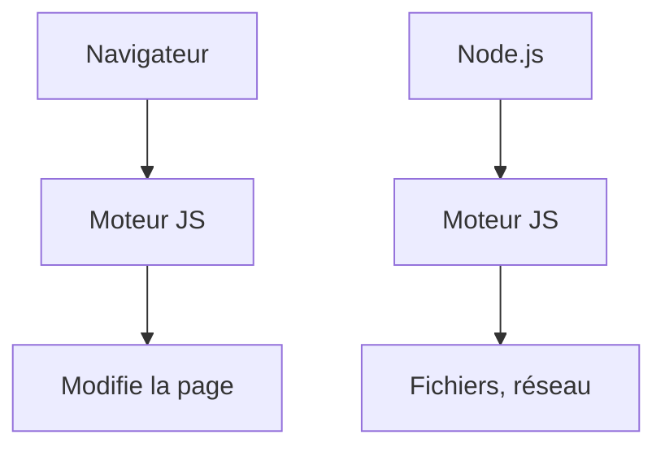

# JavaScript

> [!info] En une phrase
> Le langage de programmation du navigateur, qui tourne aussi côté serveur avec Node.js : il rend les pages interactives.

```dataviewjs
await dv.view("10 — Templates/Scripts/learning", { view: "concept" })
```

## 1 · Comprendre
### Définition
**JavaScript** (JS) est un langage de programmation **interprété**, à typage **dynamique**. Le navigateur l'exécute dans la page ; [[Node.js]] l'exécute en dehors du navigateur (serveurs, outils). Il n'a rien à voir avec Java malgré le nom.

Dans une page : le [[HTML]] donne la structure, le [[CSS]] l'apparence, et JavaScript le **comportement** (réagir à un clic, appeler une API, modifier la page).

### Pourquoi ça existe
Les premières pages web étaient figées. JavaScript a été créé pour qu'une page puisse réagir sans recharger.

### Le problème résolu
Faire des interfaces vivantes (formulaires qui se valident, listes qui se filtrent, données chargées à la demande) et, avec Node.js, utiliser un seul langage côté client et serveur.

## 2 · Explorer
### Comment ça fonctionne


### Exemple concret
```html
<button id="btn">Compter</button>
<p id="sortie">0</p>
<script>
  let n = 0;
  document.querySelector("#btn").addEventListener("click", () => {
    n = n + 1;
    document.querySelector("#sortie").textContent = n;
  });
</script>
```
Pour tester sans page : ouvre la **console** du navigateur (F12, onglet Console) et tape `2 + 3`, ou lance `node` dans le terminal.

### Cas d'utilisation
- Les scripts `npm` et les outils de build
- Les API avec Express sur Node.js

> [!warning] À ne pas confondre
> **JavaScript** et **Java** (deux langages sans rapport). Et **JavaScript** et [[TypeScript]] : TypeScript est du JavaScript avec des types, compilé en JavaScript.

## 3 · Pratiquer

### Exercice visuel

Sur Excalidraw, **sans regarder la fiche**. Puis je compare avec la fiche, je corrige en rouge ce qui était faux, et j'explique mon dessin à voix haute ou à Claude dans le chat.

> [!example] 🧠 Dessine de mémoire
> Dessine où tourne JavaScript : dans le navigateur (avec le DOM) et dans Node (avec les fichiers). Place ce que chacun peut et ne peut pas faire.

> [!example] 🔄 Change de contexte
> Redessine ce schéma pour une extension de navigateur ou un plugin d'une appli web : où tourne son code, et à quoi a-t-il accès ?

### Mon schéma

> [!tip] Mon dessin Excalidraw
> _Je crée le dessin « Schéma - JavaScript » et je l'intègre ici avec `![[Schéma - JavaScript.excalidraw]]`, puis je coche `schema`._

### Appliquer dans le fil rouge
- Pas encore d'étape du fil rouge pour cette notion : elle sera pratiquée dans le fil rouge de son niveau (voir [[Niveaux]]).

## 4 · Relier
- **Au travail** : [JavaScript au travail](obsidian://open?vault=Travail&file=JavaScript%20au%20travail)
- **Prérequis** : [[HTML]] · [[Fonction]]
- **Complémentaires** : [[Node.js]] · [[DOM]]
- **Utilisé par** : [[TypeScript]] · [[React]]

## 5 · Réviser
> [!question] Me faire interroger
> Je demande à Claude de m'interroger sur cette notion pour vérifier que je l'ai comprise.

### Validation (compris, puis maîtrisé)
Trois cases à cocher dans les propriétés de la fiche :
- `schema` : mon dessin du concept est dans « Mon schéma » ;
- `exercice_visuel` : j'ai fait et corrigé les exercices visuels de la section 3 ;
- `fil_rouge` : je l'ai appliqué dans le fil rouge (coché tout seul quand une étape qui l'utilise est réussie).

Les trois cochées : la notion compte comme **comprise**. **Maîtrisé** : c'est moi qui le mets dans `status`, quand je le sens.

```dataviewjs
await dv.view("10 — Templates/Scripts/learning", { view: "maitrise" })
```
