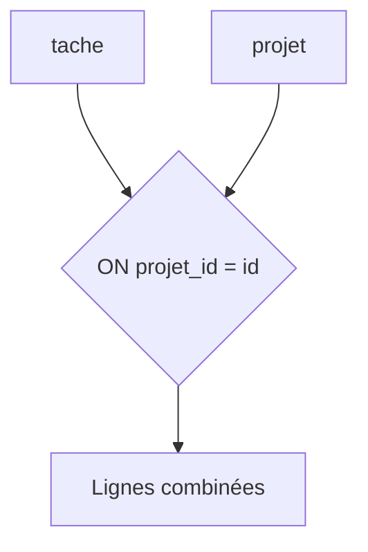

# Jointure SQL

> [!info] En une phrase
> Une jointure (JOIN) combine les lignes de plusieurs tables en les associant par une colonne commune, en général une clé étrangère.

```dataviewjs
await dv.view("10 — Templates/Scripts/learning", { view: "concept" })
```

## 1 · Comprendre
### Définition
```sql
SELECT t.nom AS tache, p.nom AS projet
FROM tache t
JOIN projet p ON p.id = t.projet_id;
```
| Jointure | Garde |
| --- | --- |
| `INNER JOIN` (ou `JOIN`) | seulement les lignes qui ont une correspondance des deux côtés |
| `LEFT JOIN` | toutes les lignes de gauche, avec `NULL` à droite s'il n'y a pas de correspondance |
| `RIGHT JOIN` | l'inverse (rare) |
| `FULL JOIN` | tout, des deux côtés |
On combine souvent avec `GROUP BY` et des fonctions d'agrégat (`COUNT`, `SUM`, `AVG`).

### Pourquoi ça existe
Les données sont séparées dans plusieurs tables ; pour répondre à une question réelle (« combien de tâches par projet ? »), il faut les réunir.

### Le problème résolu
Obtenir en une seule requête ce qui demanderait sinon plusieurs allers-retours et du code.

## 2 · Explorer
### Comment ça fonctionne


### Exemple concret
```sql
-- nombre de tâches par projet, y compris les projets vides
SELECT p.nom, COUNT(t.id) AS nb_taches
FROM projet p
LEFT JOIN tache t ON t.projet_id = p.id
GROUP BY p.nom
ORDER BY nb_taches DESC;
```

### Cas d'utilisation
- Afficher une liste avec des informations de plusieurs tables
- Statistiques (comptes, sommes)
- Trouver ce qui n'a pas de correspondance (`LEFT JOIN … WHERE t.id IS NULL`)

> [!warning] À ne pas confondre
> `INNER JOIN` fait **disparaître** les projets sans tâche ; pour les garder, `LEFT JOIN`. Et `COUNT(*)` compte aussi la ligne `NULL` d'un `LEFT JOIN` : utilise `COUNT(t.id)`.

## 3 · Pratiquer
- Écris la requête qui liste les projets sans aucune tâche

## 4 · Expliquer
> [!quote] Mon résumé, avec mes mots
> _À écrire sans regarder la fiche. Si je bloque, je ne l'ai pas encore compris._

## 5 · Relier
- **Prérequis** : [[Clé primaire et clé étrangère]] · [[SQL]]
- **Complémentaires** : [[Index de base de données]]

## 6 · Réviser
> [!question] Me faire interroger
> Je demande à Claude de m'interroger sur cette notion pour vérifier que je l'ai comprise.

### Validation de la maîtrise
La notion est maîtrisée quand j'ai réussi **tous les exercices** qui l'utilisent (statut `reussi` dans l'exercice).

```dataviewjs
await dv.view("10 — Templates/Scripts/learning", { view: "maitrise" })
```
