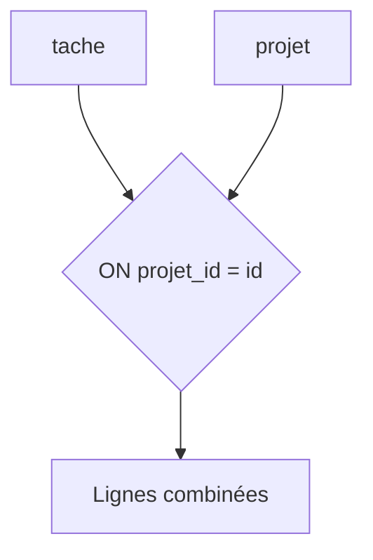

# Jointure SQL

> [!info] En une phrase
> Une jointure (JOIN) combine les lignes de plusieurs tables en les associant par une colonne commune, en général une clé étrangère.

```dataviewjs
await dv.view("10 — Templates/Scripts/learning", { view: "concept" })
```

## 1 · Comprendre
### Définition
```sql
SELECT t.nom AS tache, p.nom AS projet
FROM tache t
JOIN projet p ON p.id = t.projet_id;
```
| Jointure | Garde |
| --- | --- |
| `INNER JOIN` (ou `JOIN`) | seulement les lignes qui ont une correspondance des deux côtés |
| `LEFT JOIN` | toutes les lignes de gauche, avec `NULL` à droite s'il n'y a pas de correspondance |
| `RIGHT JOIN` | l'inverse (rare) |
| `FULL JOIN` | tout, des deux côtés |
On combine souvent avec `GROUP BY` et des fonctions d'agrégat (`COUNT`, `SUM`, `AVG`).

### Pourquoi ça existe
Les données sont séparées dans plusieurs tables ; pour répondre à une question réelle (« combien de tâches par projet ? »), il faut les réunir.

### Le problème résolu
Obtenir en une seule requête ce qui demanderait sinon plusieurs allers-retours et du code.

## 2 · Explorer
### Comment ça fonctionne


### Exemple concret
```sql
-- nombre de tâches par projet, y compris les projets vides
SELECT p.nom, COUNT(t.id) AS nb_taches
FROM projet p
LEFT JOIN tache t ON t.projet_id = p.id
GROUP BY p.nom
ORDER BY nb_taches DESC;
```

### Cas d'utilisation
- Afficher une liste avec des informations de plusieurs tables
- Statistiques (comptes, sommes)
- Trouver ce qui n'a pas de correspondance (`LEFT JOIN … WHERE t.id IS NULL`)

> [!warning] À ne pas confondre
> `INNER JOIN` fait **disparaître** les projets sans tâche ; pour les garder, `LEFT JOIN`. Et `COUNT(*)` compte aussi la ligne `NULL` d'un `LEFT JOIN` : utilise `COUNT(t.id)`.

## 3 · Pratiquer

### Exercice visuel

Sur Excalidraw, **sans regarder la fiche**. Puis je compare avec la fiche, je corrige en rouge ce qui était faux, et j'explique mon dessin à voix haute ou à Claude dans le chat.

> [!example] 🛣️ Suis le trajet
> Dessine `depenses JOIN categories` : prends trois lignes de chaque table et trace comment elles s'associent pour former le résultat.

> [!example] 🔄 Change de contexte
> Redessine le même résultat avec un LEFT JOIN quand une catégorie n'a aucune dépense. Qu'est-ce qui apparaît en plus ?

### Mon schéma

> [!tip] Mon dessin Excalidraw
> _Je crée le dessin « Schéma - Jointure SQL » et je l'intègre ici avec `![[Schéma - Jointure SQL.excalidraw]]`, puis je coche `schema`._

### Appliquer dans le fil rouge
- Pas encore d'étape du fil rouge pour cette notion : elle sera pratiquée dans le fil rouge de son niveau (voir [[Niveaux]]).

## 4 · Relier
- **Prérequis** : [[Clé primaire et clé étrangère]] · [[SQL]]
- **Complémentaires** : [[Index de base de données]]

## 5 · Réviser
> [!question] Me faire interroger
> Je demande à Claude de m'interroger sur cette notion pour vérifier que je l'ai comprise.

### Validation (compris, puis maîtrisé)
Trois cases à cocher dans les propriétés de la fiche :
- `schema` : mon dessin du concept est dans « Mon schéma » ;
- `exercice_visuel` : j'ai fait et corrigé les exercices visuels de la section 3 ;
- `fil_rouge` : je l'ai appliqué dans le fil rouge (coché tout seul quand une étape qui l'utilise est réussie).

Les trois cochées : la notion compte comme **comprise**. **Maîtrisé** : c'est moi qui le mets dans `status`, quand je le sens.

```dataviewjs
await dv.view("10 — Templates/Scripts/learning", { view: "maitrise" })
```
