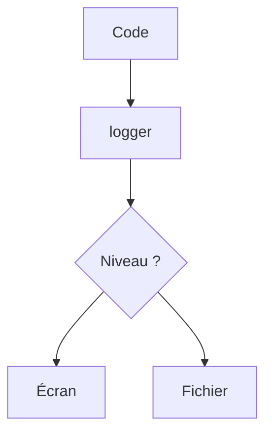

# Journaliser avec logging

> [!info] En une phrase
> Le module logging remplace les print de débogage par des messages datés, avec un niveau (INFO, WARNING, ERROR) qu'on peut filtrer et envoyer vers un fichier.

```dataviewjs
await dv.view("10 — Templates/Scripts/learning", { view: "concept" })
```

## 1 · Comprendre
### Définition
Un **journal** (*log*) raconte ce que fait le programme. `logging` ajoute à chaque message une date, un **niveau** et sa source. On règle une fois le niveau minimum affiché et la destination (écran, fichier).

| Niveau | Pour |
| --- | --- |
| `DEBUG` | détails pour déboguer |
| `INFO` | étapes normales (« 12 fichiers zippés ») |
| `WARNING` | anormal mais pas bloquant |
| `ERROR` | une opération a échoué |
| `CRITICAL` | le programme ne peut pas continuer |

### Pourquoi ça existe
Comprendre après coup ce qui s'est passé, surtout quand le script tourne sans toi (Docker, CI, serveur).

### Le problème résolu
Des `print` partout, qu'on ajoute et retire à la main, sans date ni gravité, impossibles à filtrer.

## 2 · Explorer
### Comment ça fonctionne


### Exemple concret
```python
import logging, os

logging.basicConfig(
    level=os.environ.get("NIVEAU_LOG", "INFO"),
    format="%(asctime)s %(levelname)s %(message)s",
)
log = logging.getLogger(__name__)

log.debug("affiché seulement si NIVEAU_LOG=DEBUG")
log.info("Début du traitement de %s", "photos")
log.warning("Fichier vide ignoré : %s", "c.png")
try:
    1 / 0
except ZeroDivisionError:
    log.exception("Échec du calcul")      # ERROR + le traceback
```
```text
2026-11-06 21:50:01,123 INFO Début du traitement de photos
```

### Cas d'utilisation
- Les logs d'un conteneur (`docker logs`) ou d'un job de CI
- Un script lancé chaque nuit : écrire aussi dans un fichier (`filename="script.log"`)

> [!warning] À ne pas confondre
> `print` (sortie du programme, pour l'utilisateur) et `logging` (journal, sur stderr par défaut). Et ne journalise jamais un mot de passe ou un jeton.

## 3 · Pratiquer
- Remplace tous les `print` de débogage d'un de tes scripts par `logging`, et règle le niveau avec une variable d'environnement.

## 4 · Expliquer
> [!quote] Mon résumé, avec mes mots
> _À écrire sans regarder la fiche. Si je bloque, je ne l'ai pas encore compris._

## 5 · Relier
- **Prérequis** : [[Module et import Python]] · [[Variable d'environnement]]
- **Complémentaires** : [[Exception]] · [[Redirection et pipe]]

## 6 · Réviser
> [!question] Me faire interroger
> Je demande à Claude de m'interroger sur cette notion pour vérifier que je l'ai comprise.

### Validation de la maîtrise
La notion est maîtrisée quand j'ai réussi **tous les exercices** qui l'utilisent (statut `reussi` dans l'exercice).

```dataviewjs
await dv.view("10 — Templates/Scripts/learning", { view: "maitrise" })
```
