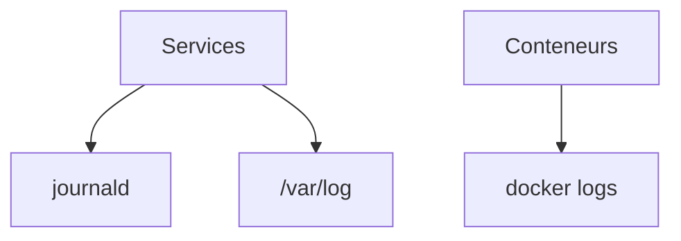

# Journaux système

> [!info] En une phrase
> Les fichiers et le journal où le système et les services écrivent ce qu'ils font : la première chose à lire quand quelque chose ne marche pas.

```dataviewjs
await dv.view("10 — Templates/Scripts/learning", { view: "concept" })
```

## 1 · Comprendre
### Définition
Deux endroits principaux :
- **journald** (systemd) : un journal central, lu avec `journalctl` ;
- **`/var/log/`** : des fichiers texte (`syslog`, `auth.log` pour les connexions, `nginx/error.log`…).
Les conteneurs, eux, ont leurs logs dans Docker (`docker logs`).

### Pourquoi ça existe
Comprendre après coup pourquoi un service a planté, qui s'est connecté, ce qui a changé.

### Le problème résolu
Deviner la cause d'une panne sans aucune trace.

## 2 · Explorer
### Comment ça fonctionne


### Exemple concret
```bash
journalctl -u docker --since "1 hour ago"    # un service, depuis une heure
journalctl -u nginx -f                        # suivre en direct
journalctl -p err -b                          # erreurs depuis le démarrage
sudo tail -f /var/log/auth.log                # connexions SSH
docker logs --tail 100 -f cvat_server
```
Méthode : partir de l'heure du problème, chercher la **première** erreur, pas la dernière.

### Cas d'utilisation
- Un service qui ne démarre pas : `systemctl status` puis `journalctl -u`
- Voir les tentatives de connexion SSH

> [!warning] À ne pas confondre
> Les logs **du système** (journalctl, /var/log) et ceux **d'un conteneur** (`docker logs`) : un conteneur n'écrit pas dans journald par défaut.

## 3 · Pratiquer

### Exercice visuel

Sur Excalidraw, **sans regarder la fiche**. Puis je compare avec la fiche, je corrige en rouge ce qui était faux, et j'explique mon dessin à voix haute ou à Claude dans le chat.

> [!example] 🛣️ Suis le trajet
> Dessine où un service écrit ses messages et comment tu les retrouves : `/var/log`, `journalctl`, `docker logs`.

> [!example] 🔄 Change de contexte
> Un conteneur plante au démarrage. Redessine le chemin pour retrouver son message d'erreur. Où regardes-tu en premier ?

### Mon schéma

> [!tip] Mon dessin Excalidraw
> _Je crée le dessin « Schéma - Journaux système » et je l'intègre ici avec `![[Schéma - Journaux système.excalidraw]]`, puis je coche `schema`._

### Appliquer dans le fil rouge
- Pas encore d'étape du fil rouge pour cette notion : elle sera pratiquée dans le fil rouge de son niveau (voir [[Niveaux]]).

## 4 · Relier
- **Prérequis** : [[Service (systemd)]] · [[Arborescence Linux]]
- **Complémentaires** : [[Journaliser avec logging]] · [[Redirection et pipe]]
- **Commandes** : [[journalctl]] · [[tail]] · [[less]]

## 5 · Réviser
> [!question] Me faire interroger
> Je demande à Claude de m'interroger sur cette notion pour vérifier que je l'ai comprise.

### Validation de la maîtrise
Trois cases à cocher dans les propriétés de la fiche :
- `schema` : mon dessin du concept est dans « Mon schéma » ;
- `exercice_visuel` : j'ai fait et corrigé les exercices visuels de la section 3 ;
- `fil_rouge` : je l'ai appliqué dans le fil rouge (coché tout seul quand une étape qui l'utilise est réussie).

Les trois cochées : la notion compte comme **comprise**. **Maîtrisé** : c'est moi qui le mets dans `status`, quand je le sens.

```dataviewjs
await dv.view("10 — Templates/Scripts/learning", { view: "maitrise" })
```
