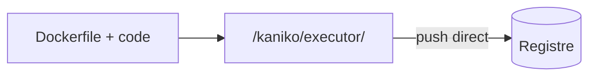

# Kaniko

> [!info] En une phrase
> Un outil qui construit une image à partir d'un Dockerfile sans démon Docker : l'alternative à Docker-in-Docker quand le runner n'est pas privilégié.

```dataviewjs
await dv.view("10 — Templates/Scripts/learning", { view: "concept" })
```

## 1 · Comprendre
### Définition
**Kaniko** lit le [[Dockerfile]], exécute chaque instruction dans son propre conteneur et pousse le résultat dans le registre. Une seule commande : `/kaniko/executor`.

### Pourquoi ça existe
Construire des images dans une CI où l'on n'a pas le droit de lancer Docker (fréquent en entreprise et sur Kubernetes).

### Le problème résolu
Sans runner privilégié, Docker-in-Docker est impossible, donc pas de build d'image du tout.

## 2 · Explorer
### Comment ça fonctionne


### Exemple concret
```yaml
build-image:
  image:
    name: gcr.io/kaniko-project/executor:debug   # la variante debug a un shell, nécessaire à GitLab
    entrypoint: [""]
  script:
    - /kaniko/executor
      --context "$CI_PROJECT_DIR"
      --dockerfile "$CI_PROJECT_DIR/Dockerfile"
      --destination "$CI_REGISTRY_IMAGE:$CI_COMMIT_SHORT_SHA"
```

| | Docker-in-Docker | Kaniko |
| --- | --- | --- |
| Runner privilégié | oui | non |
| Connexion au registre | `docker login` | fichier `/kaniko/.docker/config.json` |
| Variables de build | `--build-arg` | `--build-arg` |

### Cas d'utilisation
- Construire une image sur un runner non privilégié

> [!warning] À ne pas confondre
> Kaniko **ne lance pas** de conteneurs : il ne sert qu'à construire et pousser. Pour exécuter l'image, il faut Docker ailleurs.

## 3 · Pratiquer

### Exercice visuel

Sur Excalidraw, **sans regarder la fiche**. Puis je compare avec la fiche, je corrige en rouge ce qui était faux, et j'explique mon dessin à voix haute ou à Claude dans le chat.

> [!example] ⚖️ Avant / après
> Avant / après : un build avec Docker-in-Docker, puis avec Kaniko. Dessine qui lit le Dockerfile et qui pousse l'image.

> [!example] 🔄 Change de contexte
> Redessine-le derrière un proxy, sans accès direct à Docker Hub : d'où vient l'image de base et où part l'image finale ?

### Mon schéma

> [!tip] Mon dessin Excalidraw
> _Je crée le dessin « Schéma - Kaniko » et je l'intègre ici avec `![[Schéma - Kaniko.excalidraw]]`, puis je coche `schema`._

### Appliquer dans le fil rouge
- [[Fil rouge 06 - Construire l'image dans la CI]]

## 4 · Relier
- **Au travail** : [[Kaniko au travail]]
- **Prérequis** : [[Construire une image dans la CI]]
- **Notion parente** : [[Construire une image dans la CI]]
- **Complémentaires** : [[Registre Docker]] · [[Variable de build Docker (ARG)]]

## 5 · Réviser
> [!question] Me faire interroger
> Je demande à Claude de m'interroger sur cette notion pour vérifier que je l'ai comprise.

### Validation (compris, puis maîtrisé)
Trois cases à cocher dans les propriétés de la fiche :
- `schema` : mon dessin du concept est dans « Mon schéma » ;
- `exercice_visuel` : j'ai fait et corrigé les exercices visuels de la section 3 ;
- `fil_rouge` : je l'ai appliqué dans le fil rouge (coché tout seul quand une étape qui l'utilise est réussie).

Les trois cochées : la notion compte comme **comprise**. **Maîtrisé** : c'est moi qui le mets dans `status`, quand je le sens.

```dataviewjs
await dv.view("10 — Templates/Scripts/learning", { view: "maitrise" })
```
