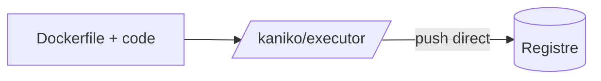

# Kaniko

> [!info] En une phrase
> Un outil qui construit une image à partir d'un Dockerfile sans démon Docker : l'alternative à Docker-in-Docker quand le runner n'est pas privilégié.

```dataviewjs
await dv.view("10 — Templates/Scripts/learning", { view: "concept" })
```

## 1 · Comprendre
### Définition
**Kaniko** lit le [[Dockerfile]], exécute chaque instruction dans son propre conteneur et pousse le résultat dans le registre. Une seule commande : `/kaniko/executor`.

### Pourquoi ça existe
Construire des images dans une CI où l'on n'a pas le droit de lancer Docker (fréquent en entreprise et sur Kubernetes).

### Le problème résolu
Sans runner privilégié, Docker-in-Docker est impossible, donc pas de build d'image du tout.

## 2 · Explorer
### Comment ça fonctionne


### Exemple concret
```yaml
build-image:
  image:
    name: gcr.io/kaniko-project/executor:debug   # la variante debug a un shell, nécessaire à GitLab
    entrypoint: [""]
  script:
    - /kaniko/executor
      --context "$CI_PROJECT_DIR"
      --dockerfile "$CI_PROJECT_DIR/Dockerfile"
      --destination "$CI_REGISTRY_IMAGE:$CI_COMMIT_SHORT_SHA"
```

| | Docker-in-Docker | Kaniko |
| --- | --- | --- |
| Runner privilégié | oui | non |
| Connexion au registre | `docker login` | fichier `/kaniko/.docker/config.json` |
| Variables de build | `--build-arg` | `--build-arg` |

### Cas d'utilisation
- Construire une image sur un runner non privilégié
- Projet CVAT : partie 1 (reprendre CVAT sur GitLab, construire ses images en CI via le Nexus)

> [!warning] À ne pas confondre
> Kaniko **ne lance pas** de conteneurs : il ne sert qu'à construire et pousser. Pour exécuter l'image, il faut Docker ailleurs.

## 3 · Pratiquer
- Adapte l'exemple pour pousser vers un registre qui demande une connexion : comment remplir `/kaniko/.docker/config.json` à partir de variables CI ?

## 4 · Expliquer
> [!quote] Mon résumé, avec mes mots
> _À écrire sans regarder la fiche. Si je bloque, je ne l'ai pas encore compris._

## 5 · Relier
- **Prérequis** : [[Construire une image dans la CI]]
- **Notion parente** : [[Construire une image dans la CI]]
- **Complémentaires** : [[Registre Docker]] · [[Nexus]] · [[Variable de build Docker (ARG)]]

## 6 · Réviser
> [!question]- Pourquoi prendre la variante `:debug` ?
> L'image normale n'a pas de shell, et le `script:` de GitLab ne peut pas s'exécuter.

> [!question]- Kaniko est-il toujours maintenu ?
> Le dépôt d'origine de Google a été archivé en 2025 : vérifie avec ton équipe quelle image elle utilise (un fork maintenu, ou une alternative comme Buildah).

### Validation de la maîtrise
- [ ] Je l'explique sans notes, en 3 phrases, à quelqu'un qui ne connaît pas
- [ ] J'ai réussi un exercice qui l'utilise
- [ ] Je l'ai utilisé dans un projet
- [ ] Je sais dire quand ne pas l'utiliser (ou ce qu'il ne faut pas confondre)
