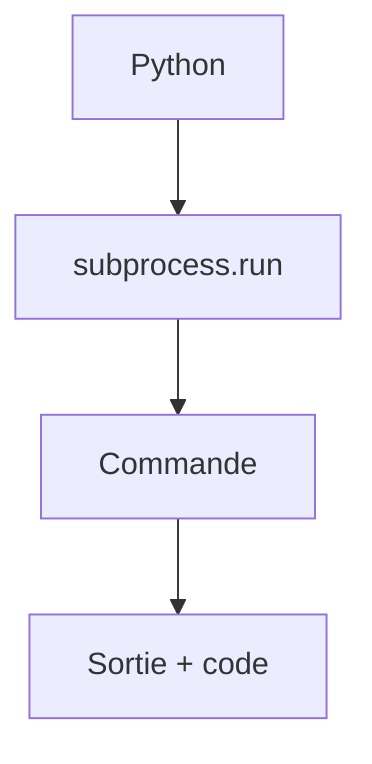

# Lancer une commande (subprocess)

> [!info] En une phrase
> subprocess lance un autre programme (git, docker, zip…) depuis Python, récupère sa sortie et son code de sortie.

```dataviewjs
await dv.view("10 — Templates/Scripts/learning", { view: "concept" })
```

## 1 · Comprendre
### Définition
`subprocess.run([...])` exécute une commande comme dans le terminal. On passe la commande en **liste** (programme puis arguments). `capture_output=True` récupère ce qu'elle affiche, `check=True` lève une exception si son code de sortie n'est pas 0.

### Pourquoi ça existe
Réutiliser des outils existants depuis un script Python plutôt que tout réécrire.

### Le problème résolu
Les scripts shell deviennent illisibles dès qu'il y a de la logique ; Python garde la logique, et appelle les commandes pour le reste.

## 2 · Explorer
### Comment ça fonctionne


### Exemple concret
```python
import subprocess

r = subprocess.run(["git", "rev-parse", "--short", "HEAD"],
                   capture_output=True, text=True, check=True)
commit = r.stdout.strip()
print("Commit :", commit)

r = subprocess.run(["docker", "image", "inspect", "mon-zipper"], capture_output=True, text=True)
if r.returncode != 0:
    print("Image absente :", r.stderr.strip())
```

### Cas d'utilisation
- Récupérer le commit Git pour nommer une archive
- Piloter `docker`, `zip`, `ffmpeg` depuis un script
- Vérifier qu'un outil est installé

> [!warning] À ne pas confondre
> La liste `["git", "log"]` et une chaîne avec `shell=True` : `shell=True` avec des données venant de l'extérieur permet d'**injecter** des commandes. Et sans `check=True`, un échec passe inaperçu ([[Code de sortie]]).

## 3 · Pratiquer

### Exercice visuel

Sur Excalidraw, **sans regarder la fiche**. Puis je compare avec la fiche, je corrige en rouge ce qui était faux, et j'explique mon dessin à voix haute ou à Claude dans le chat.

> [!example] 🛣️ Suis le trajet
> Dessine `subprocess.run(["git", "status"], capture_output=True)` : ton script, le processus enfant, la sortie et le code de retour qui reviennent.

> [!example] 🔄 Change de contexte
> Redessine-le quand la commande n'existe pas dans le conteneur. Quelle erreur remonte, et où ?

### Mon schéma

> [!tip] Mon dessin Excalidraw
> _Je crée le dessin « Schéma - Lancer une commande (subprocess) » et je l'intègre ici avec `![[Schéma - Lancer une commande (subprocess).excalidraw]]`, puis je coche `schema`._

### Appliquer dans le fil rouge
- [[MesDépenses 13 - Sauvegarder la base avec un script]]

## 4 · Relier
- **Prérequis** : [[Fonction]] · [[Code de sortie]] · [[Processus]]
- **Complémentaires** : [[Script shell]]

## 5 · Réviser
> [!question] Me faire interroger
> Je demande à Claude de m'interroger sur cette notion pour vérifier que je l'ai comprise.

### Validation (compris, puis maîtrisé)
Trois cases à cocher dans les propriétés de la fiche :
- `schema` : mon dessin du concept est dans « Mon schéma » ;
- `exercice_visuel` : j'ai fait et corrigé les exercices visuels de la section 3 ;
- `fil_rouge` : je l'ai appliqué dans le fil rouge (coché tout seul quand une étape qui l'utilise est réussie).

Les trois cochées : la notion compte comme **comprise**. **Maîtrisé** : c'est moi qui le mets dans `status`, quand je le sens.

```dataviewjs
await dv.view("10 — Templates/Scripts/learning", { view: "maitrise" })
```
