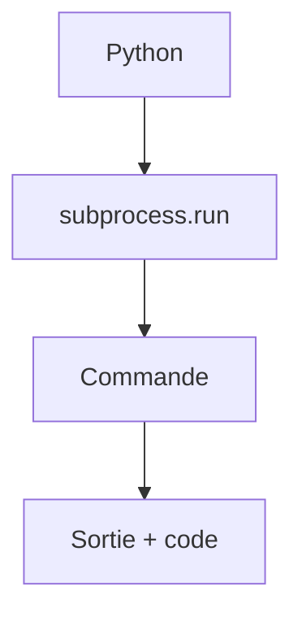

# Lancer une commande (subprocess)

> [!info] En une phrase
> subprocess lance un autre programme (git, docker, zip…) depuis Python, récupère sa sortie et son code de sortie.

```dataviewjs
await dv.view("10 — Templates/Scripts/learning", { view: "concept" })
```

## 1 · Comprendre
### Définition
`subprocess.run([...])` exécute une commande comme dans le terminal. On passe la commande en **liste** (programme puis arguments). `capture_output=True` récupère ce qu'elle affiche, `check=True` lève une exception si son code de sortie n'est pas 0.

### Pourquoi ça existe
Réutiliser des outils existants depuis un script Python plutôt que tout réécrire.

### Le problème résolu
Les scripts shell deviennent illisibles dès qu'il y a de la logique ; Python garde la logique, et appelle les commandes pour le reste.

## 2 · Explorer
### Comment ça fonctionne


### Exemple concret
```python
import subprocess

r = subprocess.run(["git", "rev-parse", "--short", "HEAD"],
                   capture_output=True, text=True, check=True)
commit = r.stdout.strip()
print("Commit :", commit)

r = subprocess.run(["docker", "image", "inspect", "mon-zipper"], capture_output=True, text=True)
if r.returncode != 0:
    print("Image absente :", r.stderr.strip())
```

### Cas d'utilisation
- Récupérer le commit Git pour nommer une archive
- Piloter `docker`, `zip`, `ffmpeg` depuis un script
- Vérifier qu'un outil est installé

> [!warning] À ne pas confondre
> La liste `["git", "log"]` et une chaîne avec `shell=True` : `shell=True` avec des données venant de l'extérieur permet d'**injecter** des commandes. Et sans `check=True`, un échec passe inaperçu ([[Code de sortie]]).

## 3 · Pratiquer
- Écris une fonction qui renvoie le commit Git courant, et une autre qui dit si Docker est disponible.

## 4 · Expliquer
> [!quote] Mon résumé, avec mes mots
> _À écrire sans regarder la fiche. Si je bloque, je ne l'ai pas encore compris._

## 5 · Relier
- **Prérequis** : [[Fonction]] · [[Code de sortie]] · [[Processus]]
- **Complémentaires** : [[Script shell]]

## 6 · Réviser
> [!question] Me faire interroger
> Je demande à Claude de m'interroger sur cette notion pour vérifier que je l'ai comprise.

### Validation de la maîtrise
- [ ] Je l'explique sans notes, en 3 phrases, à quelqu'un qui ne connaît pas
- [ ] J'ai réussi un exercice qui l'utilise
- [ ] Je l'ai utilisé dans un projet
- [ ] Je sais dire quand ne pas l'utiliser (ou ce qu'il ne faut pas confondre)
