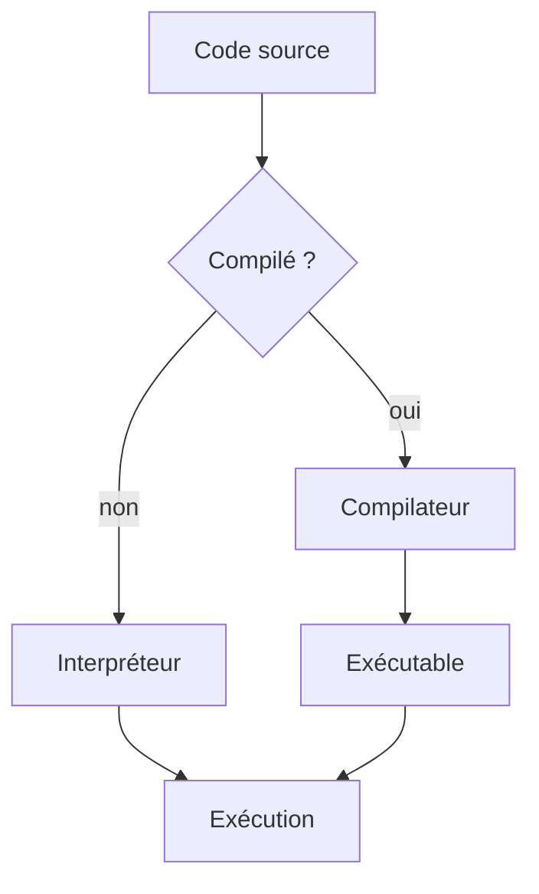

# Langage compilé et interprété

> [!info] En une phrase
> Un langage **compilé** est traduit en entier avant d'être lancé (et le traducteur refuse le code qui ne tient pas debout) ; un langage **interprété** est lu et exécuté au fur et à mesure, au moment où on le lance.

```dataviewjs
await dv.view("10 — Templates/Scripts/learning", { view: "concept" })
```

## 1 · Comprendre
### Définition
L'ordinateur ne comprend pas le code tel qu'on l'écrit. Il faut le traduire. Deux façons de faire :
- **Compilé** : un **compilateur** lit tout le code, vérifie qu'il est cohérent (types, noms, parenthèses) et produit un fichier prêt à exécuter. Si une seule erreur est trouvée, rien n'est produit. Exemples : C#, Java, Go, C, Rust.
- **Interprété** : un **interpréteur** lit le fichier et l'exécute ligne par ligne. Une erreur n'apparaît que quand la ligne fautive est atteinte. Exemples : Python, JavaScript, Bash.

En pratique c'est souvent un mélange : C# est compilé vers un langage intermédiaire, puis traduit pour la machine au lancement ; TypeScript est « compilé » (vérifié et traduit) en JavaScript, qui est ensuite interprété.

### Pourquoi ça existe
La compilation vérifie beaucoup de choses **une fois, avant**, et produit un programme rapide. L'interprétation permet d'essayer **tout de suite**, sans étape de construction.

### Le problème résolu
Choisir où l'on découvre ses erreurs : à la construction (compilé : plus tôt, plus sûr) ou à l'exécution (interprété : plus vite pour essayer, mais les erreurs peuvent arriver en production).

## 2 · Explorer
### Comment ça fonctionne


### Exemple concret
La même faute de frappe dans les deux mondes :
```text
Python : le script démarre, traite 500 fichiers, puis plante
         « NameError: name 'totl' is not defined » à la ligne 40.

C#     : dotnet build refuse de construire :
         « error CS0103: The name 'totl' does not exist in the current context »
         Le programme n'a jamais tourné.
```

### Cas d'utilisation
- Comprendre pourquoi un projet C# ou Java a une étape `build` dans la CI, et pas un script Python
- Savoir quoi installer sur un serveur : un interpréteur (Python) ou un runtime / rien (programme compilé)

> [!warning] À ne pas confondre
> **Compilé** ne veut pas dire **sans bug** : le compilateur attrape les erreurs de forme et de type, pas les erreurs de logique (un mauvais calcul compile très bien). Et **typé** n'est pas la même idée que **compilé** : Python a des types, mais ils ne sont vérifiés qu'à l'exécution (ou par un outil à part).

## 3 · Pratiquer

### Exercice visuel

Sur Excalidraw, **sans regarder la fiche**. Puis je compare avec la fiche, je corrige en rouge ce qui était faux, et j'explique mon dessin à voix haute ou à Claude dans le chat.

> [!example] 🧠 Dessine de mémoire
> Dessine les deux chemins (compilé, interprété) du code source jusqu'à l'exécution. Marque d'une croix rouge l'endroit où chaque chemin découvre une faute de frappe.

> [!example] 🔄 Change de contexte
> Place sur ton dessin un script Bash, un programme C#, un fichier TypeScript et un script Python. Lequel a besoin d'une étape de construction dans la CI ?

### Mon schéma

> [!tip] Mon dessin Excalidraw
> _Je crée le dessin « Schéma - Langage compilé et interprété » et je l'intègre ici avec `![[Schéma - Langage compilé et interprété.excalidraw]]`, puis je coche `schema`._

### Appliquer dans le fil rouge
- [[Découvrir .NET 01 - Un premier programme console]]

## 4 · Relier
- **Prérequis** : [[Système de fichiers]]
- **Complémentaires** : [[Python]] · [[Plateforme .NET]] · [[TypeScript]]

## 5 · Réviser
> [!question] Me faire interroger
> Je demande à Claude de m'interroger sur cette notion pour vérifier que je l'ai comprise.

### Validation (compris, puis maîtrisé)
Trois cases à cocher dans les propriétés de la fiche :
- `schema` : mon dessin du concept est dans « Mon schéma » ;
- `exercice_visuel` : j'ai fait et corrigé les exercices visuels de la section 3 ;
- `fil_rouge` : je l'ai appliqué dans le fil rouge (coché tout seul quand une étape qui l'utilise est réussie).

Les trois cochées : la notion compte comme **comprise**. **Maîtrisé** : c'est moi qui le mets dans `status`, quand je le sens.

```dataviewjs
await dv.view("10 — Templates/Scripts/learning", { view: "maitrise" })
```
