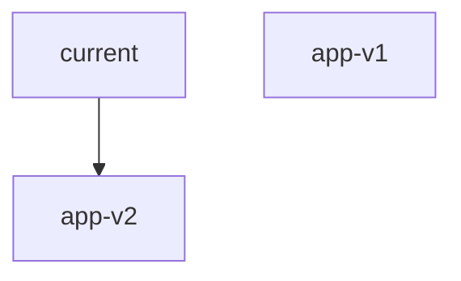

# Lien symbolique

> [!info] En une phrase
> Un raccourci vers un autre fichier ou dossier : on l'utilise comme l'original.

```dataviewjs
await dv.view("10 — Templates/Scripts/learning", { view: "concept" })
```

## 1 · Comprendre
### Définition
Un **lien symbolique** (*symlink*) est un petit fichier qui contient le chemin d'un autre. Ouvrir le lien ouvre la cible. Si la cible disparaît, le lien est **cassé**.

### Pourquoi ça existe
Avoir un même fichier accessible à plusieurs endroits, ou basculer d'une version à une autre en changeant un seul lien.

### Le problème résolu
Copier des fichiers à plusieurs endroits et devoir garder les copies à jour.

## 2 · Explorer
### Comment ça fonctionne


### Exemple concret
```bash
ln -s /opt/app-v2 /opt/current     # current → app-v2
ls -l /opt/current                 # lrwxrwxrwx … current -> /opt/app-v2
ln -sfn /opt/app-v1 /opt/current   # revenir à v1 (retour arrière instantané)
ls -l /usr/bin/python3             # souvent un lien vers python3.12
```

### Cas d'utilisation
- Déployer une nouvelle version et revenir en arrière en une commande
- Comprendre pourquoi `python3` pointe vers une version précise

> [!warning] À ne pas confondre
> Lien **symbolique** (`ln -s`, un chemin, peut être cassé) et lien **physique** (`ln`, un second nom pour les mêmes données). Supprimer le lien (`rm lien`) ne supprime pas la cible.

## 3 · Pratiquer

### Exercice visuel

Sur Excalidraw, **sans regarder la fiche**. Puis je compare avec la fiche, je corrige en rouge ce qui était faux, et j'explique mon dessin avec mes mots (section 4).

> [!example] 🧠 Dessine de mémoire
> Dessine un lien symbolique qui pointe vers un fichier, puis ce qui arrive au lien quand on supprime le fichier.

> [!example] ⚖️ Avant / après
> Avant / après : un lien symbolique, puis une copie. Dessine ce qui se passe quand tu modifies l'original.

### Mon schéma

> [!tip] Mon dessin Excalidraw
> _Je crée le dessin « Schéma - Lien symbolique » et je l'intègre ici avec `![[Schéma - Lien symbolique.excalidraw]]`._

### Appliquer dans le fil rouge
- Pas encore d'étape du fil rouge pour cette notion : je l'applique dans mon travail (CVAT, Nuclio) ou je demande une étape à Claude.

## 4 · Expliquer
> [!quote] Mon résumé, avec mes mots
> _J'explique mon schéma avec mes mots, sans regarder la fiche. Si je bloque, je ne l'ai pas encore compris._

## 5 · Relier
- **Prérequis** : [[Arborescence Linux]]
- **Commandes** : [[ln]]

## 6 · Réviser
> [!question] Me faire interroger
> Je demande à Claude de m'interroger sur cette notion pour vérifier que je l'ai comprise.

### Validation de la maîtrise
La notion est maîtrisée quand je sais :
1. **l'expliquer** de façon fluide, à partir de mon schéma (section 4) ;
2. **l'adapter** à un autre contexte (consigne « Change de contexte », ou Claude m'interroge sur un autre cas) ;
3. **l'appliquer** pour de vrai dans le fil rouge (section 3).

Réussir un exercice ne suffit pas. C'est moi qui passe le statut en `maitrise`.

```dataviewjs
await dv.view("10 — Templates/Scripts/learning", { view: "maitrise" })
```
